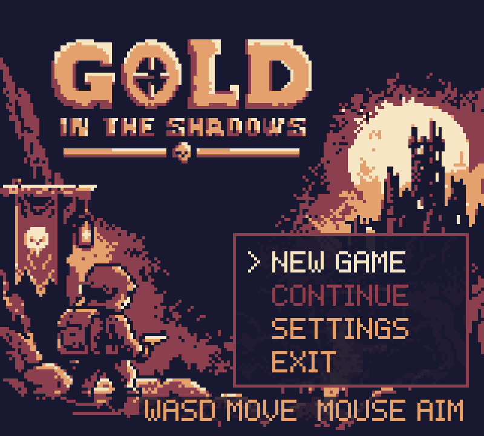
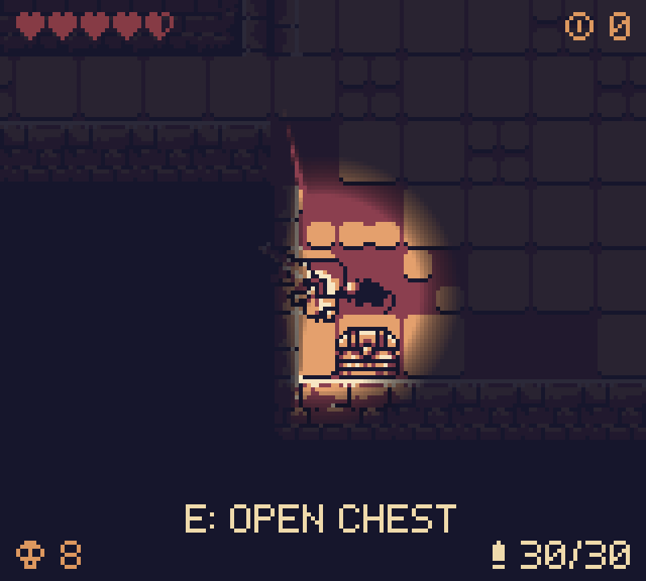
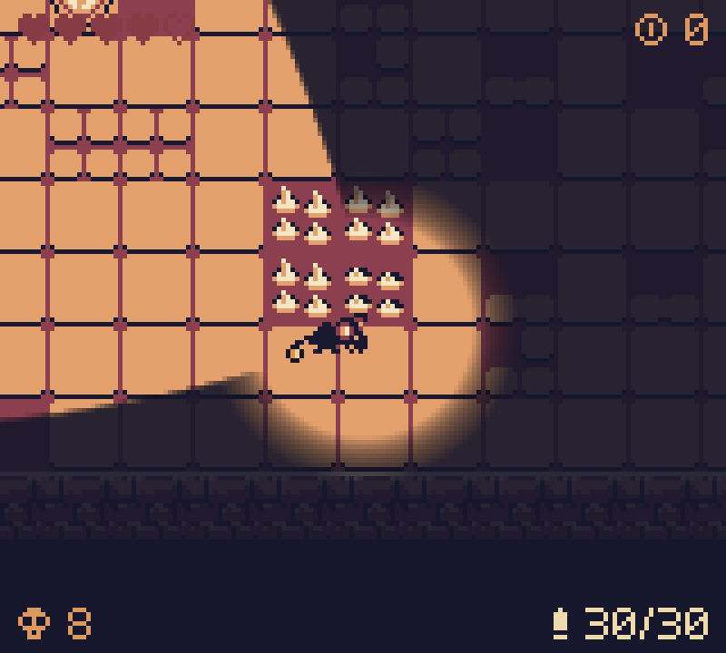
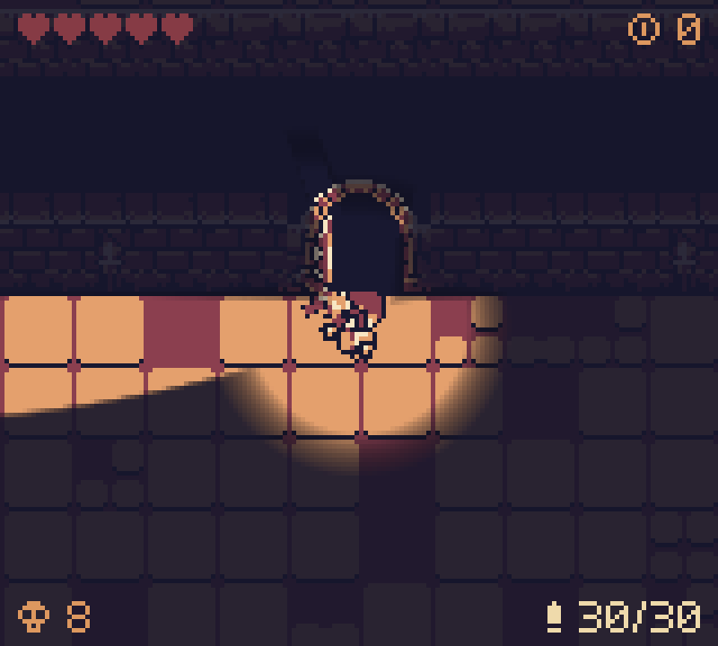
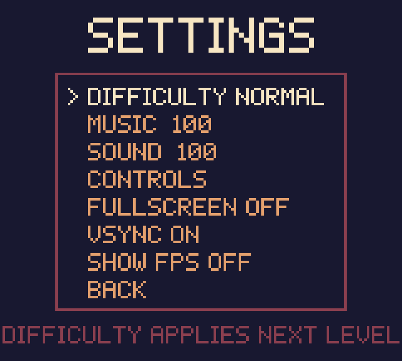
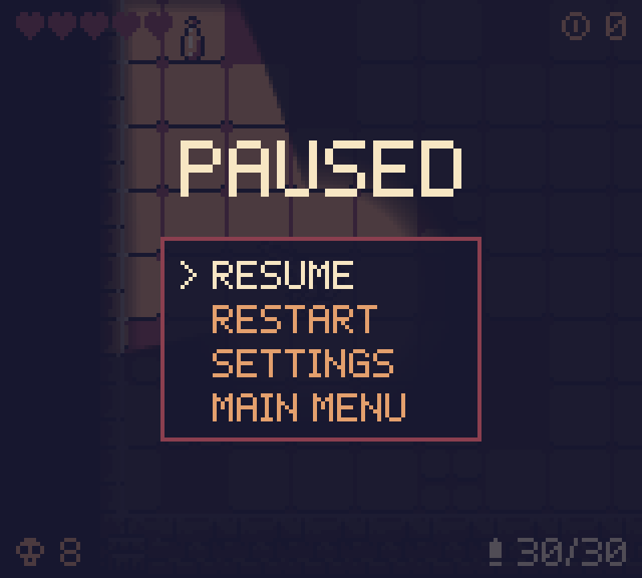
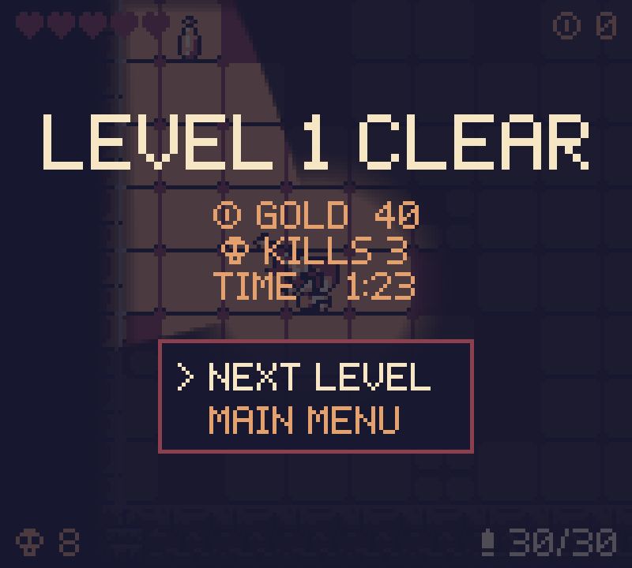
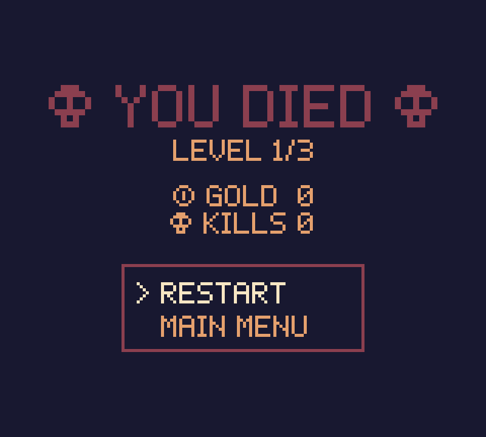
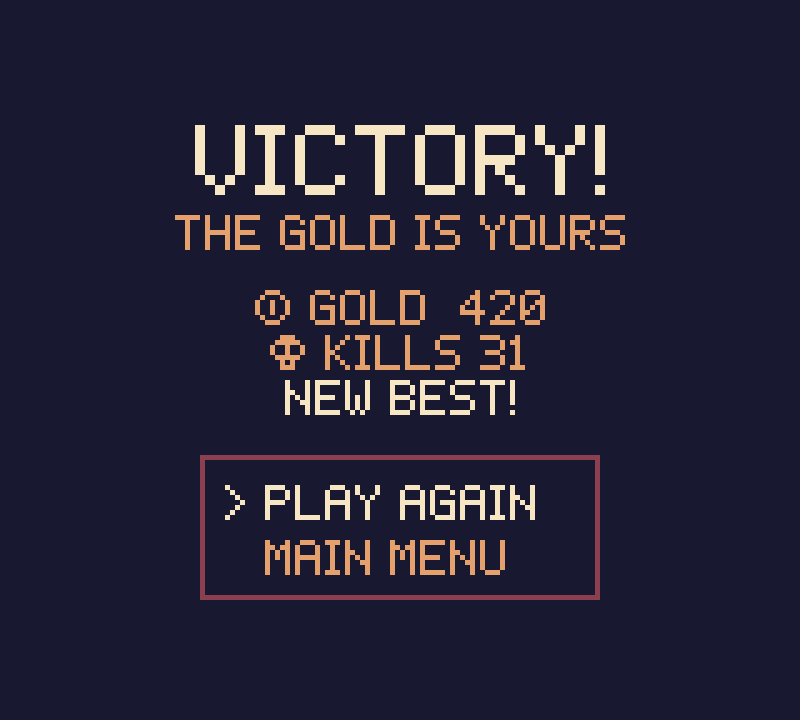
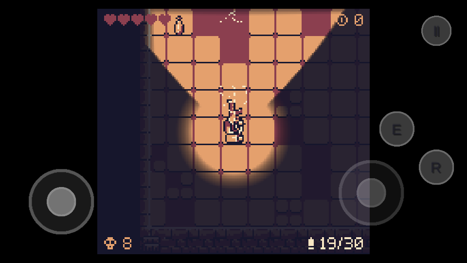

# Gold in Shadows (Ember2D demo)

A top-down dungeon shooter in a four-colour palette at 160×144. You take a rifle and a small circle of light through
three levels: The Cellar, The Crypt and The Sanctum. You fight rats, slugs, ghouls and cultists, pick up their gold, find
each level's key and get out through the exit door.

This demo is a port. Gold in Shadows is the developer's own libGDX game, with the developer's own art (see
`core/assets/ART-CREDITS.txt`). Here it is rebuilt on Ember2D, with the original's rules, values and look. The original
has about 10,300 lines of Java, including its own animation, tween, navigation, collision and vision code. The port has
about 3,000 lines of game code, plus data files. The rest comes from the engine and kits.

| | |
|---|---|
|  |  |
|  |  |

## Running it
```
./gradlew :demos:demo-gold-in-shadows:desktop:run              # dev run: F1 dev tools, F3 overlay, F12 screenshot
./gradlew :demos:demo-gold-in-shadows:android:installDebug     # on a device or emulator (Android 6.0, API 23, or newer)
```
`./gradlew :demos:demo-gold-in-shadows:desktop:releaseJar` builds a plain player jar. See
[Building for Desktop](../../wiki/Building-for-Desktop.md) and [Building for Android](../../wiki/Building-for-Android.md).

## How to play
| | Keyboard and mouse | Gamepad | Android (on-screen) |
|---|---|---|---|
| Move | WASD or arrows | left stick, D-pad | left stick (appears where your thumb lands) |
| Aim | mouse | right stick | right stick |
| Fire | left mouse button, J | R2, R1 | push the right stick past half way |
| Reload | R | X | R |
| Open a chest | E | A | E |
| Pause | Escape, P | Start | II, Back |

Everything except the mouse can be rebound in **Settings → Controls**. On Android, **Move buttons** lets you place the
on-screen controls.

- **Gold** is the score. Coins (10), piles and the pouches creatures drop all count. Gold close to you drifts to
  you. The score carries over between levels. When you die, the level starts again with the gold you had when it
  began.
- **Hearts:** 6 on Easy, 5 on Normal, 4 on Hard. Damage is halved on Easy and ×1.5 on Hard. A medkit gives back 2
  hearts. It stays on the floor while you are at full health.
- **Chests:** walk up and press E. Each gives 4 coins and a 20-gold pouch.
- **Spike traps** rise and fall in waves. A warning frame shows just before the spikes come up.
- **The exit door** is locked. Find the level's key (it shows under the hearts), then walk up to the door.
- **Creatures** only see you in the light. Walls block their view, but gunfire draws them in. A "!" means one has
  spotted you; a "?" means it heard something.

| Creature | Health | How it fights |
|---|---|---|
| Rat | 3 | wanders, then chases and bites with a lunge |
| Slug | 8 | slow; chases and spits |
| Ghoul | 5 | waits, then dashes at you |
| Cultist | 6 | keeps its distance, strafes, and fires a fan of bolts |

| Settings | Pause | Level complete | Death | Victory |
|---|---|---|---|---|
|  |  |  |  |  |

The progress (the level reached and the gold banked) and the best score are saved. **Continue** on the title screen
starts from the level reached. On Android the controls sit beside the game, not over it:



## How it is built
**Configuration and scenes.** `GoldGame.config` sets up the game: 160×144 virtual pixels, 16 pixels per world unit,
pixel-perfect scaling, input from `input.json`, assets from `manifest.json`. The scenes:
- `TitleScene`
- `LevelScene(Campaign)`, one level of a campaign
- `EndScene`, for death or victory

The pause menu and the level-complete panel are overlays inside `LevelScene`. Scenes change with fades.

**Levels.** The original's ASCII levels are converted to Tiled maps (`core/assets/maps/level1-3.tmx`, with
`tileset.tsx`) by `assets-src/demo-gold-in-shadows/ConvertLevels.java`. The converter runs the original's own level
compiler, so the auto-tiling and the collision boxes match the original exactly. Each map holds:
- **tile layers:** base, floor, walls, props and overhead;
- **a `walls` object layer:** one rectangle per collision box, `opaque` if it blocks sight;
- **an objects layer:** the player, creatures, pick-ups, chests, spikes (each with its wave phase) and the exit door,
  as prefab types (`enemy/rat`, `pickup/coin`, `chest` and so on).

`MapSpawner` spawns the objects, and `Walls` builds the collision from the rectangles. Walls that block sight go on
collision layer 3. Low props (barrels, crates) block movement but not sight, so they go on layer 0.
`LevelsTest` checks that every level can be finished: every pick-up, creature, chest and the exit can be reached from the start.

**Data.**
- `creatures.json`: the original's creature catalog, in its pixel units.
- `bullets.json`: the rifle round, the slug's spit and the cultist's bolt.
- `weapons/rifle.json`: 600 rounds per minute, 30-round magazine, 2 s reload.
- `prefabs/`: every entity type.
- `anim/*.clips.json`: the animation clip sets for the original sheets.
- Sounds and music are generated by `assets-src/demo-gold-in-shadows/sound/make_sounds.py`.

**Systems.** In `FIXED` order:
1. `CreatureSystem`: the creatures' state machine, perception and attacks.
2. kit-topdown's `AiSystem`: paths to the point the creature chose, with A* on a grid made from the walls.
3. `TopDownSystem`: moves everything against the walls.
4. `PickupSystem`, `SpikeSystem` and `ExitSystem`.
5. The weapon, health, hit, bullet, collision and animation systems.

Then:
- `HeroSystem` (`UPDATE`) turns the player's state into the original's look: aim-facing, the gun and hands, the
  reload icon and the death sequence.
- `GoldCameraSystem` and `VisionSystem` run in `LATE`.

Render layers, back to front: `floor`, `world` (sorted by y), `bullets`, `hand` (gun, hands, effects, creature marks,
floating texts), `overhead` and `fog`.

**Field of view.** The light and fog are an engine feature now, kit-topdown's `vision` package (F-030), with the
original's settings as its defaults:
- a 34 px circle and a 120 px cone of ±38°, cut by walls;
- a soft, pixelated edge drawn as geometry (no frame buffer);
- creatures, pick-ups and enemy shots hidden in the dark.

See [kit-topdown → Field of view and fog](../../wiki/Kit-Topdown.md).

**Tests** (`core/src/test`):
- `LevelsTest`: the maps.
- `GoldDataTest`: the data files.
- `CreatureBehaviourTest`: spotting, biting, hearing shots, shooting, dying.
- `WorldRulesTest`: gold, medkits, chests, spikes, the door, the campaign.
- `ScreensTest`: the screens' data.
- `ArchitectureTest`: package rules.

## From the original to Ember2D
Every class of the original (`com.deadwolfgames.goldinshadows`) and where its job is done now. "Engine" means
Ember2D's core (`ember-core`); kits are named.

| Original | Ember2D port |
|---|---|
| `core.GoldInShadowsGame` | `GoldGame` (configuration) and the engine's `EmberGame`; screen changes are scene replacements with fades |
| `core.GameConfig`, `GameConfigLoader` | `EngineConfig` in `GoldGame`; game values in `creatures.json`, `bullets.json`, `weapons/rifle.json` and the prefabs |
| `engine.animation.*` (`AnimationPlayer`, `AnimationClip`, `AnimationTrack`, `FrameSequence`, `FrameSequencePlayer`, `Keyframe`, `SpriteFrame`, `TrackInterpolation`) | Engine animation (`Animator`, `AnimationSystem`, clip sets in `anim/`); the hands' keyframe tracks in `HeroSystem` |
| `engine.assets.*` (`AssetService`, `AssetPaths`, `GameSprites`, `SpriteSheetLayout`) | Engine assets with `manifest.json`; the sheets as clip sets and `gfx/gold.atlas` |
| `engine.events.Signal` | Engine `EventBus` (queued events) |
| `engine.math.*` (`Aabb`, `Capsule`, `Geometry2D`, `Smoothing`) | libGDX math, engine `Collision`; smoothing in `GoldCameraSystem` |
| `engine.navigation.*` (`GridPathfinder`, `NavigationGrid`, `NavigationAgent`, `AvoidanceSolver`, `PathProvider`, `NavigationAgentSettings`) | kit-topdown `PathPlanner` and `AiSystem` over `Walls.navigation` |
| `engine.physics.*` (`CollisionWorld`, `CollisionLayer`, `SpatialIndex`, `StaticBody`) | Engine collision (`Collider`, `Solid`, layers and masks), built by `Walls` |
| `engine.time.*` (`FixedStepClock`, `CountdownTimer`) | Engine fixed step (`FIXED` phase, 60 Hz) and `Timers` |
| `engine.tween.*` | Engine `Tweens` |
| `engine.vision.VisionField`, `VisionSettings` | kit-topdown `vision`: `VisionField`, `VisionSettings`, `VisionSystem`, `Viewer`, `HiddenInFog` (F-030) |
| `entities.collectibles.*` (`Collectible`, `CollectibleType`, `CollectEffect`, `Collector`, `Chest`) | `Pickup`, `Chest`, `PickupSystem`; `prefabs/pickup/*.json`, `prefabs/chest.json` |
| `entities.combat.*` (`Health`, `Damageable`, `CombatTarget`) | kit-common `Health` (with `damageMultiplier`), `HealthSystem`, `Team`, `Hurtbox`; kit-bullets `BulletTarget` |
| `entities.effects.Effect`, `EffectSpawner`, `EffectType` | `Effects` (muzzle flash, impacts) with kit-common `Lifetime` |
| `entities.effects.FloatingText` | `FloatingTexts` |
| `entities.enemy.*` (`Enemy`, `EnemyState`, `AttackPhase`, `EnemyCatalog`, `EnemyDefinition`, `EnemyProperty`, `EnemyEnvironment`, `EnemyAppearance`, `EnemyVisuals`, `CreatureVisuals`) | `Creature`, `CreatureCatalog`, `CreatureSystem`, `CreatureOverlay`; `creatures.json`, `prefabs/enemy/*.json` |
| `entities.enemy.ai.*` (`ChaseBehavior`, `KeepDistanceBehavior`, `WanderBehavior`, `PatrolBehavior`, `StandStillBehavior`, `MeleeAttack`, `RangedAttack`, `DashAttack`, `AttackStats`, `EnemyAgent`, `EnemyAttack`, `EnemyBehavior`) | `CreatureSystem` (behaviours and attacks), kit-topdown `AiSystem` (paths), kit-bullets patterns for spit and bolts |
| `entities.environment.ExitDoor` | `ExitDoor`, `ExitSystem` |
| `entities.environment.SpikeTrap` | `SpikeTrap`, `SpikeSystem` |
| `entities.player.*` (`Player`, `PlayerStats`, `PlayerProperty`, `PlayerLoadout`, `PlayerAnimations`, `ReloadIndicator`) | `Hero`, `HeroSystem`, `HeroDied`; `prefabs/player.json` with kit-topdown `TopDownBody`, `Aim`, `Weapon` |
| `entities.visual.Palette`, `Tint`, `SpriteId`, `SpriteSheetId` | The palette colours in `Hud` and `GoldUi`; sprite and clip IDs in the manifest and clip sets |
| `entities.weapons.*` (`Gun`, `GunCatalog`, `GunDefinition`, `GunFactory`, `GunProperty`, `GunGeometry`, `GunMount`, `GunAnimations`) | kit-topdown `Weapon`, `WeaponSystem`, `weapons/rifle.json`; the mount and gun drawing in `HeroSystem` |
| `entities.weapons.Projectile`, `ProjectileCatalog`, `ProjectileDefinition`, `ProjectileLauncher` | kit-bullets `BulletWorld`, `BulletSystem`, `BulletTypes`, `BulletPatterns`; `bullets.json` |
| `features.level.*` (`LevelParser`, `AsciiMapCompiler`, `Level`, `LevelData`, `TileLayer`, `TileCell`, `TileSetDefinition`, `SolidBlock`, spawns, `ItemType`, `EnemyType`) | Build time: `ConvertLevels.java` writes the Tiled maps. Run time: engine `TileMap`, `TileMapRenderer`, `MapSpawner`, `Walls` |
| `features.level.Campaign`, `features.progression.GameSession`, `features.scoring.ScoreBoard` | `Campaign` (level, gold, kills, time; Continue and best score in the global save data) |
| `features.settings.*` (`GameSettings`, `Difficulty`, `SettingsStore`, `SettingsRepository`, `PreferencesSettingsRepository`) | `Difficulty`, `GoldUi.settings`; engine settings store (`saves().settings()`) for volumes, bindings and display options |
| `input.*` (`GdxInputService`, `InputAction`, `InputBinding`, `InputBindings`, `InputState`, `PointerProjector`) | Engine input: `input.json` (actions, axes, contexts, gamepad, on-screen controls), rebinding with `RebindMenu` |
| `rendering.IntegerScalingViewport` | Engine `PIXEL_PERFECT` render mode |
| `rendering.WorldRenderer` | Engine `SpriteRenderSystem` with render layers, `TileMapRenderer`, kit-bullets `BulletRenderer` |
| `rendering.VisionRenderer` | kit-topdown `FogLayer` |
| `systems.CameraController` | `GoldCamera`, `GoldCameraSystem` |
| `systems.CollectionSystem` | `PickupSystem` |
| `systems.EffectSystem` | `Effects`, kit-common `LifetimeSystem` |
| `systems.EnemySystem` | `CreatureSystem` |
| `systems.FloatingTextSystem` | `FloatingTexts` |
| `systems.HazardSystem` | `SpikeSystem` |
| `systems.HitBox` | kit-common `Hitbox`, `Hurtbox`, `HitSystem` |
| `systems.ProjectileSystem` | kit-bullets `BulletSystem` |
| `ui.GameScreen` | `LevelScene` (with the pause menu and level-complete panel) |
| `ui.HudRenderer`, `Glyphs` | `Hud`; the font's icon characters (`{ ~ }` hearts, `$` coin, `#` skull, `\|` bullet, `&` key) |
| `ui.MainMenuScreen` | `TitleScene` |
| `ui.SettingsScreen` | `GoldUi.settings` |
| `ui.EndScreen` | `EndScene` |
| `ui.MenuScreen`, `MenuPanel`, `UiStyle`, `UiContext` | `GoldUi` over the engine's `Ui`, `MenuList` and `UiSkins`; `EngineContext` |
| `ui.ScreenNavigator` | `context.scenes().replace(scene, Transition.fade(...))` |
| `world.GameWorld`, `GameWorldFactory`, `WorldOptions`, `WorldOutcome` | `LevelScene` on the engine's ECS `World`; `Difficulty`; `HeroDied` and `ExitSystem.LevelCleared` |
| `world.WorldCollector` | `PickupSystem` |

### Engine features added for this port
- **kit-topdown `vision`** (F-030): field of view, fog, and hiding things in the dark.
- **kit-common:** `Health.damageMultiplier`, for the difficulty levels.
- **kit-bullets:**
  - bullet types: `rotationOffset`, `tint` and `fogged`;
  - `BulletRenderer.setVisibility` (enemy shots hidden in the fog);
  - `BulletSystem.setWallStopListener` (impact effects).
- **Engine:**
  - `Sprite.visible`;
  - the asset manifest tool now skips bitmap-font page images;
  - on-screen controls are drawn in the whole-screen viewport their touch areas use. Before, a letterboxed game like
    this one (160×144 on a 16:9 phone) drew them squeezed into the game area, where taps missed.
- **Dev tools:** F12 saves a screenshot, and the system properties `ember.screenshotDir` and `ember.screenshotAt`
  take timed screenshots.

## Files
```
core/src/main/java/dev/ember2d/demo/gold/   the game (28 classes, one job each; see the table above)
core/src/test/java/...                     tests
core/assets/                               maps, prefabs, data, sheets, font, sounds, music, input.json, manifest.json
desktop/, android/                         launchers
assets-src/demo-gold-in-shadows/           ConvertLevels.java (original levels -> Tiled), sound/make_sounds.py
```
