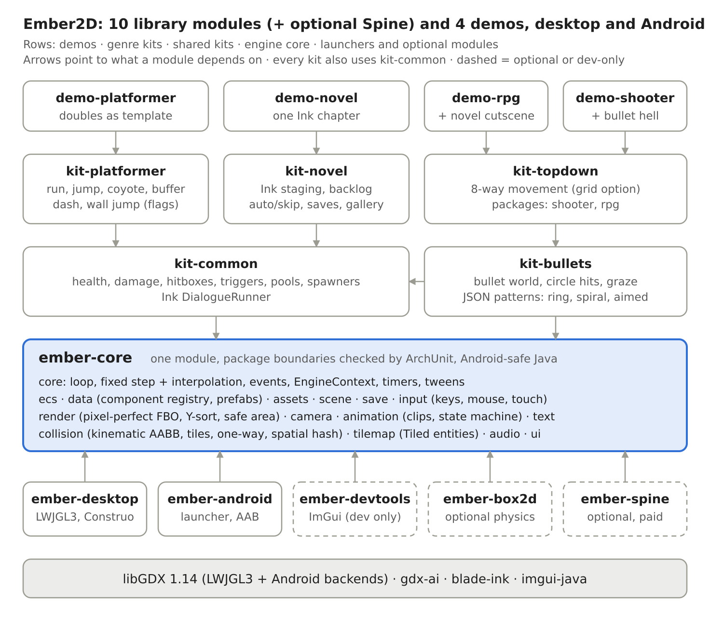
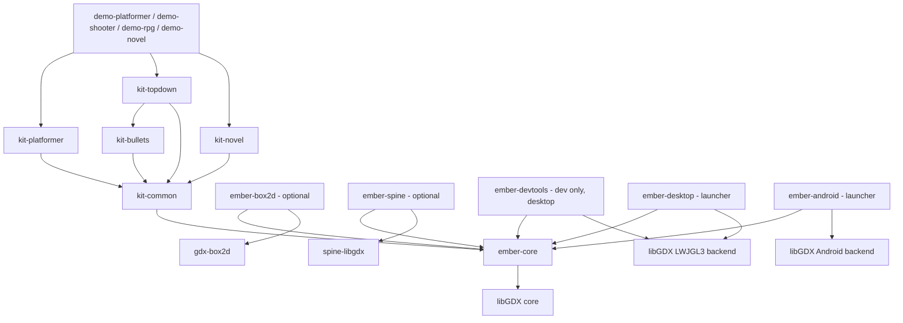

# Architecture

## Layered model

Arrows point from a module to what it depends on. Demos depend on the kits they use; every demo also uses `kit-common` and `ember-core`.

## Targets
- **Desktop** (Windows, Linux, macOS) via LWJGL3 — development platform and release target.
- **Android** — release target from the MVP onward (ADR-019). Exercised from Phase 1.
- **iOS** — not a target. Engine rules keep a later port possible (ADR-019).

## Modules
10 library modules (11 if the optional Spine module is adopted) plus 4 demos (ADR-003). A package becomes its own module only when it gains a second consumer with different dependencies, or needs a native/backend/licensed dependency that other code must not see.

| Module | Kind | Required | Purpose |
| --- | --- | --- | --- |
| `ember-core` | Platform | Yes | All engine packages (below). Depends only on libGDX core and small pure-Java libraries. Android-safe (ADR-015). |
| `ember-desktop` | Platform | Desktop | LWJGL3 launcher, window config, Construo packaging config. |
| `ember-android` | Platform | Android | Android launcher, lifecycle wiring, context-loss handling, safe areas, R8 rules, APK/AAB build (F-022). |
| `ember-devtools` | Optional, dev | No | Dear ImGui panels via imgui-java, inspector, hot reload driver. Desktop dev builds only. |
| `ember-box2d` | Optional | No | Rigid-body physics through the libGDX Box2D extension (ADR-005, F-006B). |
| `ember-spine` | Optional | No | Spine skeletal animation adapter; created only when adopted; requires a Spine license (ADR-021). |
| `kit-common` | Shared kit | No | Health, damage, hit/hurt boxes, triggers, pools, spawners, Ink `DialogueRunner` (F-021). |
| `kit-bullets` | Shared kit | No | Data-oriented bullets and patterns for shooters and bullet hell (F-024, ADR-020). |
| `kit-platformer` | Genre kit | No | Platformer controller and affordances (F-015). |
| `kit-topdown` | Genre kit | No | Top-down movement plus `shooter` and `rpg` packages (F-016, F-017). |
| `kit-novel` | Genre kit | No | Visual novel staging, reader features and saves on top of Ink (F-023). |
| `demos/demo-*` | Demo | — | `demo-platformer`, `demo-shooter` (with a bullet-hell boss stage), `demo-rpg`, `demo-novel`; each doubles as a project template. |

## Packages in `ember-core`
Base package `dev.ember2d` (chosen in I-000). Package names in the documents are written in short form: `ember.core` means `dev.ember2d.core`, and so on.

| Package | Responsibility | Spec |
| --- | --- | --- |
| `ember.core` | App lifecycle, game loop, time, fixed step, `EngineContext`, timers, tweens, state-machine helper | F-001, F-002 |
| `ember.event` | Event bus: immediate and queued events | F-019 |
| `ember.ecs` | Entities, components, systems, families, phases | F-003 |
| `ember.assets` | Asset IDs, manifest, groups, wrapper over `AssetManager`, hot reload hooks | F-008 |
| `ember.input` | Actions, axes, contexts, bindings, touch actions and pointers | F-005, F-022 |
| `ember.render` | Sprite renderer, layers, sorting (incl. Y-sort), pixel-perfect pipeline, safe area, text | F-004 |
| `ember.camera` | Camera, follow, dead-zone, look-ahead, bounds, shake, scrolling mode | F-004 |
| `ember.animation` | Frame clips, atlas and Aseprite import, frame events, animation state machine | F-007 |
| `ember.collision` | Kinematic actors and solids, tile collision, one-way, spatial hash, triggers, queries | F-006 |
| `ember.tilemap` | Tiled map loading, rendering, tile-to-collision mapping, entity placement | F-009 |
| `ember.scene` | Scene lifecycle, scene stack, transitions, per-scene asset groups | F-010 |
| `ember.data` | Component registry, JSON schemas, prefabs, validation, version migration | F-010 |
| `ember.audio` | Music and SFX playback and volumes | F-011 |
| `ember.ui` | Scene2D.ui integration, skin, HUD/menu/dialogue widgets, on-screen controls | F-012, F-022 |
| `ember.save` | Save slots, world flags, global data, settings store | F-013 |
| `ember.debug` | Debug overlay: frame metrics, collider and ray drawing (no ImGui) | F-014 |
| `ember.particles` | Wrapper over libGDX `ParticleEffect` | F-014 |

## Dependency rules
Enforced by ArchUnit tests that run in CI (`ember-core/src/test/.../ArchitectureTest`).

1. `ember.core` depends on no other engine package.
2. `ember.event`, `ember.ecs`, `ember.assets`, `ember.input` depend only on `ember.core` (and `ember.event`).
3. `ember.render`, `ember.camera`, `ember.animation`, `ember.collision`, `ember.audio`, `ember.ui`, `ember.particles`, `ember.debug` depend only on packages in rules 1–2 (`ember.render` may use `ember.camera`; `ember.ui` may use `ember.render`).
4. `ember.tilemap` may depend on `render` and `collision`. `ember.scene`, `ember.data` and `ember.save` sit on top and may depend on anything in `ember-core`.
5. No engine package names a genre concept (`jump`, `weapon`, `quest`, `inventory`, `bullet`…).
6. **Shared kits** (`kit-common`, `kit-bullets`) depend only on `ember-core`; `kit-bullets` may also use `kit-common`.
7. **Genre kits** (`kit-platformer`, `kit-topdown`, `kit-novel`) depend on `ember-core` and shared kits; genre kits never depend on each other.
8. Nothing in `ember-core` or the kits depends on `ember-desktop`, `ember-android`, `ember-devtools`, `ember-box2d`, `ember-spine` or any backend.
9. `ember-core` and kits use only Android-safe Java APIs (ADR-015); file access through `Gdx.files` inside `ember.assets`/`ember.save` only.
10. Reflection is used only in `ember.data` (component registry) and `ember-devtools`.
11. Packages named `internal` are not public API. Public API types are marked `@PublicApi`.
12. No circular package or module dependencies.

## Public API and libGDX types (ADR-013)
libGDX core is the engine's vocabulary. Public APIs may use `com.badlogic.gdx.math.*`, `graphics.g2d.*` (`TextureRegion`, `Batch`, `BitmapFont`), `graphics.Color`, `utils.*` collections, `Viewport` and `Scene2D` types.
Hidden behind Ember2D APIs: Box2D and Spine types, the LWJGL3 and Android backends, and file paths (games use asset IDs).

## Runtime loop
- **App lifecycle** (from the platform): `create`, `resize`, `suspend` (libGDX `pause`; window minimised or Android app backgrounded), `resume`, `dispose`. Never used for gameplay pause.
- **Game pause**: `Time.paused` / `timeScale = 0`. Owned by game code (pause menus).
- Each frame: sample input → run `fixed` phase 0..N times (accumulator, max catch-up steps) → run `update` and `late` phases once → render with interpolation `alpha = accumulator / fixedDelta`.
- Defaults: fixed step 1/60 s, max 5 catch-up steps, frame delta clamped to 0.25 s.
- Transforms store previous and current position/rotation so rendering interpolates between fixed ticks; without this, a 60 Hz step stutters on 90/120/144 Hz displays (common on phones too).
- "Fixed timestep" means stable simulation rate. It does **not** mean bit-identical determinism across machines; do not design replays or lockstep netcode on that assumption.
- Systems never compute their own timing; they read `Time`.

## ECS (ADR-004)
- Entity = `int` handle with a generation counter; stale handles are detectable. Components store `EntityRef` values, never raw handles kept across frames without validation.
- Components are plain Java objects, one store per component type, registered in the component registry. No archetypes, bitsets or bytecode weaving until a benchmark demands them.
- Systems declare a family (required/excluded components) and a phase: `input`, `fixed`, `update`, `late`, `render`.
- Structural changes (create/destroy entity, add/remove component) are queued and applied between systems.
- Each scene owns one `World`; persistent entities are moved explicitly between worlds.
- **Exception — bullets:** `kit-bullets` keeps bullets in a data-oriented `BulletWorld` outside the ECS for performance; it communicates through events and `kit-common` damage (ADR-020).

## Events (F-019)
- One event bus per `EngineContext` with two delivery modes: **immediate** (synchronous, for UI and input) and **queued** (delivered at a defined point after each phase, for gameplay).
- Collision contacts, animation frame and state events, trigger enter/exit, bullet hits and context restoration are published as typed queued events. No subsystem invents its own listener mechanism.
- Subscriptions are scoped to a scene and removed on scene exit.

## Services and `EngineContext`
A single `EngineContext` object is built at bootstrap and passed to systems and scenes. It exposes `time`, `events`, `assets`, `input`, `audio`, `save`, `renderer`. No global static service locator. Tests build a context with fakes. The one exception is logging (`Log`, `LogConfig` in `ember.core`): loggers are obtained statically by category because logging is needed before the context exists and in code that never sees it.

## Collision (ADR-005)
- Default: kinematic collision in `ember.collision`. Actors move with `moveAndCollide`/`moveAndSlide` against solids (tile grids and boxes). Colliders are AABBs (circles optional). Solids can be one-way. Moving solids carry riders.
- Queries (overlap, point, ray, nearest) use a spatial hash.
- Triggers are colliders with `trigger = true`; they raise enter/stay/exit events.
- Layers and masks: 32 named layers configured in project data.
- Units: world units, with `pixelsPerUnit` configured once in project settings. Conversion helpers live in one class.
- Box2D is an optional module with its own API, used for physics props and games that want rigid bodies. The kinematic API is not abstracted over Box2D.

## Rendering
- `SpriteBatch` + texture atlases (D-010).
- Render layers are ordered; within a layer, sort mode is `none`, `z` or `ySort` (top-down games). Parallax layers supported.
- **Pixel-perfect pipeline:** render the world into a low-resolution `FrameBuffer` at the game's virtual resolution, then draw it scaled by the largest integer factor that fits the screen, letterboxed (or "fill" mode that widens the visible world on wide phones). Camera position is snapped to whole virtual pixels before rendering. Texture filtering is `Nearest`.
- **Android:** the frame buffer and non-managed GL objects are recreated after graphics context loss; UI respects safe-area insets (F-022).
- UI renders after the world at screen resolution (crisp text) or virtual resolution (pixel fonts), per project setting.
- Text: `BitmapFont`, with FreeType generation as an option.

## Animation (F-007)
- Frame clips from atlases or Aseprite exports, with frame events.
- **Animation state machine:** JSON definition of parameters, states and transitions with conditions and priorities; game and kit code only set parameters. Hot-reloadable and visible in dev tools.
- Tweens (F-002) for property animation; animated tiles from Tiled; particles (F-014).
- Skeletal animation only through the optional `ember-spine` module (ADR-021).

## Content model
- **Levels:** Tiled maps (TMX or Tiled JSON) loaded with libGDX's Tiled support (ADR-016).
- **Tile collision:** a tile property (`solid`, `oneWay`) or a dedicated collision layer.
- **Entity placement:** Tiled object layers. An object's class (saved as `type`) names a prefab; custom properties override prefab fields (`Component.field`); object templates give drag-and-drop placement; object-reference properties become `EntityRef`s; polylines become paths. A Gradle task generates Tiled custom types from prefabs (F-009).
- **Prefabs:** JSON files of component defaults with a `version` field, built on the component registry (F-010).
- **Scene:** a Tiled map plus an optional JSON sidecar (music, camera bounds, systems to enable).
- **Dialogue and novels:** Ink stories compiled to JSON, run with blade-ink through `DialogueRunner` (`kit-common`); `kit-novel` stages scenes from Ink tags (ADR-017).
- **Bullet patterns:** JSON pattern files (F-024).
- **Animation state machines:** JSON definitions (F-007).
- **Saves:** game-defined save objects plus world flags, in JSON, separate from authored data; global data for unlocks and read-text tracking.
- All JSON has explicit `version` fields; migrations run on load. No Java object serialization.

## Assets
- Logical asset IDs map to paths in an asset manifest. Games never load by path.
- `AssetManager` does loading, reference counting, dependencies and disposal; Ember2D adds IDs, groups (per scene), diagnostics and fallbacks.
- Missing optional assets use a visible fallback (magenta texture, silent sound) and log a warning; missing required assets fail scene load with a clear message.
- Dev builds (desktop): a file watcher reloads changed maps, JSON, atlases, patterns, state machines and shaders (hot reload).

## Tooling (ADR-009)
- Tiled is the level and entity-placement editor. Aseprite (or any tool exporting atlases) for sprites. Inky for dialogue and novel scripts. Text editor for prefabs, patterns and state machines, with hot reload.
- `ember-devtools` provides in-game ImGui panels on desktop: entity list, component inspector with live edit, animation state view, collider view, bullet stats, event log, frame metrics, hot reload status.
- A standalone editor is out of scope until the demos ship.

## Genre decoupling rules
1. The engine never mentions a genre word. Collision exposes contact normals, `oneWay` and grounded-style contact queries; the platformer kit turns them into jumping.
2. Kits are data + components + systems. A game opts in by registering a kit's systems, never by inheriting a kit base class.
3. Shared mechanics move down a level (`kit-common`, `kit-bullets` or the engine), never sideways between genre kits.
4. Each kit has a demo using only public API. If a demo needs a genre-specific engine change, the engine API is wrong.

## Error handling
- Validate project data at load time, with file, line/object and field in the message.
- Fatal errors are surfaced, never swallowed. Optional-asset fallbacks are logged.
- Disposal and resource ownership are documented per package.

## Threading
Rendering and GL resources stay on the render thread. `AssetManager` async loading is allowed (it uploads GL resources on the render thread). Other background work may parse data only. No general job system in the MVP.

## Performance
- Batch rendering and texture atlases.
- Pool short-lived objects (effects, events) using libGDX pools; bullets use the data-oriented `BulletWorld`.
- Avoid allocations in per-frame paths where practical (garbage collection pauses are more visible on Android).
- Baseline scenes and metrics are recorded per phase on the reference desktop and a mid-range Android phone; targets are measured, not assumed.
