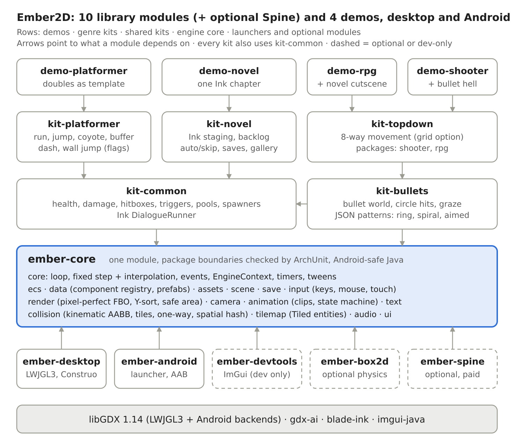
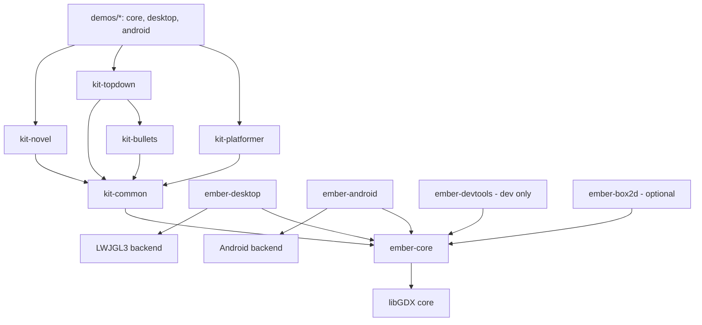
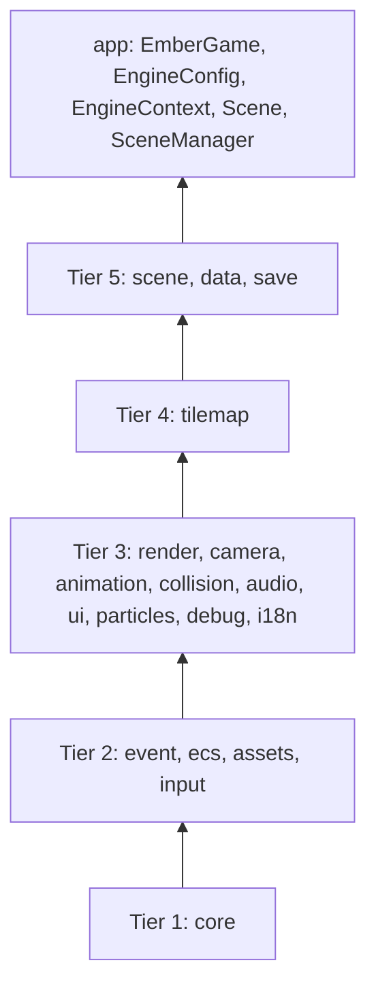
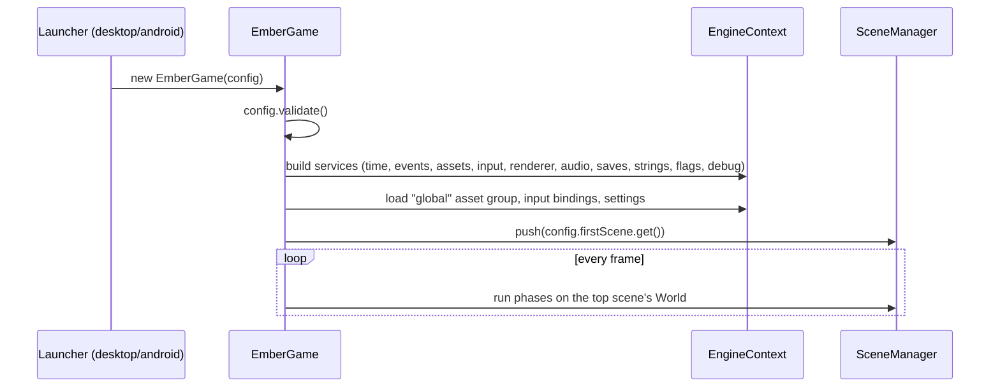

# Architecture Overview

Ember2D is a thin, opinionated layer over libGDX plus optional genre kits. libGDX does the platform work: windows, OpenGL, audio, files, the asset manager, Scene2D and Tiled loading. Ember2D adds:
- a predictable game loop;
- an ECS;
- data-driven content;
- conventions that make a game the same on desktop and Android.

## 1. Modules

Arrows point from a module to what it uses.

| Module | Kind | Purpose |
| --- | --- | --- |
| `ember-core` | engine | Every engine package. Depends only on libGDX core and small pure-Java libraries. Android-safe. |
| `ember-desktop` | platform | `DesktopLogging`, `CrashLog`, `StartupHelper`, `DesktopWindow` for LWJGL3 launchers. |
| `ember-android` | platform | `EmberAndroidLauncher`: lifecycle, safe areas, vibration, GL context loss. |
| `ember-devtools` | dev only | `DevTools.wrap` (Dear ImGui panels), `DevTools.watch` (hot reload). Never in a release. |
| `ember-box2d` | optional | Rigid-body physics through gdx-box2d. A placeholder until I-500 is built. |
| `kit-common` | shared kit | Health, hits, triggers, spawners, pools, hit flash, the Ink `DialogueRunner`. |
| `kit-bullets` | shared kit | The data-oriented bullet world and patterns. |
| `kit-platformer` | genre kit | Platformer bodies, patrollers, moving platforms. |
| `kit-topdown` | genre kit | Top-down bodies; the `shooter`, `ai` and `rpg` packages. |
| `kit-novel` | genre kit | Visual novel director, view, memory and settings. |

**Module rules** (checked by `verifyModuleDependencies` on every build):
- Shared kits depend only on `ember-core`; `kit-bullets` may also use `kit-common`.
- Genre kits depend on `ember-core` and the shared kits, never on each other.
- Nothing in `ember-core` or a kit depends on a launcher, `ember-devtools`, `ember-box2d` or a backend.
- A game's `core` may use the engine, any kit and the optional modules. Its `desktop` may add `ember-desktop` and `ember-devtools`, and its `android` may add `ember-android`.

## 2. Packages inside `ember-core`
The packages are layered in tiers. A package may only use packages in lower tiers, apart from a few named exceptions. ArchUnit tests enforce this.

| Package | Responsibility | Reference page |
| --- | --- | --- |
| `ember.app` | Composition root: `EmberGame`, `EngineConfig`, `EngineContext`, `Scene`, `SceneManager`, `Transition`, `LoadingScreen` | [App, Config and Context](App-Config-and-Context), [Scenes and Transitions](Scenes-and-Transitions) |
| `ember.core` | `Log`, `Time`, `Phase`, `Timers`, `Tweens`, `StateMachine`, `@PublicApi` | [Time, Timers and Tweens](Time-Timers-and-Tweens) |
| `ember.event` | `EventBus`: immediate and queued events | [Events](Events) |
| `ember.ecs` | `World`, `EntitySystem`, `Family`, `Transform`, `EntityRef` | [Entity Component System](Entity-Component-System) |
| `ember.assets` | `Assets`: IDs, manifest, groups, fallbacks, hot reload | [Assets](Assets) |
| `ember.input` | `Input`: actions, axes, contexts, touch gestures and on-screen controls | [Input](Input) |
| `ember.render` | `Renderer`, `Sprite`, layers, `SpriteRenderSystem`, text, materials | [Rendering and Camera](Rendering-and-Camera), [Sprite Materials](Sprite-Materials) |
| `ember.camera` | `CameraRig`, `CameraFollow`, `CameraScroll` | [Rendering and Camera](Rendering-and-Camera) |
| `ember.animation` | Clips, `Animator`, the animation state machine | [Animation](Animation) |
| `ember.collision` | `Collision`, actors, solids, triggers, queries | [Collision](Collision) |
| `ember.tilemap` | `TileMap`, `TileMapRenderer`, tile collision | [Tilemaps and Tiled](Tilemaps-and-Tiled) |
| `ember.data` | `ComponentRegistry`, `PrefabLibrary`, `MapSpawner`, `TiledTypes`, keep rules | [Prefabs and Data](Prefabs-and-Data) |
| `ember.audio` | `Audio`: sounds, music, volumes | [Audio](Audio) |
| `ember.ui` | `Ui`, `MenuList`, `DialogueBox`, HUD widgets, skins | [UI](UI) |
| `ember.save` | `SaveStore`, `SaveData`, `WorldFlags` | [Saves, Settings and World Flags](Saves-Settings-and-World-Flags) |
| `ember.i18n` | `Strings`: string tables per language | [Localisation](Localisation) |
| `ember.particles` | `Particles`, `ParticleSource`, `ParticleSystem` | [Particles](Particles) |
| `ember.debug` | `DebugOverlay` (F3) | [Debugging and Dev Tools](Debugging-and-Dev-Tools) |

Packages named `internal` are implementation details. Types meant for games carry `@PublicApi`.

## 3. The composition root
`EmberGame` is the only libGDX `ApplicationListener`. Games never subclass it. They give it an `EngineConfig` with a first scene:

`EngineContext` exposes every service: `time()`, `timers()`, `tweens()`, `events()`, `input()`, `assets()`, `prefabs()`, `renderer()`, `audio()`, `strings()`, `flags()`, `saves()`, `scenes()`, `debug()` and `config()`. There is no static service locator. Logging is the one exception, because it is needed before the context exists.

## 4. Scenes own their state
A scene is one screen: a level, a menu, a cutscene. Each scene owns:
- a `World` (entities and systems);
- its timers and tweens;
- its event subscriptions;
- optionally a Scene2D `Ui` and an asset group.

When the scene exits, all of them are released, so scenes never leak listeners or entities into each other. See [Scenes and Transitions](Scenes-and-Transitions).

## 5. Data-driven content
| Content | Format | Edited with |
| --- | --- | --- |
| Levels and entity placement | Tiled `.tmx` / `.tmj` | Tiled 1.10+ |
| Entity defaults | JSON prefabs | any editor, or "Copy as prefab JSON" in the dev tools |
| Animations and state machines | JSON clip sets and ASM files | any editor; Aseprite exports |
| Input bindings and touch layout | JSON | any editor; the in-game layout editor |
| Dialogue and visual novels | Ink (`.ink`, compiled to `.ink.json`) | Inky |
| Bullet patterns, weapons, items, casts | JSON | any editor |
| Particle effects | libGDX `.p` | libGDX particle editor, or code |
| Strings per language | JSON | any editor |

Every format has a `version` field and is checked when it loads. Errors name the file, the entry and the field. In desktop dev runs, saved files [hot-reload](Debugging-and-Dev-Tools).

## 6. Platform independence
- Shared code (the engine, the kits and a game's `core`) uses only Java APIs that exist on Android 6. `tools/android-api-check` lints it on every build.
- No `java.nio.file`, `java.awt`, threads, `System.exit` or reflection outside `ember.data`. File access goes through assets and saves.
- Public APIs never expose backend, Box2D, Spine or file-path types. Games use asset IDs.
- On Android the engine recreates GL objects after a context loss and respects safe areas (notches).

## 7. What is deliberately not here
- A standalone editor: Tiled, Inky and JSON with hot reload are the tools.
- 3D, networking and a scripting language.
- iOS (not a target; ADR-019).
- Spine skeletal animation (only with a licence; ADR-021).

Read on: [Design Principles](Design-Principles), [Frame and Data Flow](Frame-and-Data-Flow).
