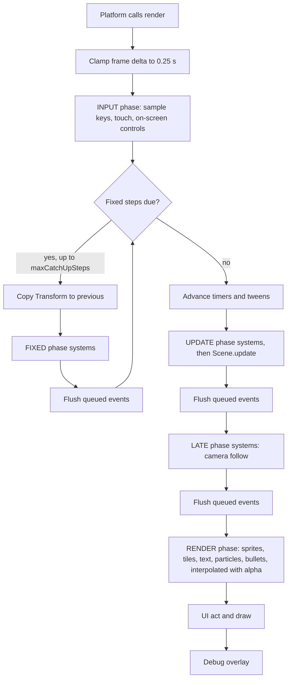
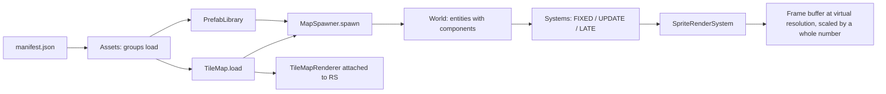

# Frame and Data Flow

This page shows what happens in one frame, and how data moves from files to entities on screen. Read it when the order of systems matters, which is most of the time.

## 1. One frame

| Phase | Runs | Delta | Typical systems |
| --- | --- | --- | --- |
| `INPUT` | once | scaled frame delta | input sampling |
| `FIXED` | 0 to `maxCatchUpSteps` times | `fixedDelta` (1/60 s) | movement (`PlatformerSystem`, `TopDownSystem`), `CollisionSystem`, AI, hits, bullets |
| `UPDATE` | once | scaled frame delta | animation, interaction, lifetimes, hit flash, game rules |
| `LATE` | once | scaled frame delta | `CameraFollowSystem`, `ParticleSystem` |
| `RENDER` | once | real frame delta | `SpriteRenderSystem` and what is attached to it |

- **While paused** (`time().setPaused(true)`), `FIXED` does not run. `UPDATE` and `LATE` systems are skipped unless they override `runsWhenPaused()`. `RENDER` and the UI keep running.
- **Too many steps due:** if more than `maxCatchUpSteps` fixed steps are due, the rest are dropped and counted (`time().droppedFixedSteps()`).
- **Interpolation:** sprites are drawn between each `Transform`'s previous and current position with `time().alpha()`. Use `transform.teleport(x, y)` to jump without a visible slide.

## 2. Order of systems inside a phase
Systems run by phase, then in the order you add them. A world takes one system per class. The orders the kits rely on:

**Platformer** (the platformer demo's `DemoScene`):
```java
world.addSystem(new MovingPlatformSystem(world, collision));   // solids move first
world.addSystem(new PatrollerSystem(world, collision));
world.addSystem(new PlatformerSystem(world, collision, input, events));
world.addSystem(new CollisionSystem(world, collision));        // after all movement: triggers
world.addSystem(new LevelSystem(world, collision, events));    // game rules read the final contacts
world.addSystem(new CameraFollowSystem(world, camera, time));  // LATE
world.addSystem(new AsmSystem(world, asmLibrary, events));     // before AnimationSystem
world.addSystem(new AnimationSystem(world, clips, events));
world.addSystem(sprites);                                      // RENDER
```

**Top-down shooter** (the shooter demo's `StageScene`):
```java
world.addSystem(new AimSystem(world, input));
world.addSystem(new SpawnerSystem(world, prefabs, events));
world.addSystem(new LifetimeSystem(world));
world.addSystem(new AiSystem(world, paths));                   // steering writes moveX/moveY...
world.addSystem(new TopDownSystem(world, collision, input, events));   // ...which this applies
world.addSystem(new WeaponSystem(world, bullets, weapons, events, input));
world.addSystem(health);
world.addSystem(new HitSystem(world, health));
world.addSystem(new HitFlashSystem(world, events));
world.addSystem(bullets);
world.addSystem(new TriggerZoneSystem(world, events));
world.addSystem(new CollisionSystem(world, collision));
world.addSystem(new CameraFollowSystem(world, camera, time));
world.addSystem(sprites);
```

## 3. Changing entities during a frame
- Inside a system, `create`, `destroy`, `add` and `remove` are queued and applied after that system. No system sees a half-changed entity.
- Outside systems (scene code, event handlers called from scene code), changes apply immediately. Check that an entity is still alive after anything that might have destroyed it.
- With kit-common, prefer `Despawn.despawn(world, e)` to `world.destroy(e)`, so pooled entities go back to their pool.

## 4. From files to the screen

1. **Manifest:** `manifest.json` lists every asset by ID with its type and groups. The `global` group loads at boot. A scene's `assetGroup()` loads before `enter` and unloads after `exit`.
2. **Map:** `TileMap.load(assets, "map.level1", ppu)` wraps the Tiled map and builds its collision grid from tile properties.
3. **Objects to entities:** `MapSpawner.spawn(world, map)` creates an entity for every Tiled object that has a class. The class names a prefab, and the object's properties override prefab values.
4. **Prefabs:** `PrefabLibrary` builds the components from the prefab JSON through the `ComponentRegistry`. No reflection is needed at run time beyond `ember.data`, and the R8 keep rules protect registered components on Android.
5. **Systems:** systems move and animate the entities. Events connect them: `Damaged`, `TriggerEntered`, `Interacted` and so on.
6. **Drawing:** `SpriteRenderSystem` draws each layer: first the attached layer content (tile layers, bullets, particles), then the layer's sprites sorted by the layer's mode, then overlays (text). It draws into a frame buffer at the virtual resolution, which is scaled to the window by a whole number.

## 5. Events across the frame
- `publish(event)` delivers immediately. Use it for UI and input.
- `queue(event)` delivers at the next flush point: after each fixed step, after `UPDATE` and after `LATE`. Use it for gameplay. Collision triggers, animation frame events, bullet hits and spawns are queued.
- Subscriptions made with `on(...)` while a scene is active belong to that scene and are removed when it exits.

More in [Events](Events).
