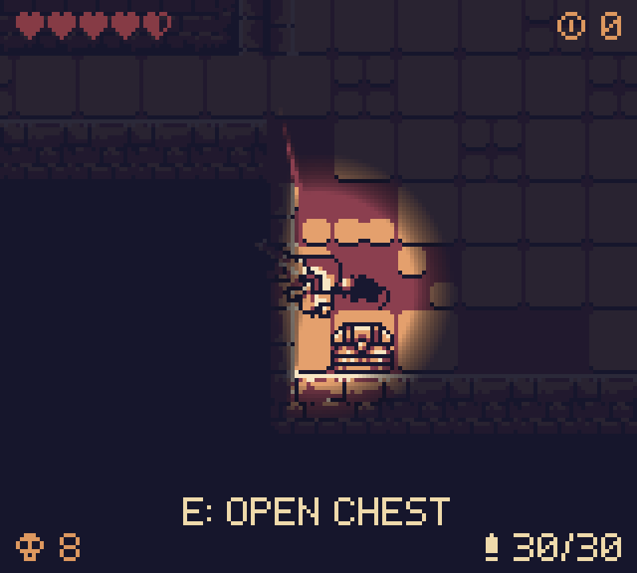
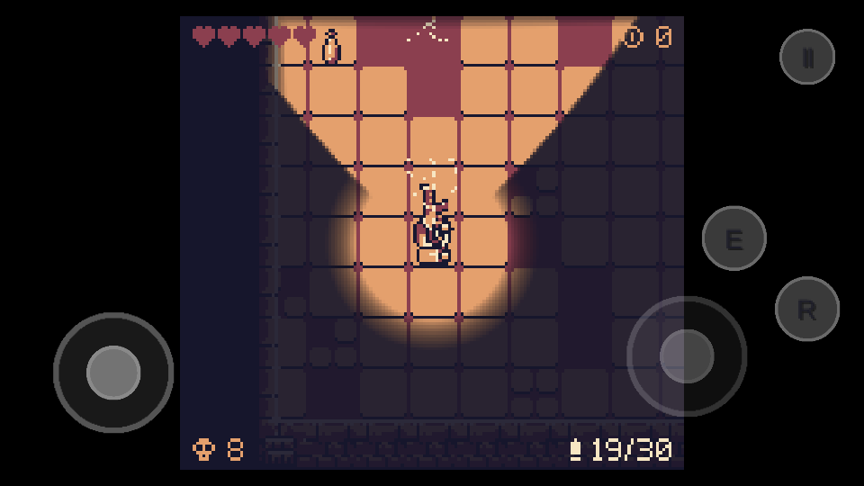

# Guide: Gold in Shadows (porting a finished game)

Gold in Shadows is a top-down dungeon shooter, 160×144 in four colours. You take a rifle and a small circle of light
through three levels of creatures, gold, spike traps and locked doors. It was first written as a standalone libGDX
game with its own engine code. This guide follows its port to Ember2D. The demo is `demos/demo-gold-in-shadows`; its
README has the controls and a table mapping every original class to its counterpart.

The guide is about **moving an existing game onto Ember2D**: what to keep, what the engine and kits replace, and the
few places where a game still needs its own systems. It also covers the field-of-view and fog feature built for this
game ([kit-topdown → Field of view and fog](Kit-Topdown)).



Reference pages: [kit-topdown](Kit-Topdown), [kit-common](Kit-Common), [kit-bullets](Kit-Bullets),
[Tilemaps and Tiled](Tilemaps-and-Tiled), [UI](UI), [Input](Input).

---

## 1. Decide what to keep
The original had about 10,300 lines of Java, and most of them were engine code:
- an animation player and tweens;
- a fixed-step clock and signals;
- grid path finding with avoidance;
- a collision world;
- a vision renderer, a menu framework and a settings store.

The port keeps none of that code but all of the game. Its **rules and values** (speeds, cooldowns, radii, damage,
timings, creature stats) and its **art** come across exactly. The engine and kits do the rest, and the port is about
3,000 lines.

A good order is to start with what can be checked without playing:
1. the data;
2. the levels, with a test that each one can be finished;
3. the player;
4. the enemies;
5. the world's rules;
6. the screens.

Each step in the demo has its own task (I-600 to I-660) and tests.

## 2. Project and data
Generate the project ([Creating a New Game Project](Creating-a-New-Game-Project)), then match the original's
resolution:
```java
EngineConfig config = new EngineConfig();
config.virtualWidth = 160;     // the original's resolution, integer-scaled
config.virtualHeight = 144;
config.backgroundColor.set(0x18 / 255f, 0x18 / 255f, 0x30 / 255f, 1f);   // the palette's darkest colour
config.firstScene = TitleScene::new;
config.inputBindings = "input";
config.saveFolder = "demo-gold-in-shadows";
config.components = new GoldComponents();
```

**Units.** The original works in pixels with y pointing down. The port uses 16 pixels per world unit and y up. Write
the original's numbers as `20f * PX` with `PX = 1f / 16f`, so every value can still be checked against the source.
`creatures.json` keeps the original's catalog in its own pixel units, and `CreatureCatalog` converts them when it loads.

**Art.** The sheets are copied unchanged and turned into clip sets with `./gradlew makeClips`. The manifest comes
from `./gradlew assetManifest` ([Working Without an Editor](Working-Without-an-Editor)).

## 3. Levels: convert them, don't rewrite them
The original stored levels as ASCII grids, with its own auto-tiling and its own collision boxes. Redrawing them in
Tiled would lose that exactness. Instead, a build-time converter (`assets-src/demo-gold-in-shadows/ConvertLevels.java`)
runs the **original's own level compiler** and writes Tiled maps:
- **tile layers:** base, floor, walls, props, overhead;
- **a `walls` object layer:** one rectangle per collision box, with `opaque` (does it block sight?) and `door`;
- **an objects layer:** prefab types such as `enemy/rat`, `pickup/coin`, `chest`, `spikes` (with a
  `SpikeTrap.phase` property) and `exit`.

At run time, `MapSpawner` spawns the objects, and a few lines build the walls. Sight-blocking walls and low props go
on different collision layers, because the fog needs to tell them apart:
```java
static final int SIGHT_LAYER = 3;                                  // walls: block movement and sight
static final int PROP_LAYER = 0;                                   // barrels, crates: block movement only
static final int MOVE_MASK = (1 << SIGHT_LAYER) | (1 << PROP_LAYER);
static final int SIGHT_MASK = 1 << SIGHT_LAYER;

for (MapObject object : map.tiled().getLayers().get("walls").getObjects()) {
    Rectangle px = ((RectangleMapObject) object).getRectangle();
    int e = world.create();
    world.add(e, new Transform()).teleport(px.x * scale, px.y * scale);
    Collider c = world.add(e, new Collider());
    c.box.set(0f, 0f, px.width * scale, px.height * scale);
    c.layer = object.getProperties().get("opaque", Boolean.TRUE, Boolean.class) ? SIGHT_LAYER : PROP_LAYER;
    world.add(e, new Solid());
    if (object.getProperties().get("door", Boolean.FALSE, Boolean.class)) {
        world.tag(e, "door");                                      // removed when the exit opens
    }
}
```
`LevelsTest` floods each map from the player's start and checks that every pick-up, creature, chest and the exit can
be reached. A conversion mistake fails the build, not a play session.

## 4. The light: field of view and fog
The original's look is its light: a small circle around you, a longer cone where you aim, and fog over everything
else. Enemies, items and enemy shots are hidden in the dark. This became an engine feature, kit-topdown's
`vision` package, with the original's numbers as its defaults:
```java
VisionField field = new VisionField(collision, Walls.SIGHT_MASK, new VisionSettings());
world.addSystem(new VisionSystem(world, field, context.events()));        // LATE
FogLayer fog = new FogLayer(field, context.renderer().camera(), "fog");     // the last render layer
sprites.addLayerContent(fog);
bulletRenderer.setVisibility(field::isVisible);                            // enemy shots hidden in the dark
```
The player prefab gets `"Viewer": {}`, and creatures and pick-ups get `"HiddenInFog": {...}`. The fog is geometry
drawn in the pixel-perfect world pass, so its edge comes out pixelated like the art, with no frame buffer. The details
are in [kit-topdown → Field of view and fog](Kit-Topdown).

## 5. The player: kits for the mechanics, one system for the look
The player is almost all kit components: `TopDownBody` (movement), `Aim` (mouse or right stick), `Weapon` with
`weapons/rifle.json` (600 rounds a minute, 30-round magazine, 2 s reload), `Health`, `Team`, `BulletTarget`,
`Hurtbox`, and `Viewer`. The game adds one marker, `Hero`. Then `HeroSystem` (in `UPDATE`) does what is specific to
this game:
- turns the player's state into the original's presentation: facing the aim, the walk and hit animations, blinking
  while invulnerable;
- draws the gun on its mount, with the hands following keyframe tracks;
- shows the reload icon;
- plays the death sequence, then sends `HeroDied`.

**Difficulty.** The original scales damage by 0.5, 1 and 1.5. kit-common's health is whole numbers, so the port counts
health in **quarter hearts** and uses `Health.damageMultiplier` (added for this port): Easy is 24 health ×1, Normal
20 ×2, Hard 16 ×3. One point of enemy damage is then half a heart on Normal, as in the original.

## 6. Enemies: a game system on top of the AI kit
The four creatures (rat, slug, ghoul, cultist) share one state machine: idle, active, attacking with a windup and
recovery, stunned, dead. They also share perception with line of sight, ally alerts, and hearing gunfire. That logic is
the game's own, in `CreatureSystem`. The kits do the heavy work under it:
- **Paths:** `CreatureSystem` only picks *where to go*. kit-topdown's `AiSystem` plans the path with A* on a grid
  made from the walls (`Walls.navigation`). `TopDownSystem` then moves the creature, sliding along the exact wall
  boxes.
  ```java
  private static void go(Steering s, float x, float y) {
      s.mode = Steering.Mode.FOLLOW_PATH;
      s.target = null;
      s.targetX = x;
      s.targetY = y;
  }
  ```
- **Shots:** the slug's spit and the cultist's bolt fan are kit-bullets patterns from `bullets.json`. Bullet types
  marked `"fogged": true` are hidden in the dark.
- **Damage and stun:** these come from kit-common: `HealthSystem` and `Damaged`/`Died` events, with `HitFlash`
  on hit.

Add the systems in this `FIXED` order: `CreatureSystem` (decide), `AiSystem` (path), `TopDownSystem` (move). The
creatures' stats live in `creatures.json` and their components in `prefabs/enemy/*.json`. Adding a fifth creature is
one JSON entry, one prefab and its clips ([Working Without an Editor](Working-Without-an-Editor)).

## 7. The world's rules
Each rule is a small `FIXED` system over a small component:

| Component (prefab) | System | Rule |
|---|---|---|
| `Pickup` (`pickup/coin`, `pile`, `pouch`, `medkit`, `key`) | `PickupSystem` | bob; dropped items fly out, slow down and wait 0.45 s; gold within 28 px drifts to you; taken within 10 px |
| `Chest` (`chest`) | `PickupSystem` | E within 22 px opens it: 4 coins and a 20-gold pouch |
| `SpikeTrap` (`spikes`) | `SpikeSystem` | 3 s cycle, waves from each trap's phase; 1 damage and knockback while up |
| `ExitDoor` (`exit`) | `ExitSystem` | opens within 20 px, spending the key; removes the `door` wall; walking through queues `LevelCleared` |

**Spawning from inside a system.** Components added while a system runs are queued, so `world.get` right after
`add` returns null. To make a dropped coin fly out, set its values as **prefab overrides** instead of changing it after
spawning:
```java
Map<String, Object> overrides = new HashMap<>();
overrides.put("Pickup.vx", MathUtils.cos(angle) * speed);
overrides.put("Pickup.vy", MathUtils.sin(angle) * speed);
overrides.put("Pickup.delay", 0.45f);
prefabs.spawn(world, "pickup/coin", x, y, overrides);
```

**The campaign.** `Campaign` holds the level, the gold (the score), kills and the level's time. On a cleared level it
saves the progress for **Continue** and keeps the best score, in the global save data (`saves().global()`), not in a
save slot:
```java
boolean newBest = campaign.gold > Campaign.best(context.saves().global());
boolean next = campaign.advance(context.saves().global());   // level reached, gold banked, best score
context.saves().flush();
```
After a death, `campaign.retryLevel()` restores the gold and kills the level started with.

## 8. Screens in the original's style
The menus are Ember2D `MenuList`s, so keyboard, mouse, touch and gamepad all work, and `RebindMenu` gives
Settings → Controls. Only the skin is the game's own. `GoldUi.useSkin` starts from `UiSkins.pixel(font, palette)` with
the original's colours, then replaces the button styles. There is no button frame: options are tan, and the chosen one
is cream with a ">" cursor. The cursor is a `Drawable` used as the focused button's background:
```java
TextButton.TextButtonStyle plain = new TextButton.TextButtonStyle(new Cursor(font, null), null, null, font);
plain.fontColor = new Color(Hud.TAN);
TextButton.TextButtonStyle focused = new TextButton.TextButtonStyle(plain);
focused.up = new Cursor(font, Hud.CREAM);          // draws ">" in its 9 px left margin
focused.fontColor = new Color(Hud.CREAM);
skin.add("default", plain);
skin.add("focused", focused);                      // MenuList uses "focused" for the chosen item
```
Two things to know at 160×144:
- `MenuList` rows are at least 24 UI units high, which is made for a 180+ pixel UI. The game sets
  `menu.defaults().minHeight(11f)` (taller on phones, from `ui.dp(...)`). For the rebinding screen it adjusts the
  cells of `ui.activeMenu()` after `RebindMenu.open`.
- Keep the skin's base text colour white and tint labels with `setColor`. The skin's `white` drawable and the
  label colour multiply, so a tan base would tint every background.

The screens:
- `TitleScene`: the original start-screen art.
- `LevelScene`: the pause menu and the level-complete panel as overlays, with time paused.
- `EndScene`: "YOU DIED" or "VICTORY!".
- Settings: difficulty, volumes, controls, and on desktop fullscreen, vsync and an FPS counter (through
  `Gdx.graphics`). All of them are saved in `saves().settings()`.

## 9. Android
`input.json` gives the twin-stick layout. The move stick floats (it appears where the thumb lands on the left half).
The aim stick fires past half its radius. R, E and pause are buttons:
```json
"touchControls": {
  "joystick": {"axis": "move", "mode": "floating", "radius": 52, "deadZone": 0.2},
  "aimStick": {"axis": "aim", "x": 150, "y": 110, "radius": 52, "deadZone": 0.15, "fire": "fire", "fireAt": 0.5},
  "buttons": [
    {"action": "reload", "label": "R", "x": 48, "y": 150, "radius": 28},
    {"action": "interact", "label": "E", "x": 110, "y": 210, "radius": 28},
    {"action": "pause", "label": "II", "x": 48, "y": -48, "radius": 24}
  ]
}
```
A 160×144 game on a 16:9 phone has wide bars at the sides, and the controls sit there, beside the game. The port
found an engine bug here: the controls were drawn squeezed into the game's viewport while their touch areas used the
whole screen. The engine now draws them in the whole-screen viewport. The demo was checked on the API 23 emulator in
debug and in release (R8). `GoldComponents` lists every component, which keeps them through R8.

## 10. Testing a port
- **Data tests** (`GoldDataTest`): the rifle, the player, the difficulty levels, the hand tracks and the creatures' gold match the original, and every prefab uses registered components.
- **Level tests** (`LevelsTest`): each level can be finished.
- **Behaviour tests** (`CreatureBehaviourTest`, `WorldRulesTest`): a headless `World` with the real systems and
  prefabs, stepped at 60 Hz. For example: "a rat 64 px away spots the player and bites", "a chest spills 60 gold",
  "the locked door needs the key".
- **Screens:** timed screenshots from a dev run, with no one at the screen:
  ```
  JAVA_TOOL_OPTIONS="-Dember.screenshotDir=shots -Dember.screenshotAt=3,6" ./gradlew :demos:demo-gold-in-shadows:desktop:run
  ```


