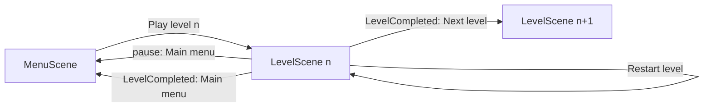

# Guide: Building a Platformer

This guide builds a complete side-view platformer with **kit-platformer**: three levels, a menu with a level list, a HUD, pause, sound, settings, saved progress and touch controls. The finished reference is `demos/demo-platformer`. Every snippet comes from it or matches its structure.

Prerequisites: [Getting Started](Getting-Started). Reference pages: [kit-platformer](Kit-Platformer), [Tilemaps and Tiled](Tilemaps-and-Tiled), [Animation](Animation).

---

## 1. Project bootstrap
1. Copy `demos/demo-platformer` to `demos/my-platformer` and rename the packages, classes and build entries ([Creating a New Game Project](Creating-a-New-Game-Project)).
2. The config:
```java
public final class MyPlatformer {
    public static EngineConfig config(boolean devMode, String version) {
        EngineConfig config = new EngineConfig();
        config.virtualWidth = 320;
        config.virtualHeight = 180;
        config.backgroundColor.set(0.08f, 0.06f, 0.10f, 1f);
        config.firstScene = MenuScene::new;
        config.inputBindings = "input";
        config.components = new MyComponents();
        config.tiledProject = "maps/platformer.tiled-project";   // class-typed properties in maps
        config.saveFolder = "my-platformer";
        config.devMode = devMode;
        return config;
    }
}
```
3. The components:
```java
public final class MyComponents implements ComponentSetup {
    @Override
    public void register(ComponentRegistry registry) {
        PlatformerKit.register(registry);      // PlatformerBody, Patroller, MovingPlatform, Ladder
        registry.register(CameraFollow.class, CameraFollow::new)
                .register(Enemy.class, Enemy::new)
                .register(Hazard.class, Hazard::new)
                .register(Checkpoint.class, Checkpoint::new)
                .register(Goal.class, Goal::new);
    }
}
```
`Enemy`, `Hazard`, `Checkpoint` and `Goal` are your own marker components, with a few fields each.

4. Run it: `./gradlew :demos:my-platformer:desktop:run`.

## 2. Asset management
Folder layout under `core/assets/`:
```text
gfx/frog/idle.png run.png jump.png fall.png hit.png   sprite strips (32 x 32 frames)
gfx/pig/walk.png hit.png
gfx/level/spikes.png checkpoint-*.png goal-*.png platform.png
maps/terrain.png terrain.tsx background.png level1.tmx level2.tmx level3.tmx platformer.tiled-project
anim/frog.clips.json frog.asm.json pig.clips.json level.clips.json
prefabs/player.json camera.json enemy/pig.json hazard/spikes.json level/start.json level/checkpoint.json level/goal.json platform/moving.json
sfx/*.wav  music/level.wav  fonts/PressStart2P-Regular.ttf
manifest.json  input.json  ART-CREDITS.txt
```
The manifest, shortened:
```json
{ "version": 1, "assets": [
  {"id": "tex.frog_idle", "path": "gfx/frog/idle.png", "type": "texture", "group": "global"},
  {"id": "tex.frog_run",  "path": "gfx/frog/run.png",  "type": "texture", "group": "global"},
  {"id": "anim.frog", "path": "anim/frog.clips.json", "type": "clips", "group": "global"},
  {"id": "asm.frog",  "path": "anim/frog.asm.json",   "type": "asm",   "group": "global"},
  {"id": "font.pixel", "path": "fonts/PressStart2P-Regular.ttf", "type": "freetype", "group": "global",
   "font": {"size": 8, "mono": true, "shadowOffsetX": 1, "shadowOffsetY": 1, "shadowColor": "#000000A0"}},
  {"id": "sfx.jump", "path": "sfx/jump.wav", "type": "sound", "group": "global", "maxInstances": 2},
  {"id": "music.level", "path": "music/level.wav", "type": "music", "group": "global"},
  {"id": "map.level1", "path": "maps/level1.tmx", "type": "map", "group": "level1"},
  {"id": "map.level2", "path": "maps/level2.tmx", "type": "map", "group": "level2"},
  {"id": "player", "path": "prefabs/player.json", "type": "prefab", "group": "global"},
  {"id": "input", "path": "input.json", "type": "json", "group": "global"}
] }
```
Give each level its own group, so only one map is in memory, and preload the next level from the menu. More in [Assets](Assets).

## 3. Audio and music
```java
Audio audio = context.audio();
audio.playMusic("music.level", 0.5f);                                          // in enter()
context.events().on(Jumped.class, e -> audio.playVaried("sfx.jump", 0.06f));
context.events().on(EnemyStomped.class, e -> audio.play("sfx.stomp"));
context.events().on(PlayerHurt.class, e -> { audio.play("sfx.hurt"); input.vibrate(40); });
context.events().on(LevelCompleted.class, e -> { audio.stopMusic(1f); audio.play("sfx.goal"); });
```
`Jumped` comes from the kit. `EnemyStomped`, `PlayerHurt` and `LevelCompleted` are your own events, published by your rules system. Pause and resume the music in the pause menu. Volumes are settings ([Audio](Audio)).

## 4. Animations
**Clips** (`anim/frog.clips.json`):
```json
{ "version": 1, "defaults": { "frameDuration": 0.05 },
  "clips": {
    "idle": { "sheet": "tex.frog_idle", "frameWidth": 32, "frameHeight": 32, "frames": [0, 10] },
    "run":  { "sheet": "tex.frog_run",  "frameWidth": 32, "frameHeight": 32, "frames": [0, 11], "events": { "2": "step", "8": "step" } },
    "jump": { "sheet": "tex.frog_jump", "frameWidth": 32, "frameHeight": 32, "frames": [0, 0] },
    "fall": { "sheet": "tex.frog_fall", "frameWidth": 32, "frameHeight": 32, "frames": [0, 0] },
    "hit":  { "sheet": "tex.frog_hit",  "frameWidth": 32, "frameHeight": 32, "frames": [0, 6], "frameDuration": 0.06, "mode": "once" } } }
```
**State machine** (`anim/frog.asm.json`): the full version is on [Animation](Animation). `PlatformerSystem` writes `grounded`, `speedX` and `velY` for you, and your rules fire `hit`.

**Player prefab:**
```json
{ "version": 1, "components": {
    "Sprite":   { "regionId": "tex.frog_jump", "origin": [16, 0], "z": 2 },
    "Collider": { "box": { "x": -0.4375, "y": 0, "width": 0.875, "height": 1.375 } },
    "Actor": {},
    "PlatformerBody": {},
    "Animator": { "clipSet": "anim.frog", "clip": "idle" },
    "AnimationStateMachine": { "definition": "asm.frog" } } }
```
Add `AsmSystem` and then `AnimationSystem` to the scene (section 8).

## 5. Screen transitions
```java
// menu -> level
context.scenes().replace(new LevelScene(1), Transition.fade(0.5f));
// level -> next level, or restart
context.scenes().replace(new LevelScene(level + 1), Transition.fade(0.5f));
context.scenes().restart();
// preload from the menu while the player reads it
context.scenes().preload("level" + progress.unlocked());
```
The level's group loads during the fade, and a loading bar shows only if it isn't ready ([Scenes and Transitions](Scenes-and-Transitions)).

## 6. Scoring, progression and state
The platformer measures **time** and **deaths** per level, keeps the **best time** per level in global data, and keeps **unlocked levels** in save slot 0.
```java
final class Progress {
    static final int SLOT = 0;
    private final SaveStore saves;
    private int unlocked = 1;
    private float playSeconds;

    static Progress load(SaveStore saves) {
        Progress p = new Progress(saves);
        LoadResult r = saves.load(SLOT);
        if (!r.ok() && r.info() != null && r.info().backupAvailable()) {
            r = saves.loadBackup(SLOT);                     // damaged: use the previous save
        }
        if (r.ok()) {
            p.unlocked = Math.max(1, Math.min(Levels.count(), r.data().getInt("unlocked", 1)));
            p.playSeconds = r.data().getFloat("playSeconds", 0f);
        }
        return p;
    }

    SaveResult completed(int level, float seconds) {
        playSeconds += seconds;
        unlocked = Math.max(unlocked, Math.min(Levels.count(), level + 1));
        return saves.save(SLOT, new SlotMeta("level" + unlocked, playSeconds, "Level " + unlocked + " of " + Levels.count()),
                new SaveData().set("unlocked", unlocked).set("playSeconds", playSeconds));
    }
}

// best time, shared by all slots:
SaveData global = context.saves().global();
float best = global.getFloat("best.level" + level, 0f);
if (best == 0f || seconds < best) { global.set("best.level" + level, seconds); context.saves().flush(); }
```

## 7. UI: menu, HUD, pause, results
**Skin** (once per scene): `ui.setSkin(UiSkins.pixel(context.assets().get("font.pixel", BitmapFont.class)), true);`

**HUD:**
```java
Table hud = new Table(ui.skin());
time = new HudCounter(ui.skin(), "Time", null);
deaths = new HudCounter(ui.skin(), "Deaths", null);
hud.add(time).left().row();
hud.add(deaths).left().padTop(2f);
ui.root().add(hud).expand().top().left().pad(4f);
// update():
time.setSeconds(level.levelTime());
deaths.setValue(level.deaths());
```
**Main menu with a level list:**
```java
MenuList menu = new MenuList(ui);
for (int i = 1; i <= Levels.count(); i++) {
    int level = i;
    menu.add("Level " + i + bestTimeText(i), () -> context.scenes().replace(new LevelScene(level), Transition.fade(0.5f)));
    menu.setDisabled(i - 1, !progress.isUnlocked(i));      // locked levels are greyed out and skipped
}
```
**Pause:** push the `ui` input context, pause time and music, and open an overlay with Resume, Restart level, Settings and Main menu ([Scenes and Transitions](Scenes-and-Transitions)). Settings use `menu.addValue` for volumes, plus "Edit controls" (`TouchLayoutEditor`) on touch screens. Call `context.saveSettings()` when leaving.

**Results panel:** on `LevelCompleted`, show the time, deaths and best time, with "Next level" and "Main menu". After the last level the title reads "You finished the demo!".

## 8. Gameplay
### The level scene
```java
@Override
protected String assetGroup() { return "level" + level; }

@Override
protected void enter(EngineContext context) {
    World world = world();
    input = context.input();
    context.renderer().setLayers(new RenderLayer("background", SortMode.NONE), new RenderLayer("world", SortMode.Z),
            new RenderLayer("foreground", SortMode.NONE));
    TileMap map = TileMap.load(context.assets(), "map.level" + level, context.renderer().pixelsPerUnit());
    Collision collision = new Collision(world, context.events());
    collision.addTileGrid(map.collision(), 0);

    new MapSpawner(context.prefabs()).spawn(world, map);
    player = world.findByName("player");
    world.get(world.findByName("camera"), CameraFollow.class).bounds = map.bounds(new Rectangle());

    world.addSystem(new MovingPlatformSystem(world, collision));
    world.addSystem(new PatrollerSystem(world, collision));
    world.addSystem(new PlatformerSystem(world, collision, input, context.events()));
    world.addSystem(new CollisionSystem(world, collision));
    rules = new LevelSystem(world, collision, context.events());     // your rules, after collision
    world.addSystem(rules);
    world.addSystem(new CameraFollowSystem(world, context.renderer().camera(), context.time()));
    AnimationLibrary clips = new AnimationLibrary(context.assets());
    world.addSystem(new AsmSystem(world, new AsmLibrary(context.assets(), clips), context.events()));
    world.addSystem(new AnimationSystem(world, clips, context.events()));
    SpriteRenderSystem sprites = new SpriteRenderSystem(world, context.renderer(), context.assets(), context.time());
    world.addSystem(sprites);
    new TileMapRenderer(map, context.renderer(), context.time()).attachTo(sprites);
    new TextRenderer(world, context.renderer(), context.assets(), context.time()).attachTo(sprites);
    world.addSystem(new CollisionDebugSystem(world, collision, context.debug(), context.renderer()));
    // audio wiring (section 3), HUD (section 7)
}
```

### Controls
Input bindings:
```json
{ "version": 1, "contexts": {
    "gameplay": {
      "actions": { "jump": ["SPACE", "Z", "UP", "W"], "dash": ["X", "L_SHIFT"], "pause": ["P", "DOUBLE_TAP"], "menu": ["ESCAPE", "BACK", "LONG_PRESS"] },
      "axes": { "move": { "left": ["LEFT", "A"], "right": ["RIGHT", "D"], "up": ["UP", "W"], "down": ["DOWN", "S"] } } },
    "ui": {
      "actions": { "ui_back": ["ESCAPE", "BACK", "P"], "ui_confirm": ["ENTER", "SPACE", "Z"] },
      "axes": { "ui_nav": { "left": ["LEFT", "A"], "right": ["RIGHT", "D"], "up": ["UP", "W"], "down": ["DOWN", "S"] } } } },
  "touchControls": {
    "opacity": 0.35,
    "joystick": { "axis": "move", "mode": "floating", "radius": 56, "deadZone": 0.2 },
    "buttons": [ { "action": "jump", "label": "A", "x": 80, "y": 80, "radius": 44 },
                 { "action": "dash", "label": "B", "x": 176, "y": 64, "radius": 34 },
                 { "action": "pause", "label": "II", "x": 48, "y": -48, "radius": 24 } ] } }
```
Show the dash button only where dash is on: `input.setTouchButtonVisible("dash", body.dash);`.

### The rules system
Your `LevelSystem` (`FIXED`, after `CollisionSystem`) owns the game rules:
- **Stomping:** landing on an `Enemy` while falling defeats it (hit clip, then removed) and bounces the player (`body.vy = enemy.stompBounce`, a field on your `Enemy` component). Touching one otherwise hurts.
- **Hazards:** spikes (`Hazard`) and falling below the map hurt.
- **Hurt:** play the hit clip, lock the body for 0.42 s, respawn at the last checkpoint and blink for 1 s; count the death.
- **Checkpoints:** touching one makes it the respawn point.
- **Goal:** touching it ends the level and publishes `LevelCompleted(seconds, deaths)`.

Use collision queries every step, because actors don't trigger actors:
```java
collision.bounds(player, playerBox);
int n = collision.overlapBox(playerBox, ~0, hits);
for (int i = 0; i < n; i++) {
    int other = hits.get(i);
    if (world.has(other, Enemy.class)) { /* stomp or hurt */ }
    if (world.has(other, Hazard.class)) { /* hurt */ }
}
```

### Levels in Tiled
- Paint terrain with the tileset. In the `.tsx`, grass and dirt have `solid`, and planks `oneWay`.
- Place objects with classes `player`, `camera` (with `CameraFollow.target` → the player object), `enemy/pig`, `hazard/spikes`, `level/start` (the sign), `level/checkpoint`, `level/goal` and `platform/moving`.
- Switch on mechanics per level on the player object (level 2: `wallSlide`, `wallJump`; level 3: `airJumps` 1, `dash` true).

## 9. Additional features
- **Moving platforms:** a `Solid` with `MovingPlatform` (`distance`, `speed`, `vertical`). Riders move with it.
- **Ladders:** a trigger collider with `Ladder`, and `PlatformerBody.ladders = true`.
- **Wall slide and jump, air jumps, dash:** fields on `PlatformerBody`.
- **One-way planks:** the `oneWay` tile property; down + jump drops through.
- **World text:** a `Text` component on the start sign (`Text.text` property in Tiled).
- **Tiled classes:** `./gradlew :demos:demo-platformer:core:tiledTypes` regenerates the project file.
- **Level tests:** `LevelMapTest` (one player, a goal, objects on ground) and `LevelReachabilityTest`, which walks from start to goal with a cautious jump model. Copy them.

## 10. The complete game
The finished structure:
```text
MyPlatformer        config (section 1)
MyComponents        registry (section 1)
MenuScene           title, level list with best times and locks, settings, quit; preloads the next level
LevelScene          the level (section 8), HUD, pause menu, results panel
LevelSystem         stomp, hurt, respawn, checkpoints, goal -> LevelCompleted
Progress            slot 0: unlocked levels, play time (section 6)
Levels              level list: map ID, title, asset group
Enemy, Hazard, Checkpoint, Goal                marker components
LevelCompleted, PlayerHurt, EnemyStomped, CheckpointReached   events
```
Flow:

Checklist before shipping:
- [ ] Every level passes your map and reachability tests.
- [ ] Progress survives a restart (desktop) and an app kill (Android).
- [ ] The touch controls feel right on a phone; the layout editor saves.
- [ ] The release builds: [Building for Desktop](Building-for-Desktop), [Building for Android](Building-for-Android).
