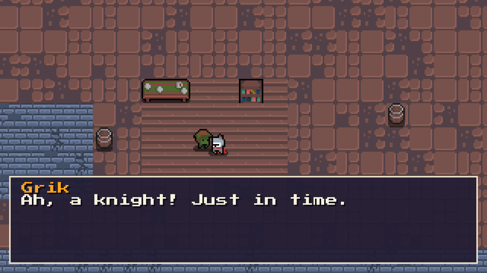
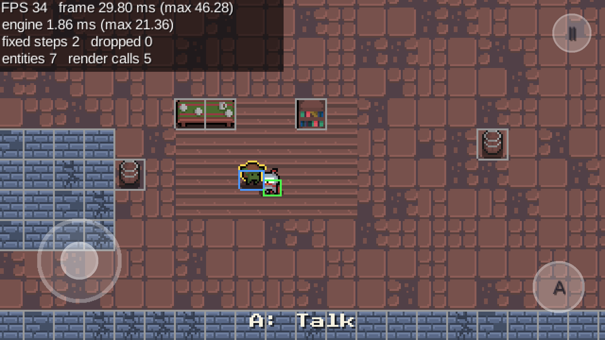
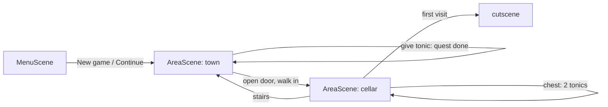

# Guide: Building a Top-Down RPG

This guide builds a small top-down RPG with:
- **kit-topdown** (`rpg` package): interaction, items, inventory;
- **kit-common:** the Ink `DialogueRunner`;
- the engine's **world flags** and **save slots**;
- **kit-novel** for a cutscene.

The game is a town and a cellar:
- an elder gives you a key through an Ink conversation;
- the key opens a locked door;
- a chest in the cellar holds a tonic;
- a cutscene plays on your first visit to the cellar;
- the door and the chest stay open after travel and after loading.

The finished reference is `demos/demo-rpg`.



Reference pages: [kit-topdown](Kit-Topdown), [kit-common](Kit-Common), [kit-novel](Kit-Novel), [Saves, Settings and World Flags](Saves-Settings-and-World-Flags).

---

## 1. Project bootstrap
Generate the project from the RPG demo: `./gradlew newGame -PgameName=my-rpg -PgamePackage=com.example.rpg -Ptemplate=rpg` ([Creating a New Game Project](Creating-a-New-Game-Project)). The stories' Ink sources land in `demos/my-rpg/core/ink/`.
```java
public static EngineConfig config(boolean devMode, String version) {
    EngineConfig config = new EngineConfig();
    config.virtualWidth = 320;
    config.virtualHeight = 180;
    config.firstScene = MenuScene::new;
    config.inputBindings = "input";
    config.saveFolder = "my-rpg";
    config.components = new RpgComponents();
    config.devMode = devMode;
    return config;
}

public final class RpgComponents implements ComponentSetup {
    @Override
    public void register(ComponentRegistry registry) {
        CommonKit.register(registry);    // TriggerZone
        TopDownKit.register(registry);   // TopDownBody
        RpgKit.register(registry);       // Interactable, Interactor, Inventory, ItemPickup
        registry.register(CameraFollow.class, CameraFollow::new)
                .register(Door.class, Door::new)       // public String flag
                .register(Chest.class, Chest::new)     // public String flag
                .register(Travel.class, Travel::new);  // public String area, spawn
    }
}
```
The core module depends on `kit-common`, `kit-topdown` and `kit-novel` (see `demos/demo-rpg/core/build.gradle`).

## 2. Asset management
```text
gfx/rpg.atlas tiles.png knight_idle.png knight_run.png goblin_idle.png slime_idle.png door.png
maps/tiles.png tiles.tsx town.tmx cellar.tmx
anim/rpg.clips.json
prefabs/player.json camera.json npc/elder.json npc/slime.json door.json chest.json travel.json marker.json
items.json cast.json input.json
ink/town.ink.json cellar.ink.json        compiled; sources in assets-src/demo-rpg/ink/
sfx/*.wav music/town.wav fonts/...
```
- **Groups:** each area's map is in its own group (`town`, `cellar`); everything else is `global`.
- **Atlas:** `gfx/rpg.atlas` names single images (chest, key, tonic) and the first frame of each character for portraits.
- **Ink stories** are `json` assets: `{ "id": "ink.town", "path": "ink/town.ink.json", "type": "json", "group": "global" }`.

### Compiling Ink
Write stories in Inky or a text editor, and compile them with inklecate through the demo's Gradle task:
```sh
# once, in ~/.gradle/gradle.properties:  ember.inklecate=C:/tools/inklecate/inklecate.exe
./gradlew :demos:demo-rpg:core:compileInk
```
It compiles `assets-src/demo-rpg/ink/*.ink` into `assets/ink/*.ink.json`. Without the property it is skipped; the compiled files are committed.

## 3. Audio and music
```java
if ("town".equals(game.area)) audio.playMusic("music.town", 1f); else audio.stopMusic(1f);   // per area
audio.play("sfx.blip");                     // each dialogue line
audio.play("sfx.chest");                    // opening the chest
audio.play("sfx.door");                     // the door opening (on FlagChanged)
audio.play("sfx.item");                     // a conversation changed the inventory
```
The cutscene's `# sfx: sfx.rumble` tag plays through the same `Audio`.

## 4. Animations
```json
"Animator": { "clipSet": "anim.rpg", "clip": "knight_idle" }
```
- **The knight:** idle and run strips, switched in the scene's `update`:
```java
TopDownBody body = world.get(player, TopDownBody.class);
world.get(player, Animator.class).playIfNotPlaying(body.moving && !body.locked ? "knight_run" : "knight_idle");
```
- **NPCs:** a looping idle clip in their prefab.
- **The door:** three clips (`door_closed`, `door_open` played once, `door_opened`). The opening is played when its flag is set (section 8).
- `TopDownBody.flipSprite` faces left and right automatically.

## 5. Screen transitions and areas
Areas are one scene class with different data. Travel zones move between them:
```json
"Collider": { "box": { "x": -0.8, "y": 0.1, "width": 1.6, "height": 0.8 }, "trigger": true },
"TriggerZone": { "tag": "player" },
"Travel": {}
```
```xml
<object name="to_cellar" type="travel" x="240" y="112"><properties>
  <property name="Travel.area" value="cellar"/><property name="Travel.spawn" value="from_town"/></properties><point/></object>
<object name="from_cellar" type="marker" x="240" y="160"><point/></object>
```
```java
context.events().on(ZoneEntered.class, e -> {
    Travel travel = world.get(e.zone(), Travel.class);
    if (travel != null && e.entity() == player && !travelling) {
        travelling = true;
        world.get(player, TopDownBody.class).locked = true;
        game.area = travel.area;
        game.spawn = travel.spawn;
        context.scenes().replace(new AreaScene(game), Transition.fade(0.6f));
    }
});
```
The new scene places the player at the arrival **marker** (an empty prefab, `marker.json`), which stands outside the zone.

## 6. State: the play-through object, flags and saves
One `Game` object lives across scenes. It holds the inventory, the world flags, the story and the position:
```java
final class Game {
    final ItemCatalog items;
    final Inventory inventory = new Inventory();
    final WorldFlags flags;            // context.flags()
    final DialogueRunner story;        // ink.town, one runner for the whole play-through
    String area = "town", spawn = "start";
    boolean hasPosition; float x, y, playSeconds;
    int itemsVersion;                  // bumped when the inventory changes (HUD refresh)

    private void bind() {               // the Ink functions
        story.bind("has", args -> inventory.has((String) args[0], 1));
        story.bind("give", args -> { int n = inventory.add(items, (String) args[0], ((Number) args[1]).intValue()); itemsVersion++; return n > 0; });
        story.bind("take", args -> { boolean ok = inventory.remove((String) args[0], ((Number) args[1]).intValue()); itemsVersion++; return ok; });
        story.bind("flag", args -> flags.getBool((String) args[0], false));
        story.bind("set_flag", args -> { flags.set((String) args[0], true); return true; });
    }

    SaveData write() {
        SaveData data = new SaveData().set("area", area).set("x", x).set("y", y).set("playSeconds", playSeconds);
        SaveData inv = new SaveData(); inventory.save(inv); data.set("inventory", inv);
        SaveData f = new SaveData(); flags.save(f); data.set("flags", f);
        SaveData s = new SaveData(); story.save(s); data.set("story", s);
        return data;
    }
}
```
- **When it saves** (slot 0): on arrival in each area, from the pause menu, and on Android suspend (`saves.setSuspendSave(this::save)`).
- **New game:** `context.flags().clear()`.
- **Continue:** loads slot 0, falling back to the backup.
- **The inventory object** is added to each area's player entity (`world.add(player, game.inventory)`), so it is the same object everywhere.

## 7. UI
- **HUD:** item icons with counts at the top left, rebuilt when `itemsVersion` changes, and the interaction prompt at the bottom ("E: Talk" on desktop, "A: Talk" on touch), from `InteractionFocus`.
- **Conversations:** a `DialogueBox` in a bottom overlay. It uses a **minimum** height of 58, so it can grow for choices.
```java
final class Conversation {
    void start(String knot, Runnable onEnd) {
        input.pushContext("ui");
        overlay.setVisible(true);
        story.jumpTo(knot);
        showNext();
    }

    private void showNext() {
        while (story.canContinue()) {
            story.next();
            if (story.text().isBlank()) continue;
            box.show(story.speaker(), NAME_COLORS.get(story.speaker()), story.text());
            audio.play("sfx.blip");
            return;
        }
        List<String> choices = story.choices();
        if (!choices.isEmpty()) {
            box.showChoices(choices, i -> { story.choose(i); showNext(); });
            return;
        }
        overlay.setVisible(false);
        input.popContext();
        onEnd.run();
    }
}
```
- **Pause menu:** Resume, Save (shows "Saved"), Main menu.
- **Main menu:** Continue (if a save exists), New game (with confirmation), Quit.
- **Focus outline:** the focused interactable gets a yellow outline ([Sprite Materials](Sprite-Materials)).



## 8. Gameplay
### Controls
```json
"gameplay": { "actions": { "interact": ["E", "SPACE", "ENTER"], "pause": ["P"], "menu": ["ESCAPE", "BACK"] },
              "axes": { "move": { "left": ["A", "LEFT"], "right": ["D", "RIGHT"], "up": ["W", "UP"], "down": ["S", "DOWN"] } } },
"ui": { "actions": { "ui_back": ["ESCAPE", "BACK", "P"], "ui_confirm": ["ENTER", "SPACE", "E"] }, ... },
"touchControls": { "joystick": { "axis": "move", "mode": "floating", "radius": 52, "deadZone": 0.2 },
                   "buttons": [ { "action": "interact", "label": "A", "x": 56, "y": 64, "radius": 32 },
                                { "action": "pause", "label": "II", "x": 40, "y": -40, "radius": 24 } ] }
```
`E` is bound in both contexts. The dialogue box ignores the press that opened a conversation, so it doesn't skip the first line.

### Interactables run story knots
Every `Interactable.action` is the name of a knot in `town.ink`, so one handler covers NPCs, doors and chests:
```json
"Interactable": { "prompt": "Talk", "action": "elder", "range": 1.5 }
```
```java
context.events().on(Interacted.class, e -> {
    if (e.interactor() != player || talk.active() || paused) return;
    String knot = e.action();
    Chest chest = world.get(e.target(), Chest.class);
    if (chest != null && game.flags.getBool(chest.flag, false)) knot = "chest_empty";
    TopDownBody body = world.get(player, TopDownBody.class);
    body.locked = true;
    talk.start(knot, () -> body.locked = false);
});
```

### The story drives the world
```ink
EXTERNAL has(item)
EXTERNAL give(item, count)
EXTERNAL take(item, count)
EXTERNAL flag(key)
EXTERNAL set_flag(key)

=== elder ===
{
- flag("quest.done"):
    Grik: The cellar is quiet again, thanks to you. Mind the stairs!
- has("tonic"):
    Grik: Is that... my tonic! You found it!
    ~ take("tonic", 1)
    ~ set_flag("quest.done")
    Grik: Keep the other bottle, friend. You have earned it.
- has("key.cellar"):
    Grik: The cellar door is in the old hall, just north of here. Bring back my tonic!
- else:
    -> ask
}
-> END

= ask
{ ask > 1:
    Grik: Back again? Changed your mind?
- else:
    Grik: Ah, a knight! Just in time.
    Grik: My cellar is full of strange noises, and my tonic is down there.
}
+ [I'll take a look.]
    Grik: Bless you. Here is the key.
    ~ give("key.cellar", 1)
    You received the cellar key.
+ [Not today.]
    Grik: Pity. Come back if you change your mind.
- -> END

=== cellar_door ===
{
- has("key.cellar"):
    ~ set_flag("door.cellar")
    The key turns. The old door creaks open.
- else:
    The door is locked. Someone in town must have the key.
}
-> END

=== chest ===
~ give("tonic", 2)
~ set_flag("chest.cellar")
You found two bottles of tonic.
-> END
```
Give each `EXTERNAL` an Ink fallback (`=== function has(item) === ~ return false`) so the story also runs in Inky.

### Doors and chests that stay open
```java
context.events().on(FlagChanged.class, e -> showFlags(true));   // a story set a flag: animate now
showFlags(false);                                               // on entering an area: show the saved state

private void showFlags(boolean animate) {
    for (int door : doors) {
        if (game.flags.getBool(world.get(door, Door.class).flag, false) && world.get(door, Solid.class) != null) {
            world.remove(door, Solid.class);                         // walk through
            world.get(door, Interactable.class).enabled = false;
            world.get(door, Animator.class).play(animate ? "door_open" : "door_opened");
        }
    }
    for (int chest : chests) {
        if (game.flags.getBool(world.get(chest, Chest.class).flag, false)) {
            world.get(chest, Sprite.class).tint.set(0.55f, 0.5f, 0.5f, 1f);   // dull: opened
            world.get(chest, Interactable.class).prompt = "Search";
        }
    }
}
```

### The scene's systems
```java
world.addSystem(new TopDownSystem(world, collision, input, context.events()));
world.addSystem(new InteractionSystem(world, input, context.events()));
world.addSystem(new TriggerZoneSystem(world, context.events()));
world.addSystem(new CollisionSystem(world, collision));
world.addSystem(new CameraFollowSystem(world, context.renderer().camera(), context.time()));
world.addSystem(new AnimationSystem(world, clips, context.events()));
world.addSystem(sprites);
```
Doors, the elder and chests are `Solid`, so the player can't walk through them.

## 9. Additional features: a cutscene with kit-novel
The first visit to the cellar plays `ink/cellar.ink` over the game world:
```ink
# show: knight left
Knight: So this is Grik's cellar. It smells of old cheese.
# sfx: sfx.rumble
# shake: 0.5
Something stirs in the dark.
# show: slime right transition=slide
Slime: Blub! Who comes down here to steal the old goblin's tonic?
* [I'm here to take it back.]
    Slime: Brave words. Fine, the chest is yours.
* [I'm just looking around.]
    Slime: A poor liar. Take the tonic and leave my cellar quiet.
- # flash: white 0.3
# hide: slime transition=fade
Knight: That was... odd.
-> END
```
```java
NovelCharacters cast = NovelCharacters.parse(context.assets().get("cast", JsonValue.class), context.assets().path("cast"));
cutscene = new NovelView(ui(), context.assets(), audio, input, context.renderer().camera(),
        new NovelSettings().load(context.saves().settings()));
cutscene.setCharacterArea(0.33f, 0.5f);          // portraits standing on the box, over the world
NovelDirector director = new NovelDirector(DialogueRunner.fromAsset(context.assets(), "ink.cellar"), cast,
        cutscene, null, context.config().devMode);
world.get(player, TopDownBody.class).locked = true;
input.pushContext("ui");
cutscene.play(director, () -> {
    game.flags.set("cutscene.cellar", true);     // never again
    input.popContext();
    world.get(player, TopDownBody.class).locked = false;
    save();
});
// update(): cutscene.update(delta);
```
- **No background:** the cutscene has no `bg:` tag, so the cellar stays visible behind the portraits.
- **When it starts:** wait until the scene's fade has finished (`!context().scenes().inTransition()`).
- **Item pickups:** an `ItemPickup` (`item`, `count`) on a `TriggerZone`, with `ItemPickupSystem`, adds items to the entering player's `Inventory` and publishes `ItemPickedUp`.

## 10. The complete game
```text
RpgDemo, RpgComponents          config and registry
MenuScene                       Continue / New game / Quit
AreaScene                       town or cellar from data: map, systems, HUD, travel, flags, pause, save, cutscene
Conversation                    DialogueBox + DialogueRunner knot player
Game                            play-through: inventory, flags, story, place; write/read slot 0
Door, Chest, Travel             components
ink/town.ink, ink/cellar.ink    the story and the cutscene
```

Test the quest headlessly, as `RpgDataTest` does. It plays every knot through the bound functions, saves, loads and checks the flags:
```java
List<String> lines = talk(game, "elder", 1);   // "Not today."
assertThat(lines).first().isEqualTo("Grik: Ah, a knight! Just in time.");
talk(game, "elder", 0);                        // "I'll take a look."
assertThat(game.inventory.has("key.cellar", 1)).isTrue();
```
Checked on an Android 6 emulator in debug and release (R8) builds: conversations, travel, the cutscene, the chest, saving and continuing after the app was killed.
