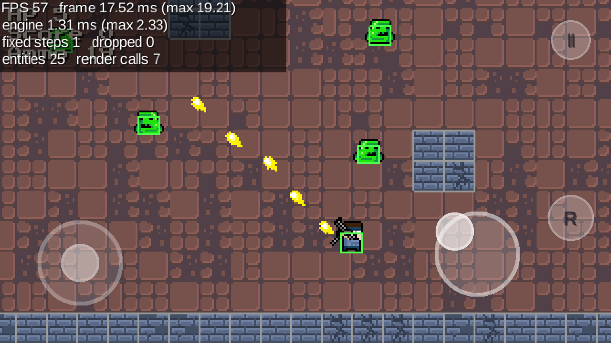
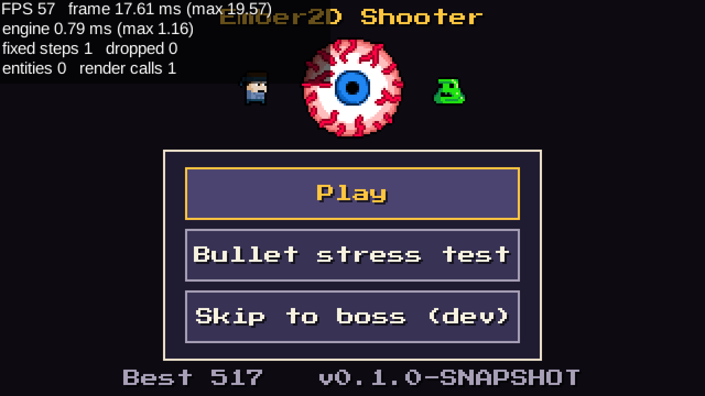
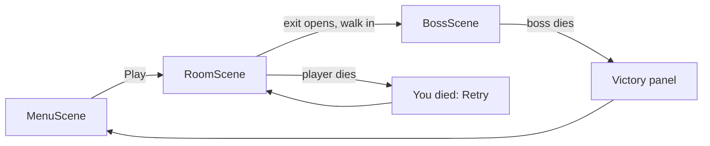

# Guide: Building a Top-Down Shooter

This guide builds a twin-stick dungeon shooter with **kit-topdown** (movement, aiming, weapons, AI) and **kit-common** (health, hits, triggers, spawners, pools, hit flash). It uses **kit-bullets** for the projectiles. The game is a room with three waves of enemies, pickups and a score; clearing the room opens an exit. The finished reference is `demos/demo-shooter` (`StageScene`, `RoomScene`). The boss fight is covered in [Guide: Bullet Hell](Guide-Bullet-Hell).



Reference pages: [kit-topdown](Kit-Topdown), [kit-common](Kit-Common), [kit-bullets](Kit-Bullets).

---

## 1. Project bootstrap
Copy `demos/demo-shooter` ([Creating a New Game Project](Creating-a-New-Game-Project)). Then the config and the components:
```java
public static EngineConfig config(boolean devMode, String version) {
    EngineConfig config = new EngineConfig();
    config.virtualWidth = 320;
    config.virtualHeight = 180;
    config.backgroundColor.set(0.05f, 0.04f, 0.07f, 1f);
    config.firstScene = MenuScene::new;
    config.inputBindings = "input";
    config.saveFolder = "my-shooter";            // the best score survives restarts
    config.components = new MyComponents();
    config.devMode = devMode;
    return config;
}

public final class MyComponents implements ComponentSetup {
    @Override
    public void register(ComponentRegistry registry) {
        CommonKit.register(registry);    // Health, Team, Hitbox, Hurtbox, Lifetime, TriggerZone, Spawner, HitFlash
        BulletsKit.register(registry);   // BulletTarget
        TopDownKit.register(registry);   // TopDownBody, Steering
        ShooterKit.register(registry);   // Aim, Weapon
        registry.register(CameraFollow.class, CameraFollow::new)
                .register(Enemy.class, Enemy::new)       // score value
                .register(Pickup.class, Pickup::new)     // score, heal
                .register(Exit.class, Exit::new);        // open flag
    }
}
```

## 2. Asset management
```text
gfx/characters.png guns.png player_bullets.png enemy_bullets.png enemies.png pickups.png splatter.png shooter.atlas
gfx/palette_red_slime.png                     a palette swap (section 9)
maps/dungeon.png dungeon.tsx room.tmx         one tileset, one map per stage
prefabs/player.json camera.json spawner.json enemy/*.json pickup/*.json fx/splat.json level/exit.json
bullets.json patterns/*.json weapons/smg.json
fx/hit.p dust.p dot.png                       particles
sfx/*.wav music/boss.wav fonts/...
```
The atlas only names regions of the sheets, so no packer is needed:
```text
enemies.png
size: 64,64
format: RGBA8888
filter: Nearest,Nearest
repeat: none
skeleton
  bounds: 16,0,16,16
slime
  bounds: 48,0,16,16
```
The demo's `assets-src/demo-shooter/make_assets.py` generates the atlas, the tileset, maps, prefabs, bullet types, patterns, the weapon, the bindings and the manifest. After that, edit the files by hand or in Tiled.

## 3. Audio and music
Sounds are wired to events in the stage:
```java
context.events().on(ShotEvents.Fired.class, e -> { if (e.entity == player) audio.playVaried("sfx.shoot", 0.1f); });
context.events().on(ShotEvents.ReloadStarted.class, e -> audio.play("sfx.reload"));
context.events().on(Damaged.class, e -> {
    if (e.target() == player) {
        audio.play("sfx.hurt");
        input.vibrate(60);
        context.renderer().camera().addTrauma(0.4f);
    } else {
        audio.playVaried("sfx.hit", 0.15f);
    }
});
```
Give rapid sounds `"maxInstances": 3` in the manifest.

## 4. Animations and effects
The shooter's sprites are single frames, so its "animation" is juice:
- **Hit flash:** `"HitFlash": {}` on every enemy prefab, and `world.addSystem(new HitFlashSystem(world, context.events()))`. Enemies flash white when hit.
- **Particles:** a hit burst and running dust ([Particles](Particles)):
  ```java
  particles = new Particles(context.assets(), ppu, "fx");
  sprites.addLayerContent(particles);
  // Damaged on an enemy: particles.spawn("fx.hit", t.position.x, t.position.y + 0.45f);
  // while moving, every 0.14 s: particles.spawn("fx.dust", feetX, feetY);
  ```
- **Camera shake:** `camera().addTrauma(0.4f)` on damage.
- **Pooled splatter:** `EntityPool.ofPrefab(world, prefabs, "fx/splat", 8)` with a `Lifetime` on the prefab. `splats.obtain(x, y)` on every kill.
- **The gun:** a separate entity on a `hand` layer that follows the player and rotates to the aim (`GunHolderSystem`).

For frame animation, add an `Animator` exactly as in the RPG guide ([Animation](Animation)).

## 5. Screen transitions
```java
// menu -> room
context.scenes().replace(new RoomScene(new Run()), Transition.fade(0.5f));
// room cleared and the player walks into the exit -> boss
context.scenes().replace(new BossScene(run), Transition.fade(0.8f));
// the room preloads the boss arena while the player fights
context.scenes().preload("boss");
```
`Run` carries the score, health and time from room to boss.

## 6. Scoring and state
```java
final class Run {
    static final String BEST_KEY = "best.score";
    int score;
    int health = -1;     // health when entering the next stage; -1 = full
    float seconds;
}
```
- **Kills:** on `Died`, add the `Enemy.score`, spawn splatter, and maybe drop a coin (32 %) or a heart (8 %).
- **Pickups:** `Pickup` entities with a `TriggerZone` (`once`). On `ZoneEntered` with the player, add score or heal, then `Despawn.despawn`.
- **Grazing** (kit-bullets): `Grazed` adds one point.
- **Best score:** kept in global save data and shown in the menu:
```java
SaveData global = context().saves().global();
if (victory && run.score > global.getInt(Run.BEST_KEY, 0)) {
    global.set(Run.BEST_KEY, run.score);
    context().saves().flush();
}
```

## 7. UI
**HUD** (top left; it updates every frame):
```java
hp.setText("HP " + Math.max(0, world.get(player, Health.class).current));
score.setText("Score " + run.score);
Weapon w = world.get(player, Weapon.class);
ammo.setText(w.reloading ? "Reloading..." : "Ammo " + Math.max(0, w.ammo));
```
- **Messages:** a centred title label ("Clear the crypt!", "The way is open!") that hides after 3 s.
- **Pause:** Resume and Main menu (with confirmation). Open it on `pause` or `menu`, push `ui`, and pause time.
- **End panels:** "Victory!" or "You died", with Play again or Retry, Main menu, the score and "New best!".
- **Main menu:** art, Play, "Bullet stress test", "Skip to boss (dev)" in dev builds, Quit (desktop only; Back exits on Android), the best score and the version.



## 8. Gameplay
### Controls
```json
"gameplay": {
  "actions": { "fire": ["MOUSE_LEFT", "SPACE"], "reload": ["R"], "pause": ["P"], "menu": ["ESCAPE", "BACK"] },
  "axes": { "move": { "left": ["A"], "right": ["D"], "up": ["W"], "down": ["S"] },
            "aim":  { "left": ["LEFT"], "right": ["RIGHT"], "up": ["UP"], "down": ["DOWN"] } } }
```
On phones: a floating left joystick for `move`, a right **aim stick** that also holds `fire` past half its radius, and R and pause buttons ([Input](Input)). Set `Aim.mouse` only on desktop:
```java
boolean touch = Gdx.app != null && Gdx.app.getType() == Application.ApplicationType.Android;
world.get(player, Aim.class).mouse = !touch;
```

### Prefabs
```json
{ "version": 1, "components": {
    "Sprite": { "regionId": "atlas.shooter/player", "origin": [8, 0], "z": 2 },
    "Collider": { "box": { "x": -0.35, "y": 0, "width": 0.7, "height": 0.6 }, "layer": 1 },
    "Actor": {}, "TopDownBody": { "maxSpeed": 6 }, "Aim": {},
    "Weapon": { "weapon": "weapon.smg", "fireAction": "fire", "reloadAction": "reload" },
    "Health": { "max": 5, "invulnerableSeconds": 1.0 }, "Team": { "id": 1 },
    "BulletTarget": { "radius": 0.18, "grazeRadius": 0.9, "offsetY": 0.45 }, "Hurtbox": {} } }
```
Actors are on **collision layer 1**, so wall bullets (wall mask = layer 0) don't treat them as walls. The enemy prefab is on [Prefabs and Data](Prefabs-and-Data).

### The stage scene
```java
@Override
protected void enter(EngineContext context) {
    world = world();  input = context.input();  audio = context.audio();
    context.renderer().setLayers(new RenderLayer("floor", SortMode.NONE), new RenderLayer("world", SortMode.Y_SORT),
            new RenderLayer("fx", SortMode.NONE), new RenderLayer("hand", SortMode.NONE),
            new RenderLayer("bullets", SortMode.NONE));
    float ppu = context.renderer().pixelsPerUnit();
    TileMap map = TileMap.load(context.assets(), "map.room", ppu);
    Rectangle bounds = map.bounds(new Rectangle());
    Collision collision = new Collision(world, context.events());
    collision.addTileGrid(map.collision(), 0);

    BulletTypes types = BulletTypes.parse(context.assets().get("bullets", JsonValue.class), context.assets().path("bullets"));
    BulletWorld bulletWorld = new BulletWorld(4096, types);
    HealthSystem health = new HealthSystem(world, context.events());
    BulletSystem bullets = new BulletSystem(world, bulletWorld, new BulletPatterns(context.assets(), types),
            context.events(), health, context.time());
    bullets.setWallMask(1, collision);

    new MapSpawner(context.prefabs()).spawn(world, map);
    player = world.findByName("player");
    world.tag(player, "player");                                   // trigger zones filter on this tag
    world.get(world.findByName("camera"), CameraFollow.class).bounds = bounds;

    PathPlanner paths = new PathPlanner(map.collision());
    world.addSystem(new AimSystem(world, input));
    world.addSystem(new SpawnerSystem(world, context.prefabs(), context.events()));
    world.addSystem(new LifetimeSystem(world));
    world.addSystem(new AiSystem(world, paths));
    world.addSystem(new TopDownSystem(world, collision, input, context.events()));
    world.addSystem(new WeaponSystem(world, bullets, new WeaponLibrary(context.assets(), types), context.events(), input));
    world.addSystem(health);
    world.addSystem(new HitSystem(world, health));
    world.addSystem(new HitFlashSystem(world, context.events()));
    world.addSystem(bullets);
    world.addSystem(new TriggerZoneSystem(world, context.events()));
    world.addSystem(new CollisionSystem(world, collision));
    world.addSystem(new CameraFollowSystem(world, context.renderer().camera(), context.time()));
    SpriteRenderSystem sprites = new SpriteRenderSystem(world, context.renderer(), context.assets(), context.time());
    world.addSystem(sprites);
    new TileMapRenderer(map, context.renderer(), context.time()).attachTo(sprites);
    sprites.addLayerContent(new BulletRenderer(bulletWorld, context.assets(), "bullets", ppu));
    world.addSystem(new CollisionDebugSystem(world, collision, context.debug(), context.renderer()));
    // events (sections 3, 6), HUD (section 7)
}
```

### Rules that need a line of code each
```java
// enemies spawned by spawners hunt the player (a prefab cannot name it):
for (int i = 0; i < hunters.entities().size; i++) {
    Steering s = world.get(hunters.entities().get(i), Steering.class);
    if (s.target == null) s.target = world.ref(player);
}
// contact damage: restart enemy hit boxes once a second
if ((contactWait -= delta) <= 0f) {
    contactWait = 1f;
    for (int i = 0; i < contact.entities().size; i++) world.get(contact.entities().get(i), Hitbox.class).restart();
}
// death of the player
context.events().on(Died.class, e -> { if (e.entity() == player) lost(); });
```

### Waves in Tiled
Spawners are objects with class `spawner` and property overrides:
```xml
<object id="4" name="wave1_a" type="spawner" x="56" y="80"><properties>
  <property name="Spawner.prefab" value="enemy/slime"/>
  <property name="Spawner.delay" type="float" value="1.0"/>
  <property name="Spawner.total" type="int" value="3"/>
  <property name="Spawner.interval" type="float" value="1.5"/>
  <property name="Spawner.maxAlive" type="int" value="3"/></properties><point/></object>
```
`RoomScene` opens the exit when every spawner has spawned its total and no `Enemy` is left:
```java
for (int i = 0; i < spawners.entities().size; i++) {
    Spawner s = world.get(spawners.entities().get(i), Spawner.class);
    if (s.total <= 0 || s.spawned < s.total) return;
}
world.get(exit, Exit.class).open = true;
```

### Enemy types
| Prefab | Behaviour |
| --- | --- |
| `enemy/slime` | `FOLLOW_PATH` chaser, contact damage |
| `enemy/flame` | a faster chaser with less health |
| `enemy/skeleton` | a chaser with a `Gunner` (your component) that fires `pattern.skeleton` at the player every 2.5 s within range |
| `enemy/slime_red` | the slime with a palette swap, 6 HP, more points |

## 9. Additional features
- **Palette-swapped variants:** `"paletteId": "tex.palette.red_slime"` on the sprite ([Sprite Materials](Sprite-Materials)).
- **Grid movement:** `TopDownBody.gridStep` for tile-by-tile games.
- **Scrolling stages:** `CameraScroll` instead of `CameraFollow` ([Rendering and Camera](Rendering-and-Camera)).
- **Bullet stress test:** a scene that spawns 3,000 bullets and logs timings. Copy it to profile your game.

## 10. The complete game
```text
ShooterDemo, ShooterComponents      config and registry
MenuScene                           title, play, stress test, dev skip, best score
StageScene (abstract)               map, kits, HUD, pause, end panels, events
  RoomScene                         three waves, exit
  BossScene                         the eye: three bullet patterns by health (Guide: Bullet Hell)
StressScene                         bullet benchmark
Run                                 score, health, time across stages
Enemy, Gunner, Pickup, Exit, Boss   components;  GunnerSystem, GunHolderSystem   systems
```

Ship it with [Building for Desktop](Building-for-Desktop) and [Building for Android](Building-for-Android).
