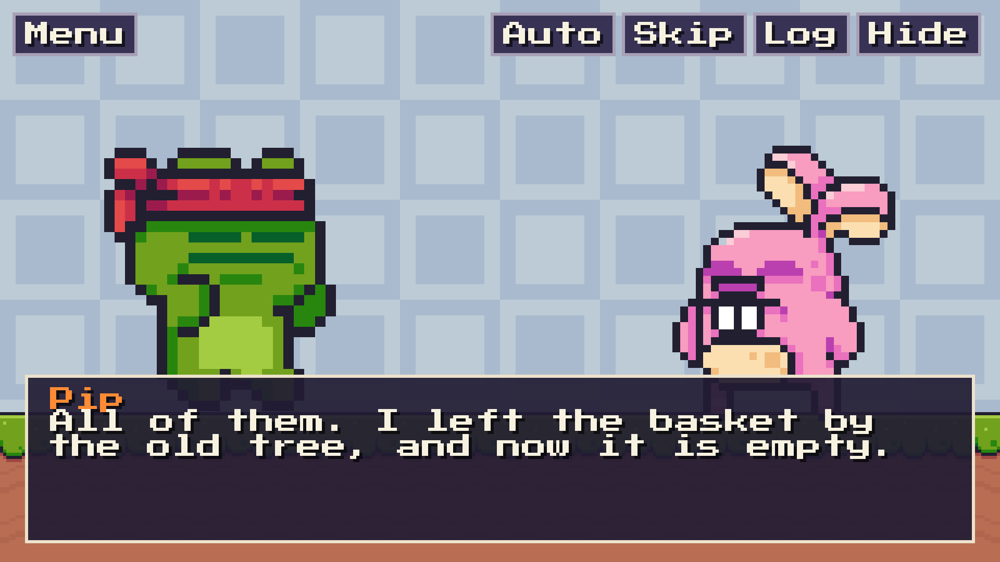
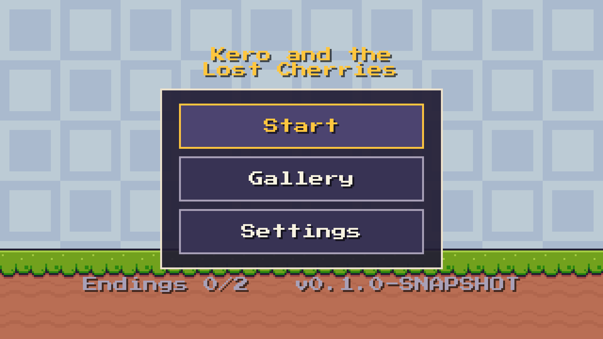
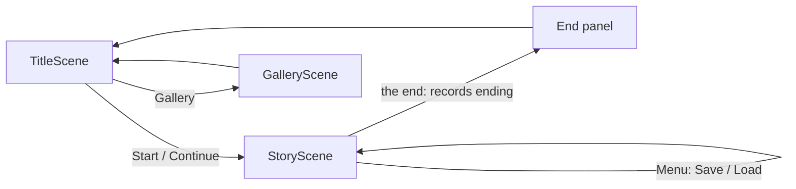

# Guide: Building a Visual Novel

This guide builds a complete visual novel with **kit-novel** on Ink: "Kero and the Lost Cherries". It has one chapter, two characters with three expressions each, and a choice that changes the ending. It also covers a title screen, save and load anywhere, a CG gallery, reader settings and endings tracking. The finished reference is `demos/demo-novel`.



Reference pages: [kit-novel](Kit-Novel), [kit-common](Kit-Common) (the dialogue runner), [UI](UI).

---

## 1. Project bootstrap
Generate the project from the novel demo: `./gradlew newGame -PgameName=my-novel -PgamePackage=com.example.novel -Ptemplate=novel` ([Creating a New Game Project](Creating-a-New-Game-Project)). The story's Ink source lands in `demos/my-novel/core/ink/`. The core module depends on `kit-novel`, which brings `kit-common`.
```java
public static EngineConfig config(boolean devMode, String version) {
    EngineConfig config = new EngineConfig();
    config.virtualWidth = 320;
    config.virtualHeight = 180;
    config.backgroundColor.set(0.08f, 0.06f, 0.1f, 1f);
    config.firstScene = TitleScene::new;
    config.inputBindings = "input";
    config.saveFolder = "my-novel";
    config.components = new NovelComponents();   // kit-novel has no components; an empty setup still feeds the R8 keep rules
    config.devMode = devMode;
    return config;
}
```

## 2. Asset management
```text
gfx/novel.atlas + character sheets     expressions are atlas regions
bg/meadow.png dusk.png night.png       backgrounds (320 x 180 textures)
cg/sunset.png                          the unlockable picture
cast.json  input.json  manifest.json
ink/chapter1.ink.json                  compiled (source: assets-src/demo-novel/ink/chapter1.ink)
sfx/*.wav  music/meadow.wav sunset.wav  fonts/...
```
```json
{ "id": "bg.meadow", "path": "bg/meadow.png", "type": "texture", "group": "global" },
{ "id": "cg.sunset", "path": "cg/sunset.png", "type": "texture", "group": "global" },
{ "id": "cast", "path": "cast.json", "type": "json", "group": "global" },
{ "id": "ink.chapter1", "path": "ink/chapter1.ink.json", "type": "json", "group": "global" }
```
- Backgrounds and CGs are **texture IDs** used directly in tags (`# bg: bg.meadow`).
- Character expressions are regions in an atlas that names frames of the character sheets:
```text
frog_hit.png
size: 224,32
format: RGBA8888
filter: Nearest,Nearest
repeat: none
kero_surprised
  bounds: 64,0,32,32
```
- **Compiling the story:** `./gradlew :demos:demo-novel:core:compileInk` with `ember.inklecate` set ([Guide: RPG](Guide-RPG), section 2).
- The demo's `assets-src/demo-novel/make_assets.py` composes its backgrounds and CG from tiles and character frames with a small pure-Python PNG module. That is useful when you have no illustrator yet.

## 3. Audio and music
All audio comes from story tags:
```ink
# music: music.meadow fade=1.5
# sfx: sfx.pop
# stopmusic fade=2
# voice: kero_001              (plays "kero_001", or "voice.kero_001" if that ID exists)
```
The view plays them through `context.audio()`. Volumes are the engine's settings.

## 4. Animations: staging
Staging tags are the novel's animation system:
```ink
# bg: bg.meadow [transition=fade 1.0]
# show: kero left
Kero: What a fine day for a walk!
# show: pip surprised right transition=slide
Pip: Kero! Kero! My cherries are gone!
# expr: kero surprised
Kero: Gone? The ones you picked for the festival?
# flash: white 0.2
# shake: 0.3
# cg: cg.sunset
# hidecg
# wait: 0.5
```
- **Transitions:** `fade`, `slide` (characters enter from their side) and `cut`.
- **Effects:** `shake` and `flash`. Every tag is listed on [kit-novel](Kit-Novel).
- **Character size:** set it with `view.setCharacterArea(bottom, height)`. The demo uses (0.25, 0.6), so its pixel-art characters stand on the dialogue box.

## 5. Screen transitions
```java
context.scenes().replace(new StoryScene(null), Transition.fade(0.6f));     // Start
context.scenes().replace(new StoryScene(savedData), Transition.fade(0.6f)); // Continue / Load
context.scenes().replace(new GalleryScene(), Transition.fade(0.3f));
context.scenes().replace(new TitleScene(), Transition.fade(0.6f));          // the end
```
Inside the story, scene changes are `# bg:` tags with fades. No engine scene change is needed.

## 6. Progress: endings, read text, CGs
- **Endings** are plain game tags on the last line of each branch (`The End. Friends at sunset. #ending_together`). Don't use a colon in game tags; `name:value` tags count as staging commands. Read them through the view:
```java
view.setOnLine(line -> {
    for (String tag : line.tags()) {
        if (tag.startsWith("ending_")) ending = tag.substring("ending_".length());
    }
});
// on finish:
context.saves().global().set("novel.ending." + ending, true);
context.saves().flush();
```
- **Read lines and CGs:** `NovelMemory(saves.global())`. The director marks lines read and CGs unlocked. Flush the saves when the chapter ends or the scene exits.
- **The title** shows "Endings n/2".

## 7. UI
**Title screen:** a background image behind a menu:
```java
Image background = new Image(context.assets().region("bg.meadow"));
background.setScaling(Scaling.fill);
background.setFillParent(true);
ui.stage().getRoot().addActorAt(0, background);
MenuList menu = new MenuList(ui);
if (Chapter.hasSave(context.saves())) menu.add("Continue", () -> start(Chapter.loadSave(context.saves())));
menu.add("Start", () -> start(null));
menu.add("Gallery", () -> context.scenes().replace(new GalleryScene(), Transition.fade(0.3f)));
menu.add("Settings", () -> showSettings(context));
```


**Settings** (saved under `novel.*`):
```java
NovelSettings settings = new NovelSettings().load(context.saves().settings());
menu.addValue("Text speed", () -> (int) settings.textSpeed, v -> settings.textSpeed = v, 0, 100, 10);
menu.addValue("Auto wait", () -> Math.round(settings.autoDelay), v -> settings.autoDelay = v, 1, 5, 1);
TextButton[] skip = new TextButton[1];
skip[0] = menu.add(label(settings), () -> { settings.skipUnread = !settings.skipUnread; skip[0].setText(label(settings)); });
// Back: settings.save(context.saves().settings()); context.saves().flush();
```

**The reader:** `NovelView` provides the dialogue box, the name plates, choices, Auto, Skip, Log (backlog with voice replay) and Hide. Add a **Menu** button for touch screens, and open the same menu on Escape or Back:
```java
if (!justClosed && input.justPressed("ui_back") && ui().activeMenu() == null) openPause();
```
The `activeMenu() == null` check keeps Back from opening the menu while choices are on screen. `justClosed` keeps the Back press that closed the menu from opening it again in the same frame.

**Gallery:** a thumbnail for each unlocked CG (`NovelMemory.isUnlocked`) and "?" for locked ones. Tap a thumbnail to view it full screen.

## 8. Gameplay: the story scene
```java
@Override
protected void enter(EngineContext context) {
    input = context.input();
    input.pushContext("ui");                      // the reader uses ui_confirm, ui_back, ui_nav
    NovelUi.useSkin(ui(), context.assets());
    view = new NovelView(ui(), context.assets(), context.audio(), input, context.renderer().camera(),
            new NovelSettings().load(context.saves().settings()));
    view.setCharacterArea(0.25f, 0.6f);
    view.setOnLine(this::line);
    director = new NovelDirector(DialogueRunner.fromAsset(context.assets(), "ink.chapter1"),
            NovelCharacters.parse(context.assets().get("cast", JsonValue.class), context.assets().path("cast")),
            view, new NovelMemory(context.saves().global()), context.config().devMode);
    if (saved != null) director.load(saved);      // redraws the stage, resumes the saved line
    view.play(director, this::finished);
    // + a Menu button (section 7)
}

@Override
protected void update(float delta) {
    if (!paused && !ended) view.update(delta);
}

private void save() {                             // from the menu: Save
    SaveData data = new SaveData();
    director.save(data);                          // story, stage, current line, backlog
    context().saves().save(0, new SlotMeta("story", seconds, "Chapter 1"), data);
}
```
**The choice that changes the ending:**
```ink
Pip: Will you help me look for them?
* [Of course I will help.]
    # expr: kero happy
    Kero: Of course! Two pairs of eyes are better than one.
    -> search
* [Sorry, I am busy today.]
    Kero: I am sorry, Pip. I promised to help my uncle today.
    -> alone

=== search ===
# bg: bg.dusk [transition=fade 1.0]
...
# cg: cg.sunset
# music: music.sunset fade=2
Together they carry the basket home as the sun goes down.
# hidecg
The End. Friends at sunset. #ending_together
-> END

=== alone ===
# hide: pip transition=fade
# bg: bg.night [transition=fade 1.5]
# stopmusic fade=2
...
The End. A quiet evening. #ending_alone
-> END
```

## 9. Additional features
- **Save anywhere:** after a load, even after the app was killed, the background, characters, expressions, music, the line on screen and the backlog come back exactly. This was checked on the emulator.
- **Skip:** passes text read in any earlier play-through and stops at the first unread line.
- **Backlog:** the last 100 lines, restored after loading.
- **Voice:** `# voice:` tags; the Log offers a replay button for lines with voice.
- **Embedding:** the same view runs cutscenes in other genres ([Guide: RPG](Guide-RPG), section 9).
- **Your own presentation:** implement `StageListener` and drive `NovelDirector.next()` yourself.

## 10. The complete game
```text
NovelDemo, NovelComponents   config, empty component setup
TitleScene                   Continue / Start / Gallery / Settings / Quit, endings seen
StoryScene                   NovelView + NovelDirector, Menu (Resume, Save, Load, Title), end panel
GalleryScene                 unlocked CGs
Chapter                      story, cast, memory, save slot, endings
ink/chapter1.ink             the story
```

Test both endings headlessly, as `ChapterTest` does. It reads each branch with `NovelDirector` in dev mode (a bad tag throws), checks the final stage, and checks that only the happy ending unlocks the CG:
```java
NovelDirector together = director();
List<String> lines = read(together, 0, tags);
assertThat(lines).last().isEqualTo(": The End. Friends at sunset.");
assertThat(memory.unlockedCgs()).containsExactly("cg.sunset");
```
Checked on an Android 6 emulator in debug and release (R8) builds.
