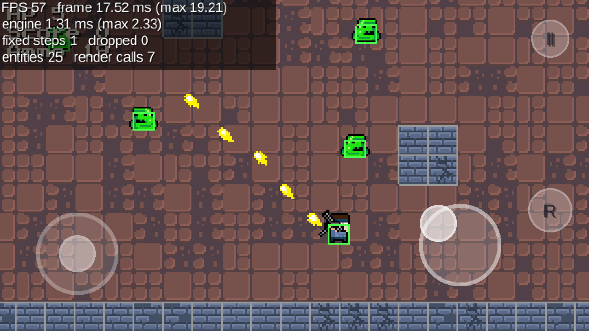

# Ember2D Developer Handbook

Ember2D is a 2D game framework built on [libGDX](https://libgdx.com) (Java). It targets **desktop** (Windows, Linux, macOS) and **Android** (API 23, Android 6.0, and newer) from one code base. The engine is small and data-driven. Genre **kits** add ready-made gameplay for platformers, top-down shooters, bullet hells, RPGs and visual novels.

This wiki is the developer handbook. It has four parts:
- **Architecture:** how the engine is put together and why.
- **Engine reference:** every subsystem, its API and how to use it.
- **Kits and game guides:** what each kit offers, and a complete game built with it step by step.
- **Building and shipping:** desktop zips and Android APK and AAB files.

> **Source of truth.** The specifications in `documents/specs/` and the architecture documents in `documents/` define the contracts. This wiki explains them for game developers and is written from the code. Where something has not been checked on a real device or platform, the page says so.

## Start here
| If you want to… | Read |
| --- | --- |
| Build the engine and run a demo in 10 minutes | [Getting Started](Getting-Started) |
| Understand how Ember2D is organised | [Architecture Overview](Architecture-Overview), [Design Principles](Design-Principles) |
| Start your own game | [Creating a New Game Project](Creating-a-New-Game-Project) |
| Make prefabs, enemies, manifests, clips, cameras and effects without an editor | [Working Without an Editor](Working-Without-an-Editor) |
| Learn one subsystem | the **Engine reference** in the sidebar |
| Build a complete game in a genre | the **Game guides** in the sidebar |
| Ship it | [Building for Desktop](Building-for-Desktop), [Building for Android](Building-for-Android) |
| Fix a problem | [Troubleshooting](Troubleshooting) |

## What is in the box
| Module | What it gives you |
| --- | --- |
| `ember-core` | The engine: app lifecycle, game loop, ECS, events, assets, input, rendering, camera, animation, collision, Tiled maps, prefabs, audio, UI, saves, localisation, particles, materials, debug overlay |
| `ember-desktop` | The LWJGL3 desktop launcher helpers, logging, crash logs, Construo packaging |
| `ember-android` | The Android launcher base class and platform wiring |
| `ember-devtools` | Hot reload and Dear ImGui dev tools (desktop dev builds only) |
| `kit-common` | Health, damage, hit and hurt boxes, triggers, spawners, pools, hit flash, the Ink dialogue runner |
| `kit-platformer` | Platformer movement (coyote time, buffering, wall jump, dash, ladders), patrollers, moving platforms |
| `kit-topdown` | Top-down movement, aiming and weapons, steering and A* paths, RPG interaction and inventories |
| `kit-bullets` | Thousands of bullets, JSON patterns, grazing, bullet clearing |
| `kit-novel` | Visual novels on Ink: staging tags, reader features, save anywhere, gallery |

Four demos show the kits in real games:

| Demo | Kits | What it is |
| --- | --- | --- |
| `demos/demo-platformer` | platformer, common | Three levels, menus, saves, settings, touch controls |
| `demos/demo-shooter` | top-down, bullets, common | A twin-stick dungeon room and a three-phase bullet-hell boss |
| `demos/demo-rpg` | top-down (rpg), novel, common | A town and a cellar, an Ink conversation, a locked door, a chest, a cutscene |
| `demos/demo-novel` | novel, common | "Kero and the Lost Cherries": one chapter with two endings |

## Conventions in this wiki
- Package names are written short: `ember.render` means `dev.ember2d.render`, and `kit.topdown.rpg` means `dev.ember2d.kit.topdown.rpg`.
- Commands are shown for a POSIX shell (`./gradlew`). On Windows use `.\gradlew.bat` with the same arguments.
- "World units" are the engine's game units. With the default 16 pixels per unit, one 16-pixel tile is one unit.
- `ctx` or `context` is the `EngineContext`.
