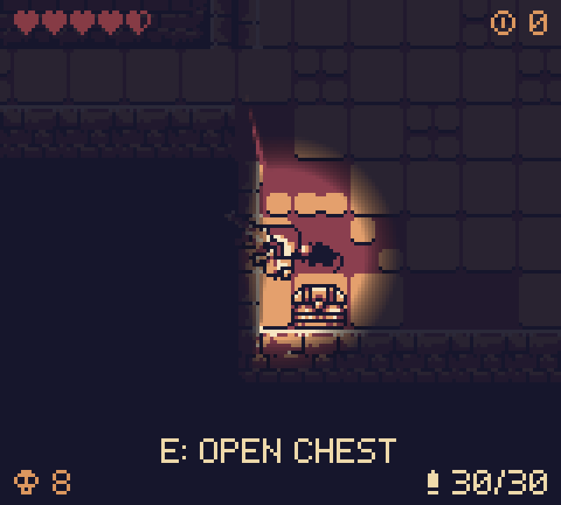

# kit-topdown

Module `kits/kit-topdown`. Specs F-016, F-017, F-030. It provides top-down movement plus four packages:

| Package | Use | Register with |
| --- | --- | --- |
| `kit.topdown` | `TopDownBody`, `TopDownSystem`, `StepFinished` | `TopDownKit.register` (also registers `Steering`) |
| `kit.topdown.shooter` | `Aim`, `AimSystem`, `Weapon`, `WeaponDef`, `WeaponLibrary`, `WeaponSystem`, `ShotEvents` | `ShooterKit.register` |
| `kit.topdown.ai` | `Steering`, `AiSystem`, `PathPlanner`, `TileGraph` | (with `TopDownKit`) |
| `kit.topdown.rpg` | `Interactable`, `Interactor`, `InteractionSystem`, `Interacted`, `InteractionFocus`, `Inventory`, `ItemCatalog`, `ItemPickup`, `ItemPickupSystem`, `ItemPickedUp` | `RpgKit.register` |
| `kit.topdown.vision` | `Viewer`, `HiddenInFog`, `VisionSettings`, `VisionField`, `VisionSystem`, `FogLayer`, `CameIntoView`, `WentOutOfView` | `VisionKit.register` |

## 1. Movement
```json
"TopDownBody": { "maxSpeed": 6 }
```
`TopDownSystem(world, collision, input, events)` (`FIXED`):
- reads the `move` 2D axis; diagonals are no faster than straight lines;
- accelerates (`acceleration` 60) and slows down (`friction` 50); slides along walls and solids;
- flips the `Sprite` (`flipSprite`) and keeps `facingX`/`facingY` (for aiming and interaction);
- applies knockback from kit-common's `Damaged` (`knockbackScale`, `knockbackDecay`);
- grid mode: `gridStep` moves exactly one tile per step at `stepsPerSecond` and publishes `StepFinished`;
- `locked` ignores input (dialogue, cutscenes); `moving` tells whether it moves;
- `useInput = false` with `moveX`/`moveY` drives it from code. The AI does this.

## 2. Aiming and weapons (`shooter`)
### Weapons
A weapon is a JSON asset (`"type": "json"`):
```json
{ "version": 1, "fireRate": 10, "auto": true, "magazine": 24, "reload": 1.0, "muzzle": 0.6,
  "emit": { "type": "random", "bullet": "player", "spread": 6, "speed": 14 } }
```
```json
"Weapon": { "weapon": "weapon.smg", "fireAction": "fire", "reloadAction": "reload" }
```
```java
world.addSystem(new WeaponSystem(world, bullets, new WeaponLibrary(context.assets(), types), context.events(), input));
```
- `emit` is a kit-bullets emitter; its angle is replaced by the aim angle.
- `WeaponSystem` (`FIXED`) handles cooldown, ammo and reloads; an empty magazine reloads by itself.
- Enemies: leave `fireAction` empty and set `weapon.trigger` from code.
- Events: `ShotEvents.Fired`, `ReloadStarted` and `Reloaded` are **reused objects**, so read them inside the handler.

### Aiming
`Aim` + `AimSystem(world, input)` (`UPDATE`): aims along the `aim` axis when held (the touch aim stick or keys). Otherwise it aims at the mouse when `mouse` is true, or keeps its last aim. Set `mouse` only on desktop, so a touch never becomes an aim.

## 3. AI (`ai`)
```json
"Steering": { "mode": "FOLLOW_PATH", "sight": 30 }
```
```java
PathPlanner paths = new PathPlanner(map.collision());   // A* (gdx-ai) over free tiles
world.addSystem(new AiSystem(world, paths));            // FIXED, before TopDownSystem
world.addSystem(new TopDownSystem(world, collision, input, events));
```
| `Steering` field | Default | Meaning |
| --- | --- | --- |
| `mode` | `FOLLOW_PATH` | `NONE`, `SEEK`, `FLEE`, `ARRIVE`, `FOLLOW_PATH` |
| `target` or `targetX`/`targetY` | — | an entity, or a point |
| `arriveRadius`, `slowRadius` | 0.3, 2 | `ARRIVE` stops and slows |
| `fleeRadius` | 0 | `FLEE` distance |
| `sight` | 0 | how far it notices the target |
| `repathSeconds` | 0.5 | how often paths are planned again |
| `pathFound`, `waypoint`, `repathLeft` | runtime | |

- AI bodies move through the same `TopDownSystem` as the player.
- A prefab can't name the player, so the shooter gives every `Steering` without a target the player each frame.
- `paths.find(fromX, fromY, toX, toY, waypoints)` gives paths for your own use; `paths.walkable(x, y)`.

## 4. RPG (`rpg`)
### Interaction
```json
"Interactable": { "prompt": "Talk", "action": "elder", "range": 1.5 }
"Interactor": {}
```
`InteractionSystem(world, input, events)` (`UPDATE`):
- **Target:** the nearest enabled interactable within `range` and inside a `cone` (120°) around the facing. Anything closer than 0.3 counts from every direction. Score = distance × (1 + angle / 180).
- **Prompt:** `InteractionFocus(interactor, target, prompt)` when the target changes.
- **Using it:** pressing `inputAction` (`interact`) publishes `Interacted(interactor, target, action)`. `interaction.interact(player)` does the same from code.
- **Locked bodies:** have no target.

### Items and inventory
```json
{ "version": 1, "items": {
    "key.cellar": { "name": "Cellar key", "icon": "atlas.rpg/key", "tags": ["key"] },
    "tonic": { "name": "Tonic", "icon": "atlas.rpg/tonic", "stack": 9, "tags": ["consumable"] } } }
```
```java
ItemCatalog items = ItemCatalog.parse(assets.get("items", JsonValue.class), assets.path("items"));
Inventory inv = new Inventory();                     // or a component from a prefab
int added = inv.add(items, "tonic", 2);             // fills stacks, then free slots (capacity 12)
boolean taken = inv.remove("tonic", 1);             // all or nothing
inv.count("tonic"); inv.has("key.cellar", 1); inv.hasTag(items, "key");
for (int i = 0; i < inv.size(); i++) { inv.item(i); inv.count(i); }
inv.save(data);  inv.load(data, items);             // unknown items skipped, stacks clamped
```
**Pickups:** `ItemPickup` (`item`, `count`) on a `TriggerZone` entity. `ItemPickupSystem(world, items, events)` adds the items to the entering entity's `Inventory`, publishes `ItemPickedUp`, and despawns the pickup (or leaves the rest).

## 5. Field of view and fog (`vision`)
What a top-down hero can see: a circle of full sight around them plus a longer cone where they aim, both stopped by walls. A soft, pixelated fog covers the rest, and enemies, pick-ups and their shots are hidden while they stand in the dark. This is F-030, built for [Gold in Shadows](Guide-Gold-in-Shadows).



```java
VisionKit.register(registry);                                   // Viewer, HiddenInFog

VisionSettings settings = new VisionSettings();                 // defaults: Gold in Shadows' values at 16 px/unit
VisionField field = new VisionField(collision, 1 << SIGHT_LAYER, settings);
world.addSystem(new VisionSystem(world, field, events));       // LATE, after movement and aiming
FogLayer fog = new FogLayer(field, renderer.camera(), "fog");   // a render layer above the world
sprites.addLayerContent(fog);                                   // dispose it in the scene's exit()
```
`Viewer` goes on the player; it looks along the player's `Aim`, or along its `angle` without one. `HiddenInFog` goes on enemies and pick-ups; the thing counts as seen when any part of the circle (`radius`, raised by `centerY`) is in view.
```json
"Viewer": { "eyeY": 0 }
"HiddenInFog": { "radius": 0.4, "centerY": 0.5 }
```

**Settings** (`VisionSettings`, world units and degrees):

| Field | Default | Meaning |
|---|---|---|
| `nearRadius` | 34/16 | full sight all around |
| `coneRange`, `coneHalfAngle` | 120/16, 38° | the aim cone |
| `coneSoftness` | 14° | the cone's sides fade over this angle |
| `edgeSoftness` | 10/16 | the fog fades in over this distance at the edge of sight |
| `wallPeek` | 6/16 | how far the light reaches into the wall it hits, so wall faces are lit |
| `darkness`, `fogColor` | 0.9, the dark palette colour | the fog |
| `rayCount` | 240 | rays cast per frame |

**How it works:**
- `VisionField.update(x, y, aimDegrees)` casts `rayCount` rays through `Collision` against the colliders and solid tiles on the sight mask. **Low props** (crates, tables) that block movement but not sight go on another collision layer.
- `FogLayer` is plain geometry drawn in the world pass, so it needs no frame buffer. In the pixel-perfect render modes it comes out pixelated, like the art.
- `VisionSystem` sets `Sprite.visible` on `HiddenInFog` entities and queues `CameIntoView(entity)` and `WentOutOfView(entity)` when that changes. A creature can growl when it is first seen, for example.
- **Your own checks:** `field.isVisible(x, y)` / `isVisible(x, y, radius)` answer "can the hero see this?", and `field.visibility(x, y)` gives 0 to 1 at the soft edge. kit-bullets uses this: `bulletRenderer.setVisibility(field::isVisible)` hides shots of bullet types marked `"fogged": true`.
- `field.enabled = false` or `fog.enabled = false` turns it off, for a lit room or a debug key.

The complete RPG is in [Guide: RPG](Guide-RPG); the shooter in [Guide: Top-Down Shooter](Guide-Top-Down-Shooter); field of view, fog, creatures and a whole campaign in [Guide: Gold in Shadows](Guide-Gold-in-Shadows).
