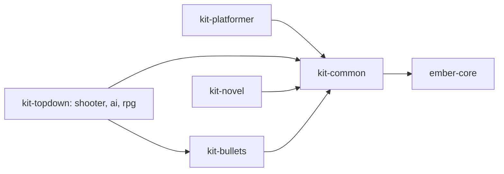

# Kits Overview

Kits are optional modules with gameplay for a genre. The engine never contains genre logic; the kits do.

| Kit | Kind | Packages | Main pieces | Reference | Guide |
| --- | --- | --- | --- | --- | --- |
| kit-common | shared | `kit.common` | `Health`, `Team`, `Hitbox`/`Hurtbox`, `TriggerZone`, `Spawner`, `Lifetime`, `EntityPool`, `Despawn`, `HitFlash`, `DialogueRunner` | [kit-common](Kit-Common) | used by every guide; see [Top-Down Shooter](Guide-Top-Down-Shooter) |
| kit-bullets | shared | `kit.bullets` | `BulletWorld`, `BulletTypes`, `BulletPatterns`, `BulletSystem`, `BulletRenderer`, `BulletTarget` | [kit-bullets](Kit-Bullets) | [Bullet Hell](Guide-Bullet-Hell) |
| kit-platformer | genre | `kit.platformer` | `PlatformerBody`, `Patroller`, `MovingPlatform`, `Ladder` and their systems | [kit-platformer](Kit-Platformer) | [Platformer](Guide-Platformer) |
| kit-topdown | genre | `kit.topdown`, `.shooter`, `.ai`, `.rpg` | `TopDownBody`; `Aim`, `Weapon`; `Steering`, `PathPlanner`; `Interactable`, `Inventory`, `ItemCatalog` | [kit-topdown](Kit-Topdown) | [Top-Down Shooter](Guide-Top-Down-Shooter), [RPG](Guide-RPG) |
| kit-novel | genre | `kit.novel` | `NovelDirector`, `NovelView`, `NovelCharacters`, `NovelMemory`, `NovelSettings` | [kit-novel](Kit-Novel) | [Visual Novel](Guide-Visual-Novel) |

## Rules
- **Dependencies:** shared kits depend only on `ember-core`; `kit-bullets` may also use `kit-common`. Genre kits may use the shared kits but **never each other**. A game's `core` module can use any combination.
- **Registration:** each kit registers its components with one call in your `ComponentSetup`: `CommonKit.register`, `BulletsKit.register`, `PlatformerKit.register`, `TopDownKit.register`, `ShooterKit.register`, `RpgKit.register`. kit-novel has no components.
- **Systems:** kits provide systems, but **you** add them to your scene's world, in the order shown on each page.
- **Input names:** kits read fixed names (`move`, `jump`, `dash`, `aim`, `interact`, `ui_confirm`, …), which your bindings file must declare.
- **Communication:** kits talk through events (`Damaged`, `Jumped`, `Interacted`, `BulletHit`, …). Your scene turns them into sound, effects and rules.

## Choosing kits
| Game | Kits |
| --- | --- |
| Side-scrolling platformer | kit-platformer (+ kit-common for health and hazards) |
| Twin-stick shooter, arena game | kit-topdown (`shooter`, `ai`) + kit-common + kit-bullets |
| Shoot-'em-up, bullet hell | kit-bullets + kit-common (+ kit-topdown for movement, `CameraScroll` from the engine) |
| Top-down RPG, adventure | kit-topdown (`rpg`) + kit-common (`DialogueRunner`) (+ kit-novel for cutscenes) |
| Visual novel, story game | kit-novel + kit-common |
| Platformer with dialogue | kit-platformer + kit-common's `DialogueRunner` (+ kit-novel for cutscenes) |
