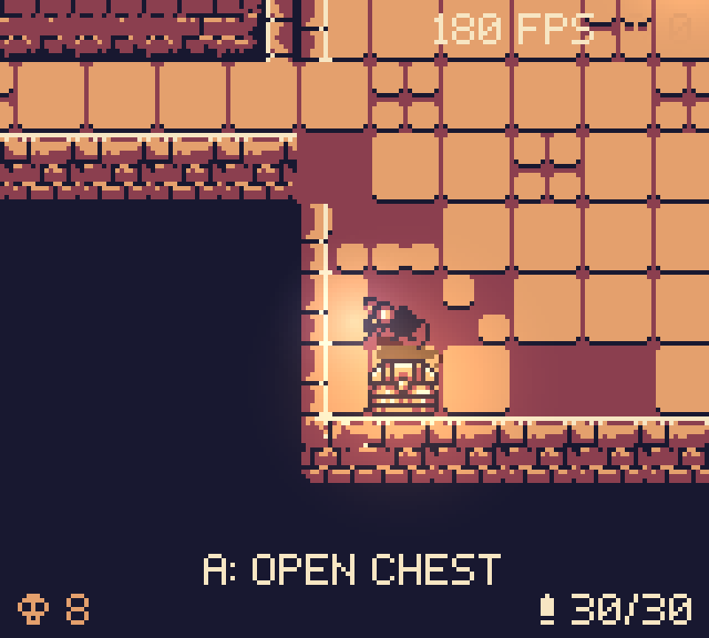
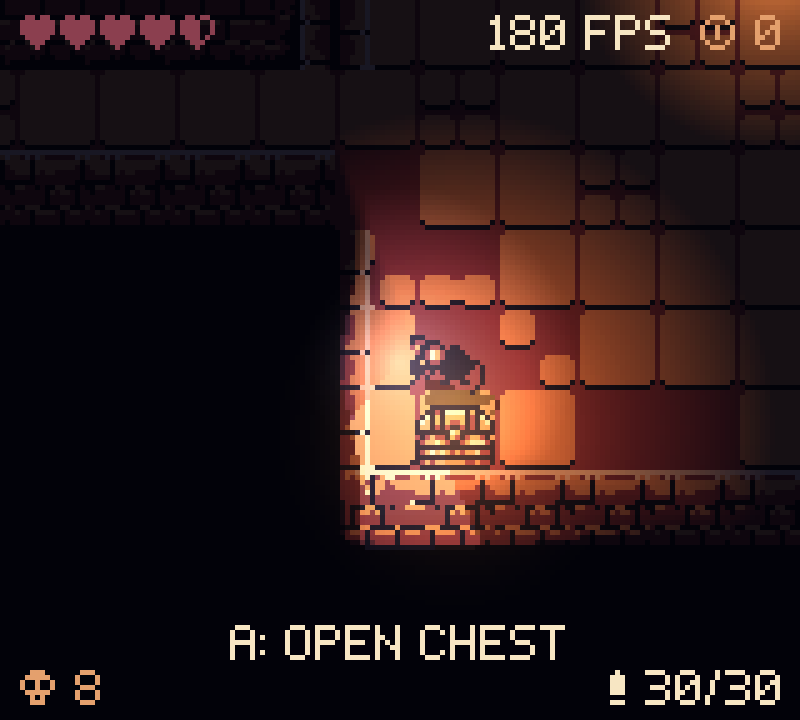
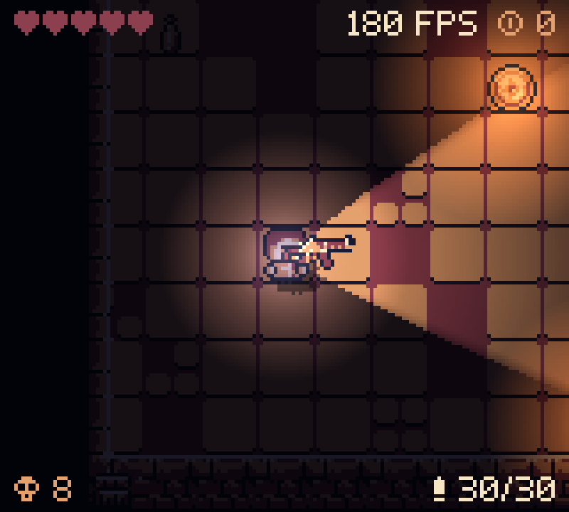
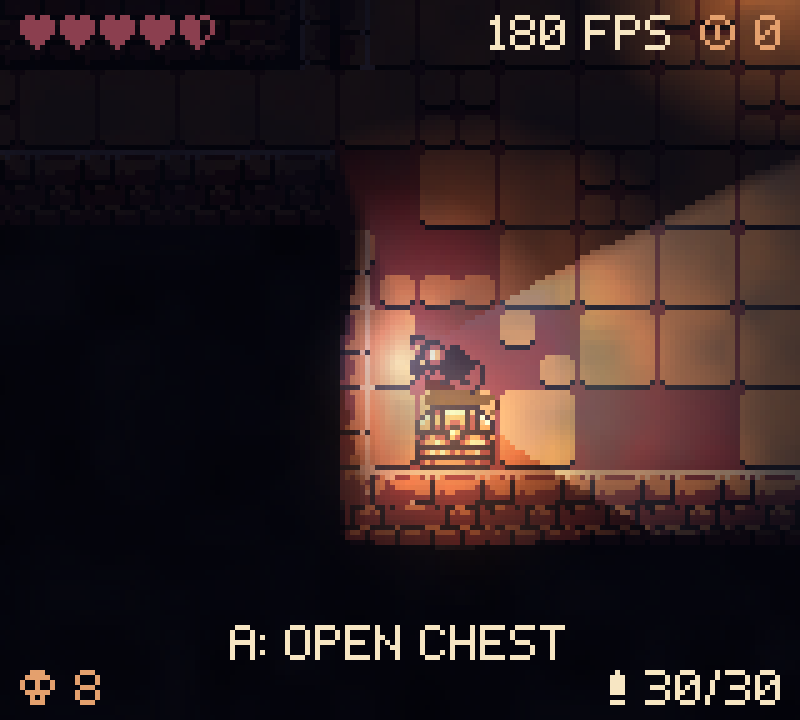

# Lighting and Atmosphere

> **Ember2D has no lighting module yet.** There are no built-in `PointLight` or `DirectionalLight` classes. This page
> shows how to build lighting, shadows, fog, mist, glow and bloom **in your own game** from what the engine already
> has:
> - kit-topdown's `VisionField`, which gives the shape of a light and its shadows;
> - render layers and `LayerContent`;
> - an extra libGDX `FrameBuffer`.
>
> Every class below was compiled and run in Gold in Shadows while this page was written (desktop, libGDX 1.14.2).
> Copy them into your game's package. On Android, it was not run.

| Unlit | Lit: ambient, a flashlight, point lights, shadows and glow |
|---|---|
|  |  |

Contents:
1. [How it fits together](#1-how-it-fits-together)
2. [Universal (ambient) light](#2-universal-ambient-light)
3. [Point lights and spotlights](#3-point-lights-and-spotlights)
4. [Light occluders and shadows](#4-light-occluders-and-shadows)
5. [Directional light](#5-directional-light)
6. [Fog and mist](#6-fog-and-mist)
7. [Glow and bloom](#7-glow-and-bloom)
8. [Putting it in a scene](#8-putting-it-in-a-scene)
9. [Performance, Android and limits](#9-performance-android-and-limits)
10. [The code](#10-the-code)

---

## 1. How it fits together
The engine draws each frame in phases: `INPUT`, `FIXED`, `UPDATE`, `LATE`, then `RENDER`. In the pixel-perfect
modes, `RENDER` draws the world into a frame buffer at the virtual resolution, layer by layer, then scales it to the
window. The UI is drawn after that, so **it is never lit**.

Lighting uses that order:

| Step | When | What |
|---|---|---|
| Build the lightmap | `LATE` (`LightSystem`) | A frame buffer the size of the view, cleared to the **ambient** colour. Each light is added to it as a soft shape, cut by the walls. |
| Draw the world | `RENDER` | As usual: tiles, sprites, bullets. |
| Light the world | `RENDER`, a render layer above the lit ones (`LightSystem` is also `LayerContent`) | The lightmap is **multiplied** over the world: `glBlendFunc(GL_DST_COLOR, GL_ZERO)`. |
| Glow | `RENDER`, after the lightmap | Additive halos and bloom, so glowing things are not darkened. |

**Why the lightmap is drawn in `LATE`:** during `RENDER` the engine has its own frame buffer bound, and libGDX
frame buffers do not nest. `FrameBuffer.end()` always goes back to the screen, so binding another frame buffer there
would break the world pass. In `LATE` nothing is bound yet.

**Layer order** decides what is lit. Everything drawn before the lightmap is lit; everything after it is not. Gold in
Shadows' layers are `floor`, `world`, `bullets`, `hand`, `overhead` and `fog`; the lightmap goes on the last one:
```java
context.renderer().setLayers(new RenderLayer("floor", SortMode.NONE), new RenderLayer("world", SortMode.Y_SORT),
        new RenderLayer("overhead", SortMode.NONE),
        new RenderLayer("light", SortMode.NONE));   // lightmap, then glow and bloom
```

## 2. Universal (ambient) light
The ambient colour is what a place with no light looks like. The lightmap is cleared to it every frame.
```java
lights.ambient.set(0.10f, 0.10f, 0.18f, 1f);   // night in a dungeon: dark blue
lights.ambient.set(0.55f, 0.50f, 0.60f, 1f);   // dusk
lights.ambient.set(1f, 1f, 1f, 1f);            // daylight: lighting has no effect
lights.enabled = false;                        // skip the lightmap entirely (no cost)
```
**Day and night, or entering a cave:** lerp the colour in your scene's `update`:
```java
lights.ambient.lerp(underground ? CAVE : DAY, Math.min(1f, delta * 2f));   // about half a second
```

## 3. Point lights and spotlights
A `Light` is a component, so a torch, a lamp or a glowing pick-up is an entity with a `Transform` and a `Light`:
```java
Light torch = world.add(entity, new Light());
torch.color.set(1f, 0.7f, 0.35f, 1f);   // warm
torch.radius = 3f;                       // world units
torch.intensity = 0.9f;
torch.offsetY = 0.5f;                    // the flame, above the entity's feet
```
To put lights on prefabs, register the component (`registry.register(Light.class, Light::new)`), then:
```json
"Light": { "radius": 3, "intensity": 0.9, "offsetY": 0.5 }
```
**Spotlight (flashlight):** set `spotDegrees`, the half angle of the cone, and turn it each frame:
```java
Light flashlight = world.add(beam, new Light());
flashlight.radius = 7f;
flashlight.spotDegrees = 28f;
flashlight.aimDegrees = world.get(player, Aim.class).angle;   // in update()
```


**Falloff:** each light is a fan of triangles from its centre. The centre gets the full colour and the edge gets
`(1 - d / radius)^2`; the GPU blends between them. Change `edge()` in `LightSystem` for a different curve.

**Flicker:** change `intensity` or `radius` every frame, for example
`torch.intensity = 0.8f + 0.1f * MathUtils.sin(time * 13f) + MathUtils.random(-0.05f, 0.05f)`.
Changing `radius` or `spotDegrees` rebuilds the light's shape, which costs a little; flicker with `intensity`.

## 4. Light occluders and shadows
Occluders are **colliders on the collision layers you give `LightSystem`** (`occluderMask`), including solid tile
grids. Rays from each light stop at them, which casts the shadows. Each light casts `rayCount` rays: 96 for a point
light, 180 for a spotlight. This is exactly how kit-topdown's field of view works, and a light's shape *is* a
`VisionField`.
```java
static final int WALLS = 3;          // walls: stop movement and light
static final int PROPS = 0;          // crates: stop movement only, light passes over them
static final int LIGHT_ONLY = 5;     // a pillar's shadow without blocking movement: a collider on this layer
lights = new LightSystem(world, renderer, collision, (1 << WALLS) | (1 << LIGHT_ONLY), "light", 1);
```
- **A collider that blocks light but not movement:** put it on a layer that is in `occluderMask` but not in your
  movement mask.
- **A light without shadows:** `light.castShadows = false`. It is cheaper, and good for small glows.
- **Lit wall faces:** rays go 6 px into the wall they hit (`wallPeek`), so the faces of walls are lit, not black.
- **Moving occluders** (doors, crates) work as they are, because the rays are cast every frame. Sprites are not
  occluders. To make an actor cast a shadow, use drop shadows (§5).

## 5. Directional light
In a 2D game, a directional light (the sun or the moon) is the **ambient colour** (§2) plus **drop shadows** that
all fall the same way. `Atmosphere.DropShadows` draws each `CastsShadow` sprite dark, squashed and offset away from
the sun. Add it as content of the actors' layer: layer content is drawn *before* that layer's sprites, so the
shadows land under them.
```java
DropShadows sun = new DropShadows(world, renderer, "world");
sun.sunDegrees = 135f;   // light comes from the top left
sun.length = 0.25f;      // world units
sprites.addLayerContent(sun);
world.add(player, new CastsShadow());   // or "CastsShadow": {} in a prefab
```
Turn `sunDegrees` and lengthen `length` over the day for long evening shadows. For **sun shafts through windows**,
use a spotlight with a large radius and no flicker.

## 6. Fog and mist
There are two kinds:
- **Fog of war:** what the hero cannot see is dark. Use kit-topdown's vision package as it is: `VisionField`,
  `FogLayer` and `HiddenInFog` ([kit-topdown → Field of view and fog](Kit-Topdown)). It can be combined with
  lighting: the lightmap decides how bright things are, and the fog decides what is hidden.
- **Atmospheric mist:** `Atmosphere.Mist` draws two layers of tileable noise drifting at different speeds. The
  texture coordinates follow the world, so the mist stays in place when the camera moves.
```java
Mist mist = new Mist(renderer, "light");   // add it BEFORE the lightmap: lights then show through it
mist.color.set(0.75f, 0.8f, 0.9f, 1f);
mist.opacity = 0.35f;
mist.windX = 0.3f;  mist.windY = 0.1f;
sprites.addLayerContent(mist);
// in update(): mist.update(delta);
```


The same class makes **cloud shadows** (dark colour, large `scale`), **smoke** (grey, faster wind) and **dust**
(warm colour, low opacity). With the lightmap after it, the mist is dark in the dark and glows inside a light,
which is what sells it.

## 7. Glow and bloom
**Cheap glow (halos):** `Atmosphere.Halos` draws a soft additive disc around each point light. There is no frame
buffer, and it suits torches and lamps:
```java
Halos halos = new Halos(world, "light");   // AFTER the lightmap
halos.strength = 0.35f;  halos.size = 0.6f;
sprites.addLayerContent(halos);
```
**Bloom (selective):** `BloomSystem` takes every sprite marked `Emissive`:
1. draws it into a small buffer (a quarter of the view);
2. blurs the buffer twice with a GLSL shader (a 9-tap Gaussian, horizontal then vertical);
3. adds it over the lit world.

Only what you mark glows, such as coins, magic, lava, neon or bullets. It doesn't need the engine's world image,
which a game can't reach.
```java
BloomSystem bloom = new BloomSystem(world, renderer, "light", 4);   // 4 = quarter resolution
bloom.intensity = 1.2f;
world.addSystem(bloom);                 // LATE: renders and blurs
sprites.addLayerContent(bloom);         // RENDER: adds the glow, AFTER the lightmap
Emissive e = world.add(coin, new Emissive());
e.color.set(1f, 0.8f, 0.4f, 1f);
```
**Full-screen bloom** of everything bright would need the engine's world frame buffer, which is internal today. Mark
what glows instead; it also gives you more control.

**Other screen effects** (CRT, vignette, colour grading) have the same limit: there is no public post-processing
pass yet. A vignette can be faked with a large radial texture drawn dark (multiply) as the last layer content.

## 8. Putting it in a scene
```java
// enter()
lights = new LightSystem(world, renderer, collision, WALL_MASK, "light", 1);
mist = new Atmosphere.Mist(renderer, "light");
halos = new Atmosphere.Halos(world, "light");
bloom = new BloomSystem(world, renderer, "light", 4);
sprites.addLayerContent(new Atmosphere.DropShadows(world, renderer, "world"));
sprites.addLayerContent(mist);      // lit
sprites.addLayerContent(lights);    // the lightmap
sprites.addLayerContent(halos);     // not darkened
sprites.addLayerContent(bloom);     // not darkened
world.addSystem(lights);            // add after your camera system, so the lightmap follows this frame's camera
world.addSystem(bloom);

// update(delta)
mist.update(delta);

// exit(): frame buffers, textures and shaders are yours to free
lights.dispose();  bloom.dispose();  halos.dispose();  mist.dispose();
```

## 9. Performance, Android and limits
- **Cost:**
  - Each light casts its rays every frame, through `Collision`. Lights outside the view are skipped.
  - The lightmap is one frame buffer at the virtual resolution: 160×144 is about 23,000 pixels.
  - Bloom adds three draws into quarter-size buffers.
  - Gold in Shadows with about 15 lights, mist, halos and bloom ran at about 180 FPS on a desktop. It was not
    measured on a phone.
- **Quality:** `quality = 1` gives one lightmap pixel per virtual pixel: crisp, pixel-art light edges. `2` gives
  half resolution with linear filtering: smoother and cheaper.
- **Android (OpenGL ES 2.0):**
  - The shader is GLSL ES 1.00, and frame buffers are RGBA8888.
  - A texture with `Repeat` wrapping must have power-of-two sizes: the mist's noise texture is 64×64.
  - Frame buffers are rebuilt when the size changes.
  - libGDX restores frame buffers after a lost graphics context, but their contents are redrawn the next frame
    anyway.
  - These recipes were not run on Android while writing this page.
- **Limits:**
  - Lights can only darken or keep the art's colours (multiply, clamped at 1). For lights that *brighten* past the
    art, use the halos or bloom on top.
  - No normal maps.
  - Sprites don't block light (§5).
  - The camera's shake offset is one frame behind in the lightmap. The lightmap is anchored in the world with a
    margin, so it still lines up.

## 10. The code
Six classes. Put them in your game's package and register `Light`, `Emissive` and `Atmosphere.CastsShadow` in your
`ComponentSetup` if prefabs use them.

### Light.java
```java
import com.badlogic.gdx.graphics.Color;
import dev.ember2d.kit.topdown.vision.VisionField;

/** A light on an entity: a point light, or a spotlight when {@code spotDegrees > 0}. Game code (wiki recipe). */
public final class Light {

    public final Color color = new Color(1f, 0.85f, 0.6f, 1f);
    /** How far the light reaches, in world units. */
    public float radius = 4f;
    /** 0..1 (or more for overbright cores; the lightmap clamps at 1). */
    public float intensity = 1f;
    /** 0 = point light; otherwise the spotlight's half angle in degrees. */
    public float spotDegrees;
    /** Spotlight direction in degrees (0 right, 90 up). */
    public float aimDegrees;
    /** Light offset from the entity's position (for example the eye or the torch flame), world units. */
    public float offsetX;
    public float offsetY;
    /** Stopped by occluders (colliders on the light's occluder layers). */
    public boolean castShadows = true;
    public boolean enabled = true;

    // Runtime: the light's shape, rebuilt when the radius or cone changes.
    VisionField shape;
    float shapeRadius;
    float shapeSpot;
    boolean shapeShadows;
}
```

### LightSystem.java
```java
import com.badlogic.gdx.Gdx;
import com.badlogic.gdx.graphics.Color;
import com.badlogic.gdx.graphics.GL20;
import com.badlogic.gdx.graphics.Pixmap;
import com.badlogic.gdx.graphics.Texture;
import com.badlogic.gdx.graphics.g2d.Batch;
import com.badlogic.gdx.graphics.glutils.FrameBuffer;
import com.badlogic.gdx.math.Matrix4;
import com.badlogic.gdx.math.MathUtils;
import com.badlogic.gdx.utils.Disposable;
import dev.ember2d.collision.Collision;
import dev.ember2d.core.Phase;
import dev.ember2d.ecs.EntitySystem;
import dev.ember2d.ecs.Transform;
import dev.ember2d.ecs.World;
import dev.ember2d.kit.topdown.vision.VisionField;
import dev.ember2d.kit.topdown.vision.VisionSettings;
import dev.ember2d.render.LayerContent;
import dev.ember2d.render.Renderer;

/**
 * 2D lighting as game code (wiki recipe): a lightmap the size of the view, cleared to the ambient colour, with every
 * {@link Light} added on top, then multiplied over the world in one render layer. Shadows come from kit-topdown's
 * {@link VisionField} (rays through {@link Collision} against the occluder layers).
 *
 * <p>The lightmap is drawn in {@code LATE}, before the engine binds its own frame buffer for the world pass (libGDX
 * frame buffers do not nest), and it is anchored in world space, so it lines up with the world even when the camera
 * shakes.
 */
public final class LightSystem extends EntitySystem implements LayerContent, Disposable {

    /** The universal light: what unlit places look like. Black = pitch dark, white = lighting off. */
    public final Color ambient = new Color(0.1f, 0.1f, 0.18f, 1f);
    public boolean enabled = true;

    private final Renderer renderer;
    private final Collision collision;
    private final int occluderMask;
    private final String layer;
    private final int quality;
    private final Matrix4 projection = new Matrix4();
    private final float[] quad = new float[20];
    private final Texture white;
    private FrameBuffer lightmap;
    private float left;
    private float bottom;
    private float width;
    private float height;
    private boolean drawn;

    /**
     * @param occluderMask collision layers that stop light, as a bit mask
     * @param layer        the render layer the lightmap is multiplied in (above everything lit, below anything unlit)
     * @param quality      lightmap pixels per virtual pixel divisor: 1 = one per virtual pixel, 2 = half (smoother)
     */
    public LightSystem(World world, Renderer renderer, Collision collision, int occluderMask, String layer,
            int quality) {
        super(Phase.LATE, world.family(Light.class, Transform.class));
        this.renderer = renderer;
        this.collision = collision;
        this.occluderMask = occluderMask;
        this.layer = layer;
        this.quality = Math.max(1, quality);
        Pixmap pixel = new Pixmap(1, 1, Pixmap.Format.RGBA8888);
        pixel.setColor(Color.WHITE);
        pixel.fill();
        white = new Texture(pixel);   // managed: survives an Android context loss
        pixel.dispose();
    }

    @Override
    protected void begin() {
        drawn = false;
        if (!enabled) {
            return;
        }
        float ppu = renderer.pixelsPerUnit();
        float margin = 1f;   // a world unit of slack all round, for camera shake
        float viewW = renderer.camera().viewWidth();
        float viewH = renderer.camera().viewHeight();
        if (viewW <= 0f || viewH <= 0f) {
            return;   // before the first frame
        }
        float step = quality / ppu;   // one lightmap pixel in world units
        left = MathUtils.floor((renderer.camera().position.x - viewW / 2f - margin) / step) * step;
        bottom = MathUtils.floor((renderer.camera().position.y - viewH / 2f - margin) / step) * step;
        int pw = MathUtils.ceil((viewW + 2f * margin) / step);
        int ph = MathUtils.ceil((viewH + 2f * margin) / step);
        width = pw * step;
        height = ph * step;
        if (lightmap == null || lightmap.getWidth() != pw || lightmap.getHeight() != ph) {
            if (lightmap != null) {
                lightmap.dispose();
            }
            lightmap = new FrameBuffer(Pixmap.Format.RGBA8888, pw, ph, false);
            Texture.TextureFilter filter = quality > 1 ? Texture.TextureFilter.Linear : Texture.TextureFilter.Nearest;
            lightmap.getColorBufferTexture().setFilter(filter, filter);
        }
        lightmap.begin();
        Gdx.gl.glClearColor(ambient.r, ambient.g, ambient.b, 1f);
        Gdx.gl.glClear(GL20.GL_COLOR_BUFFER_BIT);
        Batch batch = renderer.batch();
        projection.setToOrtho2D(left, bottom, width, height);
        batch.setProjectionMatrix(projection);
        batch.setBlendFunction(GL20.GL_SRC_ALPHA, GL20.GL_ONE);   // lights add up
        batch.begin();
        drawn = true;
    }

    @Override
    protected void process(int e, float delta) {
        if (!drawn) {
            return;
        }
        Light light = world().get(e, Light.class);
        if (!light.enabled || light.intensity <= 0f || light.radius <= 0f) {
            return;
        }
        Transform t = world().get(e, Transform.class);
        float x = t.position.x + light.offsetX;
        float y = t.position.y + light.offsetY;
        if (x + light.radius < left || x - light.radius > left + width
                || y + light.radius < bottom || y - light.radius > bottom + height) {
            return;   // culled: nowhere near the view
        }
        VisionField shape = shape(light);
        shape.update(x, y, light.aimDegrees);   // without castShadows the shape has no occluder layers
        draw(renderer.batch(), light, shape, x, y);
    }

    @Override
    protected void end() {
        if (!drawn) {
            return;
        }
        Batch batch = renderer.batch();
        batch.end();
        batch.setBlendFunction(GL20.GL_SRC_ALPHA, GL20.GL_ONE_MINUS_SRC_ALPHA);
        lightmap.end();
    }

    /** A triangle fan from the light: bright at the centre, fading to nothing at the light's full reach. */
    private void draw(Batch batch, Light light, VisionField shape, float x, float y) {
        float centre = Color.toFloatBits(light.color.r * light.intensity, light.color.g * light.intensity,
                light.color.b * light.intensity, 1f);
        int rays = shape.rayCount();
        for (int i = 0; i < rays; i++) {
            int j = (i + 1) % rays;
            float d1 = shape.distance(i);
            float d2 = shape.distance(j);
            if (d1 <= 0.001f && d2 <= 0.001f) {
                continue;
            }
            vertex(0, x, y, centre);
            vertex(1, x + shape.directionX(i) * d1, y + shape.directionY(i) * d1, edge(light, d1));
            vertex(2, x + shape.directionX(j) * d2, y + shape.directionY(j) * d2, edge(light, d2));
            vertex(3, x + shape.directionX(j) * d2, y + shape.directionY(j) * d2, edge(light, d2));
            batch.draw(white, quad, 0, 20);
        }
    }

    /** Brightness where a ray stops: quadratic falloff over the light's radius. */
    private static float edge(Light light, float distance) {
        float f = 1f - Math.min(1f, distance / light.radius);
        f = f * f * light.intensity;
        return Color.toFloatBits(light.color.r * f, light.color.g * f, light.color.b * f, 1f);
    }

    private void vertex(int index, float x, float y, float color) {
        int o = index * 5;
        quad[o] = x;
        quad[o + 1] = y;
        quad[o + 2] = color;
        quad[o + 3] = 0.5f;
        quad[o + 4] = 0.5f;
    }

    private VisionField shape(Light light) {
        if (light.shape == null || light.shapeRadius != light.radius || light.shapeSpot != light.spotDegrees
                || light.shapeShadows != light.castShadows) {
            VisionSettings s = new VisionSettings();
            s.coneRange = light.radius;
            s.nearRadius = light.spotDegrees > 0f ? 0.05f : light.radius;   // a spotlight is all cone
            s.coneHalfAngle = light.spotDegrees > 0f ? light.spotDegrees : 0f;
            s.coneSoftness = light.spotDegrees > 0f ? 8f : 0f;
            s.wallPeek = 6f / 16f;            // light the faces of the walls it hits
            s.rayCount = light.spotDegrees > 0f ? 180 : 96;
            light.shape = new VisionField(collision, light.castShadows ? occluderMask : 0, s);
            light.shapeRadius = light.radius;
            light.shapeSpot = light.spotDegrees;
            light.shapeShadows = light.castShadows;
        }
        return light.shape;
    }

    /** Multiplies the lightmap over everything drawn so far in this frame's world pass. */
    @Override
    public void drawLayer(String layerName, Batch batch) {
        if (!layer.equals(layerName) || !enabled || lightmap == null) {
            return;
        }
        int src = batch.getBlendSrcFunc();
        int dst = batch.getBlendDstFunc();
        batch.setBlendFunction(GL20.GL_DST_COLOR, GL20.GL_ZERO);
        Texture tex = lightmap.getColorBufferTexture();
        batch.draw(tex, left, bottom, width, height, 0, 0, tex.getWidth(), tex.getHeight(), false, true);
        batch.setBlendFunction(src, dst);
    }

    @Override
    public void dispose() {
        if (lightmap != null) {
            lightmap.dispose();
            lightmap = null;
        }
        white.dispose();
    }
}
```

### Atmosphere.java (halos, mist, drop shadows, generated textures)
```java
import com.badlogic.gdx.graphics.Color;
import com.badlogic.gdx.graphics.GL20;
import com.badlogic.gdx.graphics.Pixmap;
import com.badlogic.gdx.graphics.Texture;
import com.badlogic.gdx.graphics.g2d.Batch;
import com.badlogic.gdx.graphics.g2d.TextureRegion;
import com.badlogic.gdx.math.MathUtils;
import com.badlogic.gdx.utils.Disposable;
import dev.ember2d.ecs.Family;
import dev.ember2d.ecs.Transform;
import dev.ember2d.ecs.World;
import dev.ember2d.render.LayerContent;
import dev.ember2d.render.Renderer;
import dev.ember2d.render.Sprite;

/** Cheap atmosphere as layer content (wiki recipes): light halos, drifting mist and directional drop shadows. */
public final class Atmosphere {

    private Atmosphere() {
    }

    /** A soft white disc fading to transparent: for halos, glows and light cookies. */
    public static Texture radialTexture(int size) {
        Pixmap p = new Pixmap(size, size, Pixmap.Format.RGBA8888);
        float r = size / 2f;
        for (int y = 0; y < size; y++) {
            for (int x = 0; x < size; x++) {
                float d = (float) Math.sqrt((x + 0.5f - r) * (x + 0.5f - r) + (y + 0.5f - r) * (y + 0.5f - r)) / r;
                float a = Math.max(0f, 1f - d);
                p.setColor(1f, 1f, 1f, a * a);
                p.drawPixel(x, y);
            }
        }
        Texture t = new Texture(p);
        p.dispose();
        t.setFilter(Texture.TextureFilter.Linear, Texture.TextureFilter.Linear);
        return t;
    }

    /** Tileable blotchy noise (value noise, wrapped), for mist and clouds. */
    public static Texture noiseTexture(int size, int cells, long seed) {
        java.util.Random random = new java.util.Random(seed);
        float[][] grid = new float[cells][cells];
        for (float[] row : grid) {
            for (int i = 0; i < cells; i++) {
                row[i] = random.nextFloat();
            }
        }
        Pixmap p = new Pixmap(size, size, Pixmap.Format.RGBA8888);
        for (int y = 0; y < size; y++) {
            for (int x = 0; x < size; x++) {
                float gx = (float) x / size * cells;
                float gy = (float) y / size * cells;
                int x0 = (int) gx;
                int y0 = (int) gy;
                float fx = smooth(gx - x0);
                float fy = smooth(gy - y0);
                float top = MathUtils.lerp(grid[y0 % cells][x0 % cells], grid[y0 % cells][(x0 + 1) % cells], fx);
                float low = MathUtils.lerp(grid[(y0 + 1) % cells][x0 % cells], grid[(y0 + 1) % cells][(x0 + 1) % cells], fx);
                float v = MathUtils.lerp(top, low, fy);
                p.setColor(1f, 1f, 1f, v * v);
                p.drawPixel(x, y);
            }
        }
        Texture t = new Texture(p);
        p.dispose();
        t.setWrap(Texture.TextureWrap.Repeat, Texture.TextureWrap.Repeat);
        return t;
    }

    private static float smooth(float t) {
        return t * t * (3f - 2f * t);
    }

    /** A soft additive halo around every enabled {@link Light}: cheap glow, no frame buffer. */
    public static final class Halos implements LayerContent, Disposable {
        public float strength = 0.35f;
        public float size = 0.6f;   // fraction of the light's radius
        private final World world;
        private final Family lights;
        private final String layer;
        private final Texture disc = radialTexture(64);

        public Halos(World world, String layer) {
            this.world = world;
            this.layer = layer;
            this.lights = world.family(Light.class, Transform.class);
        }

        @Override
        public void drawLayer(String layerName, Batch batch) {
            if (!layer.equals(layerName) || lights.size() == 0) {
                return;
            }
            int src = batch.getBlendSrcFunc();
            int dst = batch.getBlendDstFunc();
            batch.setBlendFunction(GL20.GL_SRC_ALPHA, GL20.GL_ONE);
            for (int i = 0; i < lights.size(); i++) {
                int e = lights.entities().get(i);
                Light l = world.get(e, Light.class);
                if (!l.enabled || l.spotDegrees > 0f) {
                    continue;
                }
                Transform t = world.get(e, Transform.class);
                float r = l.radius * size;
                batch.setColor(l.color.r, l.color.g, l.color.b, strength * Math.min(1f, l.intensity));
                batch.draw(disc, t.position.x + l.offsetX - r, t.position.y + l.offsetY - r, 2f * r, 2f * r);
            }
            batch.setColor(Color.WHITE);
            batch.setBlendFunction(src, dst);
        }

        @Override
        public void dispose() {
            disc.dispose();
        }
    }

    /** Two layers of noise drifting at different speeds across the view: mist, smoke or cloud shadows. */
    public static final class Mist implements LayerContent, Disposable {
        public final Color color = new Color(0.75f, 0.8f, 0.9f, 1f);
        public float opacity = 0.35f;
        /** World units per second. */
        public float windX = 0.3f;
        public float windY = 0.1f;
        /** World units one noise tile covers. */
        public float scale = 6f;
        private final Renderer renderer;
        private final String layer;
        private final Texture noise = noiseTexture(64, 8, 7L);
        private float time;

        public Mist(Renderer renderer, String layer) {
            this.renderer = renderer;
            this.layer = layer;
        }

        /** Call once a frame (the scene's {@code update}). */
        public void update(float delta) {
            time += delta;
        }

        @Override
        public void drawLayer(String layerName, Batch batch) {
            if (!layer.equals(layerName) || opacity <= 0f) {
                return;
            }
            float w = renderer.camera().viewWidth() + 2f;
            float h = renderer.camera().viewHeight() + 2f;
            float x = renderer.camera().position.x - w / 2f;
            float y = renderer.camera().position.y - h / 2f;
            drawSheet(batch, x, y, w, h, time * windX, time * windY, scale, opacity);
            drawSheet(batch, x, y, w, h, -time * windY * 0.7f, time * windX * 0.6f, scale * 0.6f, opacity * 0.6f);
            batch.setColor(Color.WHITE);
        }

        private void drawSheet(Batch batch, float x, float y, float w, float h, float driftX, float driftY,
                float tile, float alpha) {
            batch.setColor(color.r, color.g, color.b, alpha);
            // Texture coordinates follow the world, so the mist stays put while the camera moves.
            float u = (x - driftX) / tile;
            float v = (y - driftY) / tile;
            batch.draw(noise, x, y, w, h, u, v + h / tile, u + w / tile, v);
        }

        @Override
        public void dispose() {
            noise.dispose();
        }
    }

    /** Marks an entity whose sprite casts a directional (sun or moon) drop shadow. */
    public static final class CastsShadow {
        public float opacity = 0.35f;
    }

    /**
     * Directional shadows: each {@link CastsShadow} sprite drawn dark, offset away from the light and squashed. Add it
     * as content of the actors' layer; layer content draws before that layer's sprites, so shadows land under them.
     */
    public static final class DropShadows implements LayerContent {
        /** Direction the light comes from, degrees (0 right, 90 up); shadows fall the other way. */
        public float sunDegrees = 135f;
        /** Shadow offset length in world units. */
        public float length = 0.25f;
        private final World world;
        private final Renderer renderer;
        private final String layer;
        private final Family casters;

        public DropShadows(World world, Renderer renderer, String layer) {
            this.world = world;
            this.renderer = renderer;
            this.layer = layer;
            this.casters = world.family(CastsShadow.class, Sprite.class, Transform.class);
        }

        @Override
        public void drawLayer(String layerName, Batch batch) {
            if (!layer.equals(layerName)) {
                return;
            }
            float ppu = renderer.pixelsPerUnit();
            float dx = -MathUtils.cosDeg(sunDegrees) * length;
            float dy = -MathUtils.sinDeg(sunDegrees) * length;
            for (int i = 0; i < casters.size(); i++) {
                int e = casters.entities().get(i);
                Sprite s = world.get(e, Sprite.class);
                TextureRegion region = s.region;
                if (region == null || !s.visible) {
                    continue;
                }
                Transform t = world.get(e, Transform.class);
                float w = region.getRegionWidth() / ppu;
                float h = region.getRegionHeight() / ppu;
                float x = t.position.x - s.origin.x / ppu + dx;
                float y = t.position.y - s.origin.y / ppu + dy;
                batch.setColor(0f, 0f, 0f, world.get(e, CastsShadow.class).opacity);
                boolean flip = s.flipX != region.isFlipX();
                batch.draw(region.getTexture(), x, y, 0f, 0f, w, h * 0.6f, 1f, 1f, 0f, region.getRegionX(),
                        region.getRegionY(), region.getRegionWidth(), region.getRegionHeight(), flip, false);
            }
            batch.setColor(Color.WHITE);
        }
    }
}
```

### Emissive.java
```java
import com.badlogic.gdx.graphics.Color;

/** Makes an entity's sprite glow: it is drawn into the bloom buffer, blurred and added over the lit world. */
public final class Emissive {

    public final Color color = new Color(1f, 0.8f, 0.4f, 1f);
    /** How strong the glow is when added back. */
    public float strength = 1f;
}
```

### BloomSystem.java
```java
import com.badlogic.gdx.Gdx;
import com.badlogic.gdx.graphics.Color;
import com.badlogic.gdx.graphics.GL20;
import com.badlogic.gdx.graphics.Pixmap;
import com.badlogic.gdx.graphics.Texture;
import com.badlogic.gdx.graphics.g2d.Batch;
import com.badlogic.gdx.graphics.g2d.TextureRegion;
import com.badlogic.gdx.graphics.glutils.FrameBuffer;
import com.badlogic.gdx.graphics.glutils.ShaderProgram;
import com.badlogic.gdx.math.MathUtils;
import com.badlogic.gdx.math.Matrix4;
import com.badlogic.gdx.utils.Disposable;
import dev.ember2d.core.Phase;
import dev.ember2d.ecs.EntitySystem;
import dev.ember2d.ecs.Transform;
import dev.ember2d.ecs.World;
import dev.ember2d.render.LayerContent;
import dev.ember2d.render.Renderer;
import dev.ember2d.render.Sprite;

/**
 * Selective bloom as game code (wiki recipe): every {@link Emissive} sprite is drawn into a small buffer (a quarter of
 * the view's pixels), blurred twice (horizontal, then vertical, a 9-tap Gaussian in GLSL ES 1.00), and added over the
 * world with additive blending. Only what you mark glows, so it works without access to the engine's world image.
 */
public final class BloomSystem extends EntitySystem implements LayerContent, Disposable {

    private static final String VERTEX = """
            attribute vec4 a_position;
            attribute vec4 a_color;
            attribute vec2 a_texCoord0;
            uniform mat4 u_projTrans;
            varying vec4 v_color;
            varying vec2 v_uv;
            void main() {
                v_color = a_color;
                v_uv = a_texCoord0;
                gl_Position = u_projTrans * a_position;
            }
            """;
    private static final String BLUR = """
            #ifdef GL_ES
            precision mediump float;
            #endif
            varying vec4 v_color;
            varying vec2 v_uv;
            uniform sampler2D u_texture;
            uniform vec2 u_step;
            void main() {
                vec4 c = texture2D(u_texture, v_uv) * 0.2270270;
                c += texture2D(u_texture, v_uv + u_step * 1.3846154) * 0.3162162;
                c += texture2D(u_texture, v_uv - u_step * 1.3846154) * 0.3162162;
                c += texture2D(u_texture, v_uv + u_step * 3.2307692) * 0.0702703;
                c += texture2D(u_texture, v_uv - u_step * 3.2307692) * 0.0702703;
                gl_FragColor = c * v_color;
            }
            """;

    /** Overall strength of the glow added back. */
    public float intensity = 1.2f;
    public boolean enabled = true;

    private final Renderer renderer;
    private final String layer;
    private final int divisor;
    private final ShaderProgram blur;
    private final Matrix4 projection = new Matrix4();
    private FrameBuffer a;
    private FrameBuffer b;
    private float left;
    private float bottom;
    private float width;
    private float height;
    private boolean drawn;

    /**
     * @param layer   the render layer the glow is added in (after the lightmap, so the glow is not darkened)
     * @param divisor buffer pixels per virtual pixel divisor: 4 = a quarter, soft and cheap
     */
    public BloomSystem(World world, Renderer renderer, String layer, int divisor) {
        super(Phase.LATE, world.family(Emissive.class, Sprite.class, Transform.class));
        this.renderer = renderer;
        this.layer = layer;
        this.divisor = Math.max(1, divisor);
        ShaderProgram.pedantic = false;
        blur = new ShaderProgram(VERTEX, BLUR);
        if (!blur.isCompiled()) {
            throw new IllegalStateException("Bloom blur shader: " + blur.getLog());
        }
    }

    @Override
    protected void begin() {
        drawn = false;
        float viewW = renderer.camera().viewWidth();
        float viewH = renderer.camera().viewHeight();
        if (!enabled || family().size() == 0 || viewW <= 0f) {
            return;
        }
        float step = divisor / renderer.pixelsPerUnit();
        float margin = 1f;
        left = MathUtils.floor((renderer.camera().position.x - viewW / 2f - margin) / step) * step;
        bottom = MathUtils.floor((renderer.camera().position.y - viewH / 2f - margin) / step) * step;
        int pw = MathUtils.ceil((viewW + 2f * margin) / step);
        int ph = MathUtils.ceil((viewH + 2f * margin) / step);
        width = pw * step;
        height = ph * step;
        if (a == null || a.getWidth() != pw || a.getHeight() != ph) {
            disposeBuffers();
            a = buffer(pw, ph);
            b = buffer(pw, ph);
        }
        a.begin();
        Gdx.gl.glClearColor(0f, 0f, 0f, 0f);
        Gdx.gl.glClear(GL20.GL_COLOR_BUFFER_BIT);
        Batch batch = renderer.batch();
        projection.setToOrtho2D(left, bottom, width, height);
        batch.setProjectionMatrix(projection);
        batch.begin();
        drawn = true;
    }

    @Override
    protected void process(int e, float delta) {
        if (!drawn) {
            return;
        }
        Sprite sprite = world().get(e, Sprite.class);
        TextureRegion region = sprite.region;
        if (region == null || !sprite.visible) {
            return;
        }
        Emissive glow = world().get(e, Emissive.class);
        Transform t = world().get(e, Transform.class);
        float ppu = renderer.pixelsPerUnit();
        Batch batch = renderer.batch();
        batch.setColor(glow.color.r, glow.color.g, glow.color.b, glow.strength);
        batch.draw(region, t.position.x - sprite.origin.x / ppu, t.position.y - sprite.origin.y / ppu,
                region.getRegionWidth() / ppu, region.getRegionHeight() / ppu);
    }

    @Override
    protected void end() {
        if (!drawn) {
            return;
        }
        Batch batch = renderer.batch();
        batch.setColor(Color.WHITE);
        batch.end();
        a.end();
        // Two blur passes: a -> b horizontally, b -> a vertically.
        projection.setToOrtho2D(0f, 0f, a.getWidth(), a.getHeight());
        batch.setProjectionMatrix(projection);
        batch.setShader(blur);
        pass(batch, a, b, 1f / a.getWidth(), 0f);
        pass(batch, b, a, 0f, 1f / a.getHeight());
        batch.setShader(null);
    }

    private void pass(Batch batch, FrameBuffer from, FrameBuffer to, float stepX, float stepY) {
        to.begin();
        Gdx.gl.glClearColor(0f, 0f, 0f, 0f);
        Gdx.gl.glClear(GL20.GL_COLOR_BUFFER_BIT);
        batch.begin();
        blur.setUniformf("u_step", stepX, stepY);
        Texture tex = from.getColorBufferTexture();
        batch.draw(tex, 0f, 0f, to.getWidth(), to.getHeight(), 0, 0, tex.getWidth(), tex.getHeight(), false, true);
        batch.end();
        to.end();
    }

    /** Adds the blurred glow over what is drawn so far. */
    @Override
    public void drawLayer(String layerName, Batch batch) {
        if (!layer.equals(layerName) || !enabled || a == null || !drawn) {
            return;
        }
        int src = batch.getBlendSrcFunc();
        int dst = batch.getBlendDstFunc();
        batch.setBlendFunction(GL20.GL_SRC_ALPHA, GL20.GL_ONE);
        Texture tex = a.getColorBufferTexture();
        batch.setColor(1f, 1f, 1f, Math.min(1f, intensity));
        batch.draw(tex, left, bottom, width, height, 0, 0, tex.getWidth(), tex.getHeight(), false, true);
        if (intensity > 1f) {   // a second, weaker copy for a hotter glow
            batch.setColor(1f, 1f, 1f, intensity - 1f);
            batch.draw(tex, left, bottom, width, height, 0, 0, tex.getWidth(), tex.getHeight(), false, true);
        }
        batch.setColor(Color.WHITE);
        batch.setBlendFunction(src, dst);
    }

    private static FrameBuffer buffer(int w, int h) {
        FrameBuffer f = new FrameBuffer(Pixmap.Format.RGBA8888, w, h, false);
        f.getColorBufferTexture().setFilter(Texture.TextureFilter.Linear, Texture.TextureFilter.Linear);
        return f;
    }

    private void disposeBuffers() {
        if (a != null) {
            a.dispose();
            b.dispose();
            a = null;
            b = null;
        }
    }

    @Override
    public void dispose() {
        disposeBuffers();
        blur.dispose();
    }
}
```

Positional sound and ambience for the same scenes are in [Audio → Positional sound and ambience](Audio).
