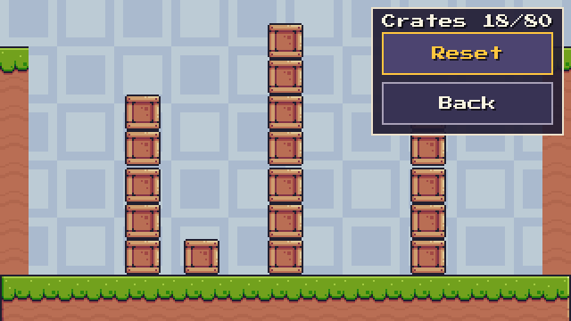

# Physics with Box2D

Module `ember-box2d`, package `dev.ember2d.box2d` (`RigidBody`, `BodyType`, `BodyShape`, `Box2dSystem`, `Box2dDebugSystem`, `ContactBegan`, `ContactEnded`, `Box2dKit`). Spec F-006B, ADR-005. It is optional rigid-body physics with the classic libGDX Box2D extension, inside the ECS and the fixed step.



## 1. Box2D or Collision?
| Use | For |
| --- | --- |
| [Collision](Collision) (kinematic) | characters, enemies, bullets, triggers: precise control, no simulation |
| Box2D | things that should behave physically: stacks, piles, rolling, bouncing, tumbling props |

The two are separate. A Box2D body doesn't block a kinematic actor. To connect them, give the actor a Box2D **sensor**.

## 2. Setup
| File | Add |
| --- | --- |
| `core/build.gradle` | `api project(':ember-box2d')` |
| `desktop/build.gradle` | `runtimeOnly variantOf(libs.gdx.box2d.platform) { classifier('natives-desktop') }` |
| `android/build.gradle` (natives loop) | `gdxNatives variantOf(libs.gdx.box2d.platform) { classifier("natives-${abi}") }` |
| `android/proguard-rules.pro` | `-keep class com.badlogic.gdx.physics.box2d.** { *; }` |
| `ComponentSetup` | `Box2dKit.register(registry);` |

```java
// enter()
Box2dSystem physics = new Box2dSystem(world, context.events(), context.time(), 0f, -20f);
physics.addTileGrid(map.collision());    // solid tiles become static boxes (one-way tiles are skipped)
world.addSystem(physics);                 // FIXED
world.addSystem(new Box2dDebugSystem(world, physics, context.debug()));   // F3
// exit()
physics.dispose();
```
**Units:** one Box2D metre is one world unit (one tile at 16 pixels per unit). No conversion.

## 3. Bodies
```json
"RigidBody": { "type": "DYNAMIC", "shape": "BOX", "width": 1.25, "height": 1.25, "friction": 0.6 }
```
**Fields** (read when the body is made, on the next fixed step):

| Field | Default | Meaning |
| --- | --- | --- |
| `type` | `DYNAMIC` | `STATIC`, `KINEMATIC`, `DYNAMIC` |
| `shape` | `BOX` | `BOX` or `CIRCLE` |
| `width`, `height` | 1, 1 | box size |
| `radius` | 0.5 | circle radius |
| `offset` | (0, 0) | shape centre relative to the position |
| `density`, `friction`, `restitution` | 1, 0.4, 0 | material |
| `sensor` | false | overlaps only |
| `fixedRotation`, `bullet` | false | never rotate; continuous collision |
| `gravityScale`, `linearDamping`, `angularDamping` | 1, 0, 0 | |
| `category`, `mask`, `group` | 1, 0xFFFF, 0 | filtering |
| `velocityX`, `velocityY`, `angularVelocity` | 0 | the start velocity |

**Methods:**
- `applyImpulse(x, y)`, `applyForce(x, y)`, `applyTorque(t)`;
- `setVelocity(x, y)`, `velocity(out)`, `angularVelocity()`, `setAngularVelocity(deg)`;
- `teleport(x, y, degrees)`;
- `isAwake()`, `hasBody()`.

**Syncing:** dynamic and kinematic bodies are written back into `Transform` (position, rotation in degrees) after every step, with interpolation.

**Rotating sprites:** put the sprite's `origin` at the image centre.

**Removing:** destroying the entity or removing `RigidBody` destroys the body. `dispose()` destroys them all.

## 4. Events
| Event | When |
| --- | --- |
| `ContactBegan(a, b)` / `ContactEnded(a, b)` | two solid bodies start or stop touching (`involves(e)`, `other(e)`) |
| `TriggerEntered(trigger, actor)` / `TriggerExited` | a sensor body overlaps another body; the same events as kinematic triggers |

- **Delivery:** events are queued during the step and delivered after it.
- **Removed entities:** events naming an entity that is already gone are dropped.
- **Tiles:** tile bodies send no events.

## 5. The Crates scene
Platformer demo, main menu → **Crates**:
- stacks of 7, 5 and 5 crates on a Tiled floor;
- tap or click to drop more (up to 80);
- **Reset** (R or Y) and **Back**.

It was checked on desktop and in the minified release APK on the Android emulator.

## 6. Not included
- joints, polygons and chains;
- one-way platforms in Box2D;
- ray casts and area queries;
- Box2D v3.

These are candidates for later, when a game needs them.

## 7. Common mistakes
| Symptom | Cause | Fix |
| --- | --- | --- |
| `UnsatisfiedLinkError` at start | Box2D natives missing for the platform | add the `gdx-box2d-platform` natives (section 2) |
| Release build crashes on the first contact | R8 renamed Box2D's callbacks | the keep rule in `proguard-rules.pro` |
| Bodies keep existing after a scene change | no `dispose()` | `physics.dispose()` in `exit()` |
| Changing `RigidBody.width` does nothing | fields are read once | remove and add the component, or use the methods |
| Gaps in stacks, or crates floating | the shape matches the image, not the visible art | measure the art's opaque pixels |
| Crates rotate around a corner | sprite origin at bottom-left | `origin` at the image centre |
