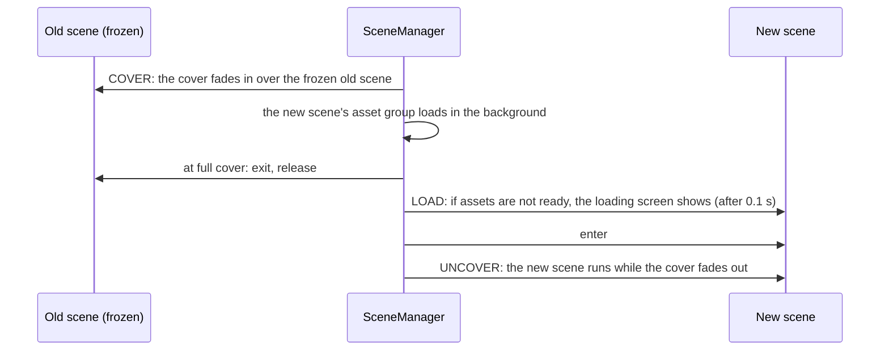

# Scenes and Transitions

Package `ember.app` (`Scene`, `SceneManager`, `Transition`, `LoadingScreen`). Spec F-010.

## 1. What a scene is
A scene is one screen: a menu, a level, a cutscene, a pause screen. It owns:
- a `World` (`world()`): entities and systems;
- `timers()` and `tweens()`, cancelled on exit;
- event subscriptions made with `context.events().on(...)`, removed on exit;
- a Scene2D layer (`ui()`), created on first use and disposed on exit;
- an asset group (`assetGroup()`), loaded before `enter` and unloaded after `exit`.

```java
final class LevelScene extends Scene {
    private final int level;

    LevelScene(int level) {
        this.level = level;
    }

    @Override
    protected String assetGroup() {
        return "level" + level;                 // loaded before enter, unloaded after exit
    }

    @Override
    protected void enter(EngineContext context) {
        World world = world();
        // build the level: map, collision, prefabs, systems, HUD
    }

    @Override
    protected void update(float delta) {
        // every frame, after the world's UPDATE systems (scaled delta; 0 while paused)
    }

    @Override
    protected void exit() {
        // undo global changes you made: input contexts, time pause, suspend save
    }
}
```
Other hooks:
- `onAssetReloaded(AssetReloaded e)`: return true to handle a hot-reloaded map yourself. The default restarts the scene with a fresh world.
- `context()`: the `EngineContext`.

## 2. Switching scenes
```java
context.scenes().replace(new LevelScene(2));   // exit the current scene, start another
context.scenes().push(new ShopScene());        // on top; the scene below stops running but keeps its world
context.scenes().pop();                        // back to the scene below
context.scenes().restart();                    // the current scene again, with a fresh world
```
- **When:** changes happen at the start of the next frame, never in the middle of one.
- **Which scene runs:** only the top scene runs. A scene below keeps its world, but its systems, timers and `update` stop. Its event handlers still receive events.
- **The last scene:** `pop()` that would leave no scene throws. Use `replace`.
- **Queries:** `current()`, `currentWorld()` and `depth()`.

## 3. Transitions
```java
context.scenes().replace(new LevelScene(2), Transition.fade(0.5f));          // to black and back
context.scenes().replace(new MenuScene(), Transition.fade(0.6f, Color.WHITE));
context.scenes().pop(Transition.cut());                                       // instant, but loading is not blocking
```
How a fade runs:

- **During a transition:** `inTransition()` is true. Taps and keys do not reach the old scene's menus, and scene changes requested meanwhile wait.
- **Loading screen:** `config.loadingScreen` draws a progress bar by default. Implement `LoadingScreen.draw(batch, pixel, width, height, progress)` for your own, or set it to null for a plain colour.

## 4. Preloading
Start loading the next scene's group early, so the fade never shows a loading bar:
```java
context.scenes().preload("level2");    // e.g. from the menu, or during level 1
context.scenes().cancelPreload("level2");
```
The scene that uses the group takes the preload over.

## 5. Patterns from the demos
**A pause overlay without a new scene** (`StageScene`, `AreaScene`, `DemoScene`):
```java
private void openPause() {
    paused = true;
    context().time().setPaused(true);
    context().audio().pauseMusic();
    input.pushContext("ui");                 // menus read ui_nav, ui_confirm, ui_back
    Table panel = MyUi.overlay(ui());
    MenuList menu = new MenuList(ui());
    menu.add("Resume", this::closePause);
    menu.add("Main menu", () -> ConfirmDialog.show(ui(), "Quit to the main menu?", "Yes", "No",
            () -> context().scenes().replace(new MenuScene(), Transition.fade(0.5f))));
    menu.onBack(this::closePause);
    MyUi.show(panel, "Paused", menu);
}
```

**Leaving a scene cleanly:** pop any input contexts you pushed, and unpause time:
```java
@Override
protected void exit() {
    while (!"gameplay".equals(input.topContext())) {
        input.popContext();
    }
    if (context().time().paused()) {
        context().time().setPaused(false);
    }
}
```

**Carrying state between scenes:** pass an object to the next scene's constructor. Examples are the shooter's `Run` (score, health) and the RPG's `Game` (inventory, flags, story).

## 6. Common mistakes
| Symptom | Cause | Fix |
| --- | --- | --- |
| Menu keys do nothing after returning to a scene | an input context was left pushed | pop contexts in `exit()` |
| The next scene starts paused | time was paused when leaving | unpause in `exit()` |
| "Asset … is not loaded" | the asset's group is not loaded | return it from `assetGroup()` or `preload` it |
| A loading bar flashes between scenes | slow group | `preload` the group earlier |
| `pop() would leave no scene` | popping the last scene | `replace` |
