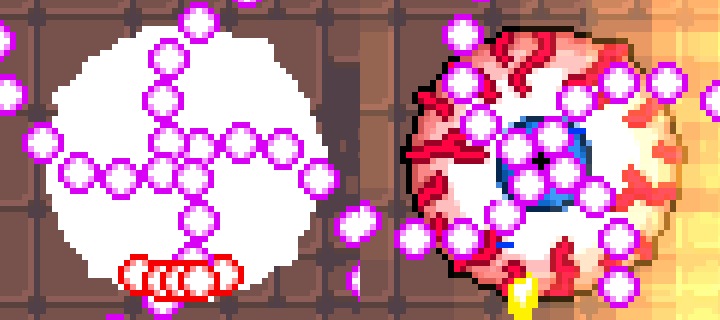
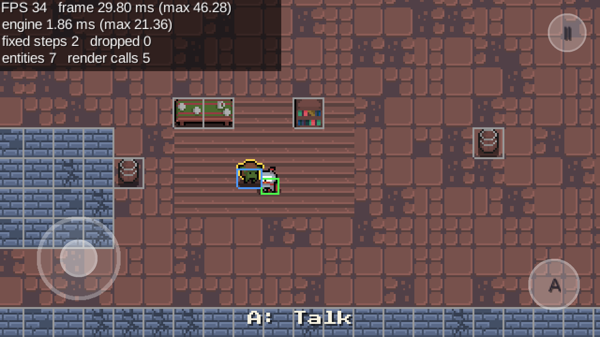
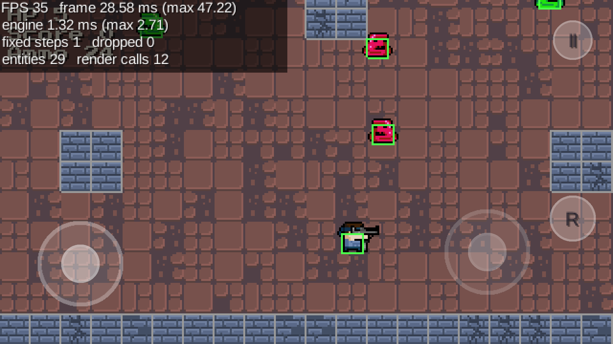

# Sprite Materials

Package `ember.render` (`Sprite` fields, `SpriteMaterials`) plus `HitFlash` in kit-common. Spec F-026. These are three common sprite effects that need no GLSL from you: a **hit flash**, a **1-pixel outline** and a **palette swap**.



## 1. The fields
```java
sprite.flash = 1f;                       // 0..1: mix towards flashColor
sprite.flashColor.set(Color.WHITE);
sprite.outline.set(1f, 0.85f, 0.3f, 1f); // alpha 0 = no outline
sprite.paletteId = "tex.palette.red_slime";
boolean on = sprite.hasMaterial();
```
All of them are off by default. A sprite with none set draws exactly as before and keeps batching.

They can be set in prefabs like any sprite field:
```json
"Sprite": { "regionId": "atlas.shooter/slime", "origin": [8, 0], "z": 1, "paletteId": "tex.palette.red_slime" }
```

## 2. Hit flash with kit-common
```json
"HitFlash": { "seconds": 0.06 }
```
```java
world.addSystem(new HitFlashSystem(world, context.events()));   // UPDATE
```
On `Damaged`, the system sets the target's `Sprite.flash` to 1 with `HitFlash.color`, and back to 0 after `seconds` of game time. All of the shooter's enemies and its boss use it.

## 3. Outline
The outline colour is drawn on **fully transparent** pixels that touch an opaque pixel (alpha 0.5 or more). Semi-transparent pixels such as shadows keep their look.

Rules:
- **Margin:** the region needs a 1-pixel transparent margin where the outline should show, because the outline is drawn inside the sprite's quad.
- **Neighbours:** samples outside the region count as transparent, so atlas neighbours never bleed in.

The RPG demo outlines whatever the player can interact with:
```java
context.events().on(InteractionFocus.class, e -> {
    outline(focused, false);
    focused = e.target();
    outline(focused, true);
});

private void outline(int entity, boolean on) {
    Sprite sprite = entity == World.NONE || !world.isAlive(entity) ? null : world.get(entity, Sprite.class);
    if (sprite != null) {
        sprite.outline.set(1f, 0.85f, 0.3f, on ? 1f : 0f);
    }
}
```


## 4. Palette swap
A palette is a small texture asset, up to 16 × 2 pixels:
- **Row 0:** the source colours, exactly as they appear in the sheet.
- **Row 1:** the colours they become.
- Pixels of other colours are unchanged.

```json
{ "id": "tex.palette.red_slime", "path": "gfx/palette_red_slime.png", "type": "texture", "group": "global" }
```
The shooter's `make_assets.py` builds its palette from the slime's own colours and shifts them from green to red:
```python
for c in colours:                       # the sprite's distinct colours, black excluded
    h, s, v = colorsys.rgb_to_hsv(*[k / 255 for k in c])
    r, g, b = colorsys.hsv_to_rgb((h + 0.62) % 1.0, s, v)
    rows[0].append(c + (255,))
    rows[1].append((round(r * 255), round(g * 255), round(b * 255), 255))
```


Rules:
- Colours match within 0.01 per channel, so use the sheet's exact colours.
- A palette wider than 16 pixels uses the first 16 and logs a warning.
- An unknown `paletteId` fails like any unknown asset ID.

## 5. How it works
- `SpriteRenderSystem` asks `renderer.materials()` (a `SpriteMaterials`) to `begin` before a sprite that has an effect and `end` after it.
- The built-in implementation (`render.internal.MaterialShader`) flushes the batch, switches to one GLSL ES 1.00 program, sets the uniforms for that sprite, draws it, flushes again and restores the default shader.
- The shader does, in order: the palette lookup, the outline test on the texture's own alpha, the tint, then the flash mix.
- The shader is compiled on first use. If it fails (an old driver), that is logged once and sprites draw without effects.
- Renderers without shaders return `SpriteMaterials.NONE`, which is also handy in tests.

## 6. Cost and limits
- Each sprite with an effect costs a batch flush. That's fine for dozens at a time. Don't put effects on every bullet. (Bullets are not sprites anyway; they draw in one pass.)
- Outlines are 1 pixel. Custom shaders and post-processing are not part of F-026.
- Checked on an API 23 emulator (GLES 2): flash, outline and palette all work. On desktop the shader was compiled into the build but not checked by hand.
